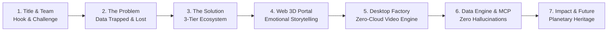

# NASA Space Apps Challenge — 7-Slide Winning Pitch Deck Guide

This skill provides an authoritative, step-by-step instruction set for an AI agent or human developer to craft an exceptional, competition-winning **7-slide presentation** for **CosmoLost** (`Project NUOS SpaceLixtar`), submitted to the **NASA Space Apps Challenge 2026**.

All rules, structural constraints, and rubrics in this document are directly derived from the official [`NASA Space Apps Challenge.pdf`](file:///C:/hackathon/CosmoLost/NASA%20Space%20Apps%20Challenge.pdf) *(Project Submission Guide)*, the project engineering handbook, and the CosmoLost technical architecture.

---

## 1. Official Competition Rules & Hard Constraints

According to the official NASA Space Apps Challenge Project Submission Guide (pages 11–13):

1. **Strict 7-Slide Limit**:
   - The slide deck must be **no more than seven (7) slides** in total (including title, introductory, and concluding slides).
   - > [!CAUTION]
     > **Disqualification Rule**: Any presentation containing 8 or more slides is automatically disqualified from Global Awards judging. Do not exceed 7 slides under any circumstance.
2. **Language Requirement**:
   - All text, graphics, captions, and linked materials must be entirely in **English**.
3. **Public Accessibility**:
   - The final deck must be hosted on an external public service (GitHub, Google Drive, OneDrive, Dropbox) with **no passwords, login requirements, or permission barriers**.
4. **Mandatory Metadata**:
   - Slide 1 must explicitly state:
     - **Project Name**: `Project NUOS SpaceLixtar — CosmoLost`
     - **Team Name**: `NUOS SpaceLixtar` (or `Space Ліхтар`)
     - **Team Members' Names**
     - **Challenge Title**: *«Abandoned but not Forgotten: Storytelling about NASA's Discarded Equipment on the Moon and Mars»*
5. **Required Content Elements**:
   - Display real screenshots/renders of the working project prototype.
   - Clearly describe the user experience across primary personas.
   - Specifically cite how **NASA open data and space agency partner tools** enabled the solution.
6. **Child Protection & Legal Terms**:
   - Must not contain any likeness, photos, or audio of individuals under 18 years old.
   - Must not alter, misrepresent, or generate counterfeit NASA logos, patches, or flags.

---

## 2. NASA Space Apps Judging Rubric Alignment

Every slide must directly target the **5 Global Judging Criteria** (weighting 100% of the score):

| Criterion | Evaluation Focus | Targeted in Slide |
| :--- | :--- | :--- |
| **Relevance** | Does the project address the core challenge of storytelling for abandoned lunar/Martian equipment? | **Slide 1, Slide 2** |
| **Creativity** | Is the solution novel, inspiring, and innovative? Does it use creative storytelling? | **Slide 3, Slide 4** |
| **Validity** | Is the science, engineering, and data solid? Does the prototype actually work? | **Slide 5, Slide 6** |
| **Impact** | Does it solve a genuine educational/scientific problem and reach a massive audience? | **Slide 2, Slide 7** |
| **Presentation** | Is the deck clean, visual, highly readable, structured, and compelling? | **All Slides (Design System)** |

---

## 3. Visual Identity & Slide Design System

### 3.1 Color Palette
- **Deep Space Black** (`#0B0E17`): Slide background. Gives cinematic space immersion.
- **Cosmic Cyan** (`#00F0FF`): Primary accent, technical badges, NASA open data highlights.
- **Mars Ochre / Solar Amber** (`#FF5722` / `#FFA000`): Planetary highlights, emotional storytelling indicators.
- **Lunar Silver / Card Surface** (`#161B26` / `#1F293D`): Elevated card containers with 1px border (`#2D3748`).
- **Text White** (`#F7FAFC`): Headlines; **Muted Platinum** (`#A0AEC0`): Secondary body copy.

### 3.2 Typography & Density Rules
- **Font Stack**: Clean modern grotesque sans-serif (`Space Grotesk`, `Inter`, `Roboto`).
- **The 3-Second Rule**: A judge skimming the slide for 3 seconds must immediately grasp the headline and key metric.
- **Word Budget**: **Maximum 30–45 words per slide**. Use cards, callout badges, and diagrams instead of dense paragraphs.
- **Visuals Ratio**: Minimum 60% of the slide area dedicated to high-resolution UI screenshots, 3D models, or architecture diagrams.

---

## 4. The Complete 7-Slide Blueprint (Slide-by-Slide)

---

### Slide 1: Title, Team & Mission Hook (Relevance & Presentation)

- **Header / Tagline**:
  - `CosmoLost: The Ecosystem of Humanity's Planetary Heritage`
  - *«Abandoned on the Moon and Mars, but Never Forgotten by Humanity»*
- **Required Metadata Box**:
  - **Challenge**: *Abandoned but not Forgotten: Storytelling about NASA's Discarded Equipment on the Moon and Mars*
  - **Team Name**: `NUOS SpaceLixtar` (Space Ліхтар)
  - **Team Members**: `[Insert Team Member Names & Roles: e.g. Frontend / 3D, Backend / Data, Product / Storytelling]`
  - **Submission Year**: NASA Space Apps Challenge 2026
- **Visual Composition**:
  - Left 45%: Mission hook, title, team names, challenge badge.
  - Right 55%: Cinematic high-contrast render: Apollo 11 Lunar Module Descent Stage resting in the lunar dust with interactive telemetry HUD overlay (coordinates `0.67408° N, 23.47297° E`, mission duration, status: `INACTIVE / HISTORIC MONUMENT`).
- **Speaker Pitch (15–20s)**:
  > *"Over six decades of exploration, humanity has left over two hundred technological pioneers silent on the Moon and Mars. Our team, NUOS SpaceLixtar, created CosmoLost—a complete ecosystem that transforms these forgotten scientific machines into inspiring, interactive cultural monuments for the entire world."*

---

### Slide 2: The Problem — The Planetary Data Paradox (Impact & Relevance)

- **Slide Headline**: `The Planetary Data Paradox: Rich Science, Silent Stories`
- **Two-Column Contrast Layout**:
  - **Column A: The Official Archives (Dense & Inaccessible)**
    - *NASA PDS & NSSDCA*: 60+ years of priceless mission telemetry locked in dry, fragmented tabular databases.
    - Technical jargon isolates schoolchildren, non-specialists, and science enthusiasts.
    - Result: Millions of people believe abandoned equipment is just "space junk."
  - **Column B: The Content & AI Gap (Hallucinations & Friction)**
    - *Youth Consumption*: 78% of STEM learners consume science via short vertical videos (TikTok, Shorts, Reels).
    - *Creator Friction*: Producing 1 fact-checked scientific 3D space video manually takes **4+ hours**.
    - *AI Hallucinations*: Generative LLMs hallucinate coordinates, landing dates, and rover fates without verified data grounding.
- **Key Metric Callout Card**:
  - `4 Hours → 30 Seconds`: The editing bottleneck holding back STEM science outreach.
  - `200+ Artifacts`: Awaiting storytelling across lunar and Martian surfaces.
- **Speaker Pitch (20s)**:
  > *"While NASA's Planetary Data System archives our missions with unmatched scientific rigor, the data remains trapped in dry tables. Creators spend hours editing simple videos, while social media algorithms spread AI hallucinations. Humanity's greatest engineering triumphs are fading into forgotten statistics."*

---

### Slide 3: The Solution — CosmoLost 3-Tier Ecosystem (Creativity & Architecture)

- **Slide Headline**: `CosmoLost: An Integrated Closed-Loop Ecosystem`
- **Sub-headline**: *From raw NASA planetary archives to 3D web exploration, local-first content creation, and verified AI reasoning.*
- **Visual Diagram (3 Core Pillars)**:
  1. **Pillar 1: Interactive 3D Web Portal (React 19 + Three.js)**
     - Full planetary globes, NASA Treks WMTS basemaps, photorealistic 3D GLB spacecraft inspection, and AstroGuessr 360 photospheres.
  2. **Pillar 2: Desktop Creator Studio (Tauri v2 + FFmpeg + edge-tts)**
     - Local-first "Content Factory" rendering 1080x1920 60fps vertical videos in under 30 seconds with bilingual neural voiceover.
  3. **Pillar 3: FastMCP Gateway & Multiplayer Backend (Django + FastMCP)**
     - Standardized Model Context Protocol providing verified, hallucination-free NASA records to Claude, Gemini, and Antigravity, backed by Zero-Knowledge multiplayer duels.
- **Value Proposition Badge**:
  - `Zero Cloud Rendering Cost` · `Zero AI Hallucinations` · `100% NASA Grounded`
- **Speaker Pitch (20s)**:
  > *"We built CosmoLost as a unified three-tier platform. An interactive 3D Web Portal for deep visual discovery, a local-first Desktop Studio that renders viral educational videos in 30 seconds without cloud costs, and a FastMCP server connecting frontier AI models directly to verified NASA ground truth."*

---

### Slide 4: Pillar 1 — Web 3D Portal & Emotional Storytelling (Creativity & Presentation)

- **Slide Headline**: `Living Monuments: 3D Visualization & «Diary of the Last Sol»`
- **Visual Composition (Full UI Walkthrough)**:
  - Screenshot of CosmoLost Web Portal showcasing:
    - Interactive Moon/Mars globe using **NASA Treks WMTS tile server**.
    - Real-time 3D model viewer rendering authentic **NASA 3D Asset Repository GLB** (Perseverance, Opportunity, Surveyor 3).
    - AstroGuessr 360-degree panoramic surface viewer.
- **Storytelling Feature Callout: «Diary of the Last Sol»**:
  - Shifts perspective from distant technical observation to poignant first-person narrative.
  - Recounts the probe's final operational hours: dust storms, battery depletion, final data transmissions, and lasting human legacy.
  - *Example quote*: *"Sol 5111: My solar panels are dark, but my tracks across Meridiani Planum will remain for ten thousand years."*
- **Technology & Data Badges**:
  - `NASA Treks WMTS` · `NASA 3D Resources` · `Three.js / WebGL` · `React 19 / Chakra UI`
- **Speaker Pitch (20s)**:
  > *"On our web portal, users don't just read data—they land on the surface. Powered by NASA Treks satellite mosaics, learners inspect photorealistic 3D models and experience the 'Diary of the Last Sol'—emotionally charged, scientifically grounded monologues chronicling each probe's final moments."*

---

### Slide 5: Pillar 2 — Desktop Content Factory: Zero-Cloud Video Engine (Validity & Impact)

- **Slide Headline**: `Desktop Content Factory: 1-Click Viral STEM Outreach`
- **Visual Composition**:
  - Screenshot of the **Tauri v2 Desktop Studio UI**:
    - Left: Selected artifact (Opportunity Rover, Sol 5111).
    - Center: 1080x1920 9:16 mobile preview with automated safe-zone margins (preventing TikTok/Shorts UI overlap).
    - Right: Waveform audio generator, bilingual subtitle track, and 1-click export button.
- **Core Engineering Achievements**:
  - **Local-First Native Sidecars**: Bundles **FFmpeg** and **edge-tts** within Rust runtime.
  - **Sub-30-Second Render**: Compiles 1080x1920 60fps videos locally on standard student laptops.
  - **$0 Server Operational Cost**: Zero cloud rendering farms or expensive GPU instances required.
  - **Bilingual & Automated**: Generates natural English and Ukrainian neural voiceovers with synchronized kinetic captions.
- **Speaker Pitch (20s)**:
  > *"To reach younger audiences, our Tauri-powered desktop studio turns raw NASA telemetry into high-retention 1080x1920 vertical videos in under 30 seconds. With embedded FFmpeg and neural voiceovers, it runs 100% locally on any laptop with zero cloud costs, empowering teachers and creators to publish daily."*

---

### Slide 6: Pillar 3 — Verified NASA Data Engine & FastMCP Gateway (Validity & Data)

- **Slide Headline**: `Data Integrity: FastMCP Gateway & Authoritative Backend`
- **Two-Panel Technical Validation**:
  - **Panel A: Automated NASA Ingestion & Zero-Knowledge Backend**
    - Django 6.1 + PostgreSQL 16 relational engine syncing **NASA PDS, NSSDCA Master Catalog, and JPL Photojournal**.
    - Django Channels WebSocket engine running real-time multiplayer duels (**AstroDuel**) with **Zero-Knowledge validation** (answers verified server-side to prevent cheating).
    - **100% Green Test Suite**: 127 automated tests passing cleanly across all modules.
  - **Panel B: FastMCP Gateway for AI Assistants**
    - Implements Anthropic's **Model Context Protocol (MCP)** via FastMCP.
    - Grants AI models (Claude, Gemini, Antigravity) 8 structured tools to query official coordinates, mass, and operational history.
    - **Eliminates AI hallucinations** by mandating verified NASA URLs and NSSDCA identifiers for every fact.
- **NASA Data Citations Badge**:
  - `NASA PDS` · `NSSDCA Master Catalog` · `NASA Open APIs` · `JPL Photojournal`
- **Speaker Pitch (20s)**:
  > *"Behind CosmoLost lies an authoritative data pipeline. Our Django backend syncs NASA's PDS and NSSDCA catalogs, verified by 127 automated tests. Crucially, our FastMCP server connects modern AI models directly to this database, eradicating hallucinations with peer-reviewed NASA citations."*

---

### Slide 7: Global Impact, Traction & Roadmap (Impact & Presentation)

- **Slide Headline**: `Honoring Yesterday's Pioneers, Inspiring Tomorrow's`
- **Tri-Fold Impact Breakdown**:
  1. **Education & Society**: Demystifies aerospace engineering for classrooms worldwide; transforms silent hardware into humanity's shared cultural heritage.
  2. **Creator Economy**: Empowers STEM educators to scale science communication 10x faster with zero budget.
  3. **AI & Open Science**: Establishes the first standardized open-source MCP planetary artifact catalog for autonomous research agents.
- **Strategic Roadmap**:
  - **Hackathon MVP (Complete)**: 3D Web Portal, Desktop Content Factory, FastMCP server, multiplayer backend (127 passing tests).
  - **Phase 2 (Q1–Q2)**: Rover traverse tracks (NASA MMGIS integration), NotebookLM automated audio deep-dives, community storytelling moderation.
  - **Phase 3 (Q3)**: Global museum & planetarium interactive touch-kiosk deployment.
- **Call to Action & Links**:
  - **Repository**: `https://github.com/JekVolk/CosmoLost`
  - *«Explore with us. Because no pioneer on the Moon or Mars should ever be forgotten.»*
- **Speaker Pitch (20s)**:
  > *"CosmoLost bridges past heroism and future inspiration. By combining authentic NASA science, immersive 3D graphics, and local-first AI tooling, we ensure that every machine that paved humanity's way to the stars is forever remembered. Explore CosmoLost with us today. Thank you!"*

---

## 5. Pre-Submission Verification & Disqualification Audit

Before compiling the slides into PDF or uploading to Google Drive/GitHub, the AI agent must run this audit:

- [ ] **Slide Count Check**: Count is strictly **7 slides** (Slide 1 through Slide 7). Not 8, not 9.
- [ ] **English Only**: Every title, label, quote, and annotation is in English.
- [ ] **Team & Challenge Metadata**: Slide 1 includes project title, team name, member names, and exact challenge name.
- [ ] **No Minors Likeness**: No photos or audio of individuals under 18 years old.
- [ ] **No Counterfeit NASA Branding**: NASA logos are authentic open-source references, never altered or synthetically re-generated.
- [ ] **Live Working Proof**: Slides 4, 5, and 6 display authentic UI screenshots from `web-client`, `desktop-client`, and backend test runs.
- [ ] **Public Link**: The URL in the submission form (`https://github.com/JekVolk/CosmoLost`) is verified public and does not prompt for authentication.

---

## 6. Slide Generation Formats

When instructed to output this deck, the agent can generate:
1. **Marp Markdown (`presentation.marp.md`)**: Direct conversion to PDF or HTML using Marp CLI (`marp --pdf presentation.marp.md`).
2. **HTML / Reveal.js Presentation**: Responsive standalone presentation playable in any browser.
3. **Structured Slide Specification**: Formatted text ready for copy-pasting into Google Slides, PowerPoint, or Canva.
