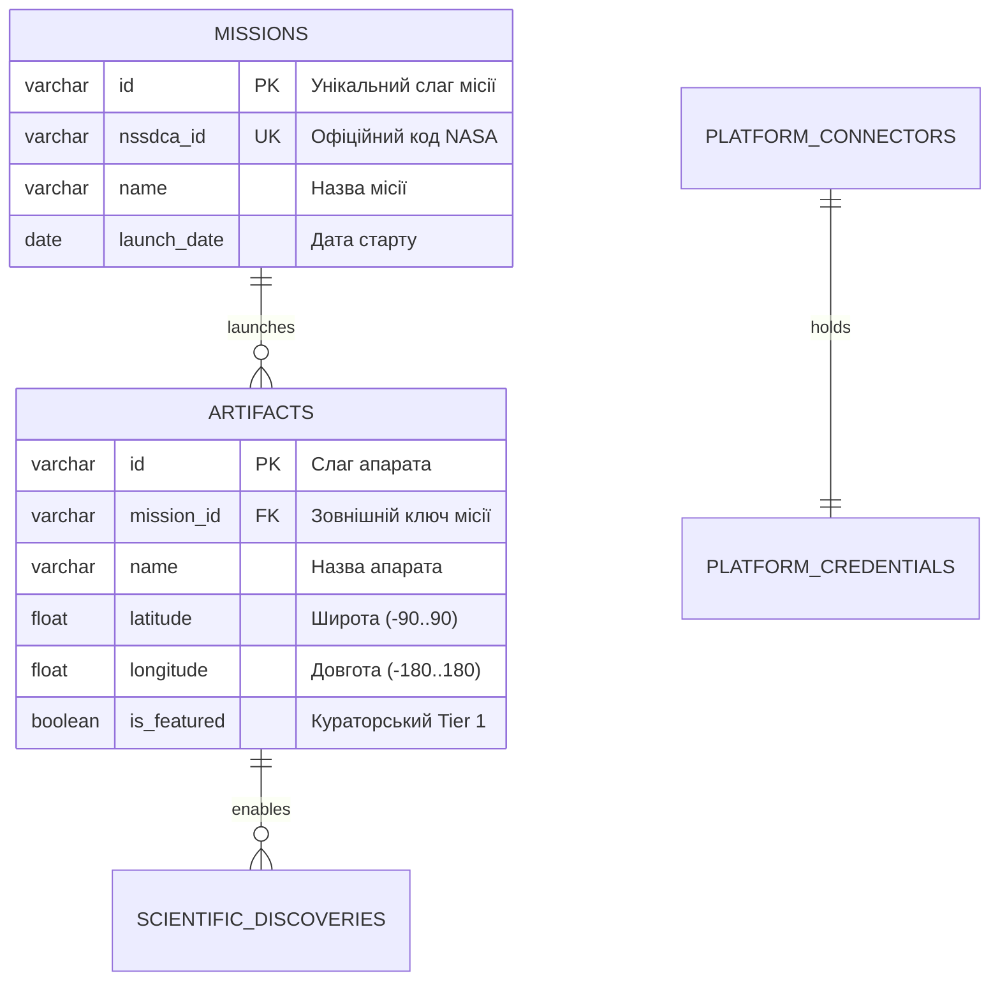

# Скіл: Архітектор ERD Діаграм (`mermaid-erd-architect`)

> **Призначення**: Проектування, моделювання та візуалізація реляційних та документоорієнтованих баз даних у форматі Mermaid `erDiagram`, а також автоматична генерація фізичних PNG-зображень для специфікації та дизайн-документів.

---

## 1. Інженерні стандарти проектування ERD

1. **Відповідність доменній моделі**:
   * Кожна таблиця відповідає зареєстрованій доменній сутності `ENT-*`.
   * Назви таблиць формуються у множині або UPPERCASE (`ARTIFACTS`, `MISSIONS`, `PLATFORM_CONNECTORS`).
2. **Типізація та ключі**:
   * Кожне поле має зазначений технічний тип (`uuid`, `varchar`, `integer`, `float`, `boolean`, `timestamp`, `jsonb`, `date`, `text`).
   * Обов'язкове маркування первинних ключів (`PK`) та зовнішніх ключів (`FK`), а також унікальних індексів (`UK`).
   * До кожного ключового поля додається лаконічний коментар у лапках.
3. **Точна кардинальність зв'язків**:
   * `||--||` : Строго один-до-одного (Strictly One-to-One)
   * `||--o{` : Один-до-багатьох, нуль або більше (One-to-Many, zero or more)
   * `||--|{` : Один-до-багатьох, один або більше (One-to-Many, one or more)
   * `}o--o{` : Багато-до-багатьох (Many-to-Many)

---

## 2. Шаблон синтаксису Mermaid ERD



---

## 3. Автоматична генерація PNG-зображень

Скіл містить автономний скрипт `scripts/render_erd.py`, який витягує блок `erDiagram` з markdown або `.mmd` файлу та рендерить високороздільний PNG файл через надійний компресійний шлюз Kroki (з fallback на mermaid.ink).

### Команда запуску генератора:
```powershell
python .agents/skills/mermaid-erd-architect/scripts/render_erd.py --input "spec/06_architecture/02_DATA_MODEL_ERD.md" --output "spec/06_architecture/images/erd.png"
```

### Параметри скрипта:
* `--input`, `-i`: Шлях до `.md` або `.mmd` файлу, який містить діаграму Mermaid ERD.
* `--output`, `-o`: Цільовий шлях для збереження вихідного `.png` файлу.
