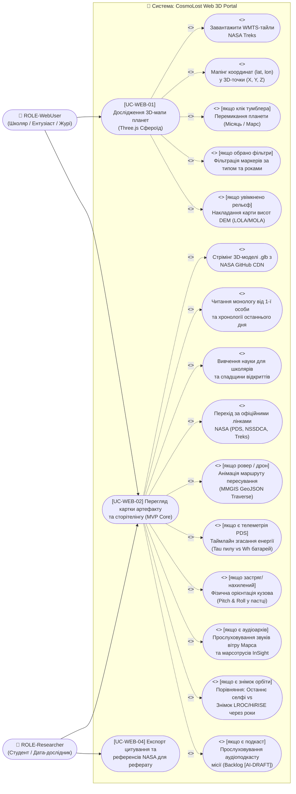

# Реєстр Користувацьких Сценаріїв (Use Cases) (02_USE_CASES.md)

> **Статус**: `APPROVED`  
> **Версія специфікації**: `v0.5.2`  
> **Стандарт**: Use Case Specification (Cockburn Template) & `spec-decomposition-engine` на основі `inbox/Ресурси та API для космічного челенджу.md` та `inbox/Створення IT-контенту для соцмереж.md`

---

## 1. Модуль Вебпорталу (Web 3D Portal)

### 1.1. Діаграма прецедентів Вебпорталу (Mermaid Use Case Diagram)

---

### 1.2. Детальна специфікація сценаріїв Вебпорталу

### [UC-WEB-01] Дослідження небесного тіла на 3D-мапі (Three.js)
* **Актор**: [`ROLE-WebUser`](../03_users/01_ROLES.md) (Школяр, любитель астрономії, журі NASA).
* **Формула декомпозиції**: `[REQ-MAP-01..07] | Переглядати та орієнтуватися | 3D-сфера планетного тіла | Головна сторінка CosmoLost | Включає завантаження тайлів та розширюється фільтрами`.
* **Передумови**: Користувач відкрив головну сторінку вебпорталу у WebGL-сумісному браузері.
* **Основний сценарій (Main Flow)**:
  1. Браузер ініціалізує сцену Three.js (`THREE.SphereGeometry`, радіус за моделлю небесного тіла).
  2. `<<include>>`: Система завантажує глобальну текстурну мозаїку NASA Treks WMTS (LRO WAC для Місяця або Viking/MRO для Марса) безпосередньо з серверів NASA без API-ключа.
  3. `<<include>>`: Система отримує масив артефактів через `GET /api/v1/portal/artifacts/?body=moon` та трансформує широту/довготу $(lat, lon)$ у декартові координати $(X,Y,Z)$ на поверхні сфери.
  4. Користувач керує камерою через `OrbitControls` (обертання, панорамування, наближення).
  5. При наведенні курсору на маркер (`THREE.Raycaster`) об'єкт підсвічується і спливає 2D-тултіп: назва апарата, роки служби, тип та мініатюра.
  6. При кліку на маркер камера плавно фокусується на об'єкті, і користувач переходить до сценарію `[UC-WEB-02]`.

* **Точки розширення (`<<extend>>`)**:
  * **`EXT-01: Перемикання планети`**: Користувач клікає тумблер «Місяць / Марс». Сцена анімує плавний відліт камери, замінює текстурну мапу на шар іншої планети та оновлює масив маркерів.
  * **`EXT-02: Динамічна фільтрація`**: Користувач обирає фільтри у бічній панелі (наприклад, «Тільки ровери», «Статус: DORMANT», «Епоха: 1995–2010»). Система змінює властивість `marker.visible = false` для невідповідних об'єктів без перезавантаження сцени.
  * **`EXT-03: Шар рельєфу DEM [Backlog]`**: Користувач активує перемикач «3D-рельєф». Three.js накладає карту висот (LOLA DEM для Місяця, MOLA для Марса) через displacement shader для вираження кратерів.

---

### [UC-WEB-02] Перегляд картки артефакту та сторітелінгу (MVP Core)
* **Актор**: [`ROLE-WebUser`](../03_users/01_ROLES.md), [`ROLE-Researcher`](../03_users/01_ROLES.md)
* **Формула декомпозиції**: `[REQ-ART-01..08] | Досліджувати та читати | Картка та 3D-модель артефакту | Сторінка /artifacts/:id/ | Включає 3D стрімінг, монолог, науку, лінки NASA`.
* **Передумови**: Користувач клікнув на маркер на мапі або перейшов за прямим посиланням із соцмереж (наприклад, `/artifacts/opportunity-rover/`).
* **Основний сценарій (Main Flow)**:
  1. Сторінка завантажує структурований паспорт артефакту: офіційну назву, материнську місію, код NSSDCA, бейдж планети, статус та точні координати.
  2. `<<include>>`: Вбудований переглядач Three.js `GLTFLoader` підвантажує 3D-модель апарата напряму з відкритого репозиторію NASA 3D Resources (`raw.githubusercontent.com/nasa/NASA-3D-Resources/...`). Користувач обертає детальну інженерну модель.
  3. `<<include>>`: Відображається блок художнього сторітелінгу «Щоденник останнього Сола»:
     * Читання монологу від першої особи (емоційний погляд машини на самотність, пил та спогади місії).
     * Хронологія фінального дня (точні технічні обставини втрати зв'язку).
  4. `<<include>>`: Відображається блок інженерії та науки для школярів:
     * «Як це працювало»: проста земна аналогія роботи головного інструменту.
     * «Наукова спадщина»: що саме відкрив прилад (доказ води, породи, марсотруси) для підготовки місій Artemis та Mars Sample Return.
  5. `<<include>>`: Відображається блок офіційних першоджерел NASA (NASA Verified Gateways):
     * Пряме посилання на архів **NASA Planetary Data System (PDS)**.
     * Пряме посилання на каталог **NASA NSSDCA Master Catalog**.
     * Пряме посилання на інтерактивне місце посадки в **NASA Solar System Treks** (із центруванням на кратері).
     * Посилання на фотоархів **NASA Image & Video Library** за номерами PIA.
     * Обов'язкове повідомлення про Public Domain: *"Data & imagery provided by NASA / JPL-Caltech"*.

---

### [UC-WEB-03] Дослідження розширених інженерних даних (`<<extend>>` Додаткові дії)
* **Актор**: [`ROLE-WebUser`](../03_users/01_ROLES.md), [`ROLE-Researcher`](../03_users/01_ROLES.md)
* **Опис**: Додаткові інтерактивні дії, які розширюють сценарій `[UC-WEB-02]` за наявності відповідних відкритих даних NASA:

1. **`EXT-01: Анімація маршруту пересування (MMGIS GeoJSON Traverse)`**:
   * *Умова*: Для мобільних апаратів (Opportunity, Spirit, Curiosity, Perseverance, Ingenuity, Apollo LRV).
   * *Дія*: Натискання кнопки «Показати маршрут». Система накладає на локальну карту реальний векторний шлях (LineString) з точками зупинок (Waypoints). Клік на точку відкриває подію: *«Sol 400: Знайдено метеорит Heat Shield Rock поруч із власним скинутим щитом»*.
2. **`EXT-02: Інтерактивний таймлайн згасання енергії (Tau vs Wh)`**:
   * *Умова*: Для апаратів із сонячними батареями (Opportunity, InSight).
   * *Дія*: Користувач переміщує повзунок таймлайну від Sol 1 до останнього дня. На графіку відображається падіння енергії батарей з 700 Wh до критичних 22 Wh та зростання пилу в небі $Tau > 10.8$. Освітлення у 3D-в'ювері пропорційно темніє.
3. **`EXT-03: Фізична орієнтація кузова (Pitch & Roll у точці спочинку)`**:
   * *Умова*: Для Spirit у піщаній пастці Troy або InSight.
   * *Дія*: Натискання перемикача «Реальне положення». 3D-модель нахиляється під точними кутами телеметрії останнього дня (-11.5° нахилу), наочно демонструючи, чому сонячні батареї не зловили світло.
4. **`EXT-04: Прослуховування звуків вітру Марса та марсотрусів`**:
   * *Умова*: Для InSight та місій Apollo.
   * *Дія*: Клік на відтворення аудіо. Відтворюється реальний аудіозапис марсіанського вітру, сейсмічний гул марсотрусу або переговори астронавтів під час паркування місячного ровера.
5. **`EXT-05: Порівняльна машина часу (Останнє селфі vs Орбітальний знімок)`**:
   * *Умова*: Наявність знімків LROC NAC або MRO HiRISE.
   * *Дія*: Інтерактивний спліт-слайдер («шторка»): зліва останнє фото з поверхні перед замерзанням, справа — супутникове фото з орбіти через 10 років, де видно залишений модуль серед пісків.
6. **`EXT-06: Дослідження кладовища пробірок (Three Forks Sample Depot)`**:
   * *Умова*: Для артефакту Perseverance Sample Depot.
   * *Дія*: 3D-огляд розкладки 10 титанових пробірок із кернами ґрунту на марсіанському піску та скинутого захисного кожуха з парашутом.
7. **`EXT-07: Прослуховування аудіоподкасту місії [Backlog]`**:
   * *Умова*: За наявності згенерованого епізоду подкасту в майбутніх версіях.
   * *Дія*: Прослуховування діалогу двох дикторів про драматичний кінець апарата.

---

### [UC-WEB-04] Експорт цитування та референсів NASA
* **Актор**: [`ROLE-Researcher`](../03_users/01_ROLES.md), [`ROLE-WebUser`](../03_users/01_ROLES.md) (Школяр, що готує навчальний проєкт).
* **Передумови**: Відкрито картку артефакту `[UC-WEB-02]`.
* **Основний сценарій**:
  1. Користувач натискає кнопку «Цитувати артефакт для реферату / дослідження».
  2. `<<include>>`: Система генерує стандартизований блок академічного посилання (APA / BibTeX / простий текстовий формат) з обов'язковим зазначенням NSSDCA ID, назви місії, архіву NASA PDS та посилання на CosmoLost.
  3. `<<include>>`: Клік на кнопку «Скопіювати цитату» копіює текст у системний буфер обміну.
  4. Спливає повідомлення про успішне копіювання з нагадуванням про Public Domain статус матеріалів NASA.

---

## 2. Модуль Десктопної «Фабрики контенту» (Desktop App)

### [UC-FAC-01] Побудова сценарію через Нодовий Редактор (React Flow)
* **Актор**: [`ROLE-Creator`](../03_users/01_ROLES.md) (Наукпоп-блогер або розробник команди).
* **Передумови**: Відкрито додаток на ПК під керуванням Tauri.
* **Основний сценарій**:
  1. Креатор додає на полотно `ArtifactSourceNode` та обирає об'єкт (наприклад, "InSight Lander").
  2. Вузол зв'язується з `ScriptTemplateNode` з вибором рубрики «Останній день на зв'язку».
  3. Нодовий граф генерує 4 блоки таймлайну:
     * *0–3с (Хук)*: «Цей зонд записав 1300 марсотрусів і замовк під шаром пилу».
     * *3–15с (B-roll)*: Схеми датчика сейсмометра SEIS та приладу вимірювання тепла HP3.
     * *15–35с (Кульмінація)*: Фінальне селфі апарата у пилу та останні слова перед вимкненням живлення.
     * *35–40с (Loop)*: Зациклена кінцівка із закликом дослідити кратер на 3D-мапі CosmoLost.
  4. Креатор переглядає полотно у режимі «Safe Zones Overlay» і переконується, що ключовий візуал не потрапляє під системні кнопки TikTok (відступи 220 px зверху та 420 px знизу збережені).

---

### [UC-FAC-02] Синтез аудіо, Jump-cut та налаштування PNGTuber
* **Актор**: [`ROLE-Creator`](../03_users/01_ROLES.md)
* **Основний сценарій**:
  1. У вузлі `AudioTTSNode` креатор обирає мову (Українська) та диктора (`uk-UA-OstapNeural`).
  2. Додаток викликає рушій `edge-tts`, прискорює темп на 1.1x та вирізає паузи довше 0.15 секунди (техніка Jump-cut).
  3. Креатор у вузлі `VisualCompositeNode` обирає дефолтний космічний аватар від Віолетти (або імпортує власні PNG-спрайти).
  4. Модуль синхронізації призначає стани:
     * На 0–3с: стан `STATE_SHOCK` по центру екрана.
     * На 3-й секунді: аватар зі звуком *whoosh* зменшується і відлітає у лівий кут (стан `STATE_EXPERT`).
  5. Додаток під час відтворення голосу автоматично відкриває і закриває рот аватара відповідно до піків гучності.

---

### [UC-FAC-03] Пакетний монтаж відео у FFmpeg та збереження (Batch Queue)
* **Актор**: [`ROLE-Creator`](../03_users/01_ROLES.md)
* **Основний сценарій**:
  1. Креатор вибирає 5 артефактів списком і натискає «Пакетна генерація 5 роликів».
  2. Фоновий воркер формує 5 незалежних завдань у черзі `BatchQueueTask`.
  3. Для кожного ролика виконується компіляція у скрипт FFmpeg з фільтрами Ken Burns zoompan та xfade-переходами.
  4. За 50–70 секунд на диск у вихідну папку записуються 5 готових файлів `.mp4` (1080x1920, 30/60 fps).
  5. Для кожного ролика створюється текстовий файл із 3-рядковим SEO описом та першим дискусійним коментарем (Pin Comment).

---

### [UC-FAC-04a] Підключення облікових записів соцмереж
* **Актор**: [`ROLE-Creator`](../03_users/01_ROLES.md)
* **Основний сценарій**:
  1. Креатор переходить у вкладку «Підключені канали» (Settings -> Channels).
  2. Для **YouTube**: натискає «Підключити Google / YouTube». Додаток запускає локальний веб-сервер на порту 8089, відкриває браузер за URL авторизації Google OAuth2 PKCE. Після надання дозволу додаток перехоплює код авторизації, обмінює його на токени доступу та зберігає у захищеному сховищі ОС. Статус змінюється на `CONNECTED` (зелений бейдж).
  3. Для **Telegram**: натискає «Підключити Telegram-канал», вводить `Bot Token` та ID каналу (наприклад, `@cosmolost_hq`). Додаток виконує тестовий виклик `getChat` до Telegram Bot API. У разі підтвердження прав адміністратора статус змінюється на `CONNECTED`.

---

### [UC-FAC-04b] Мультиплатформна пряма публікація (Multi-Platform Dispatch)
* **Актор**: [`ROLE-Creator`](../03_users/01_ROLES.md)
* **Передумови**: Відеоролик змонтований (статус `RENDERED`), хоча б один конектор у стані `CONNECTED`.
* **Основний сценарій**:
  1. Креатор відкриває вікно «Дистрибуція та Публікація».
  2. Система відображає згенерований 3-рядковий SEO-опис та перший закріплений коментар з можливістю швидкого редагування.
  3. Креатор відмічає чекбокси цільових платформ: `[x] YouTube Shorts`, `[x] Telegram-канал`.
  4. Креатор натискає кнопку «Запустити публікацію».
  5. Додаток паралельно ініціює завдання:
     * Для **YouTube Shorts**: починає частинне потокове завантаження (resumable upload по 5 МБ) з прогрес-баром у відсотках. Після успіху отримує `video_id` та автоматично публікує і закріплює Pin Comment.
     * Для **Telegram**: відправляє файл через метод `sendVideo` з форматованим MarkdownV2 описом та інлайн-кнопкою переходу на 3D-мапу вебпорталу.
  6. У таблиці завдань відображаються клікабельні посилання на опубліковані пости.

---

### [UC-FAC-04c] Ручний експорт та відкриття системної папки з виділенням відео
* **Актор**: [`ROLE-Creator`](../03_users/01_ROLES.md)
* **Передумови**: Відеоролик змонтований (статус `RENDERED`).
* **Основний сценарій**:
  1. Креатор у вікні дистрибуції обирає дію «Відкрити папку з відео (для TikTok / Reels)».
  2. Додаток через Tauri Shell викликає системну команду ОС:
     * Windows: `explorer.exe /select,"<шлях_до_файлу.mp4>"`
     * macOS: `open -R "<шлях_до_файлу.mp4>"`
     * Linux: `xdg-open "<шлях_до_папки>"`
  3. Одночасно додаток автоматично копіює 3-рядковий SEO-пакет (байт + SEO-ядро + хештеги) у системний буфер обміну.
  4. Chakra UI показує спливаюче сповіщення: *«📁 Папка відкрита! SEO-текст у буфері обміну. Ви можете перетягнути файл у веб-кабінет TikTok / Instagram»*.
  5. На екрані з'являється модальне вікно з текстом закріпленого коментаря та кнопкою «Скопіювати Pin Comment».
  6. Креатор після завантаження ролика вставляє посилання на допис і натискає «Позначити як опубліковано вручну» (`PUBLISHED_MANUALLY`).

---

## 3. Модуль FastMCP Сервера (Зовнішній ШІ-контур)

### [UC-MCP-01] Фактологічна відповідь ШІ-асистента без RAG
* **Актор**: [`ROLE-AIAgent`](../03_users/01_ROLES.md) (Claude Desktop, Gemini).
* **Передумови**: Користувач підключив FastMCP CosmoLost у налаштуваннях ШІ.
* **Основний сценарій**:
  1. Користувач запитує у ШІ: *«Які прилади місії Аполлон-11 досі працюють на Місяці?»*.
  2. Модель викликає FastMCP-інструмент `search_artifacts(query="Apollo 11", artifact_type="RETRO_REFLECTOR")`.
  3. FastMCP робить прямий реляційний запит до Django ORM (БЕЗ RAG/векторного пошуку).
  4. Сервер повертає структурований JSON з описом `Apollo 11 LRRR`: 100 кварцових призм, пасивний стан без батарей, лазерні вимірювання з Землі.
  5. Модель викликає `get_verified_citations(artifact_id="apollo-11-lrrr")` та отримує посилання NSSDCA і картку CosmoLost.
  6. ШІ відповідає користувачеві вичерпною історією без галюцинацій та додає посилання на CosmoLost і NASA.

---

## 4. Модуль Адміністрування та Парсингу (Django Unfold)

### [UC-ADM-01] Щогодинний автоматичний імпорт каталогів NASA
* **Актор**: [`ROLE-Admin`](../03_users/01_ROLES.md) або фоновий Cron.
* **Основний сценарій**:
  1. За розкладом (щогодини) запускається management-команда `ingest_nasa_catalog`.
  2. Скрипт перевіряє доступність ендпоінтів NASA (NSSDCA, Catalogue of Manmade Material on the Moon).
  3. Нові об'єкти проходять валідацію координат через Pydantic DTO.
  4. Записи оновлюються в базі PostgreSQL методом ідемпотентного Upsert.
  5. Адміністратор у панелі Django Unfold бачить зелений індикатор статусу та кількість провалідованих об'єктів.
