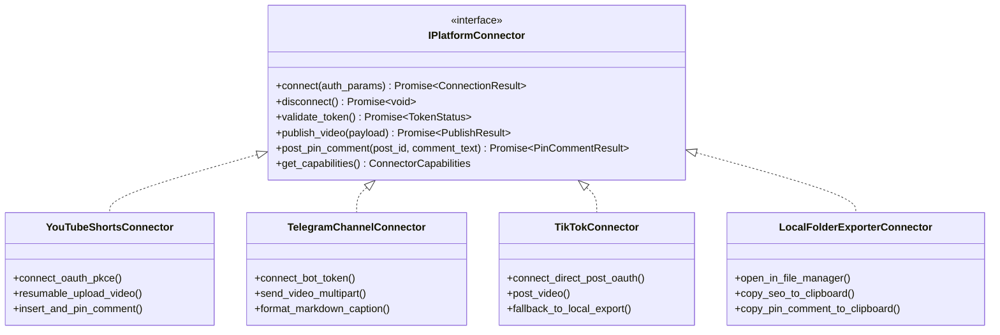

# [ID: FEAT-04] Дистрибуція та Публікація Контенту (FEAT-04_social_publishing.md)

> **Статус**: `APPROVED`  
> **Пріоритет**: `MUST HAVE (MVP)`  
> **Роль**: [`ROLE-Creator`](../03_users/01_ROLES.md)  
> **Рішення**: Модульна архітектура конекторів соцмереж (YouTube Shorts, Telegram, TikTok, Meta) з підтримкою прямого мультипостингу та нативної дії «Відкрити папку з відео» для миттєвого ручного експорту.  
> **Пов'язані сутності**: [`ENT-10 PublicationProject`](../05_domain/01_ENTITIES.md), [`ENT-12 PlatformConnector`](../05_domain/01_ENTITIES.md), [`ENT-13 PlatformCredential`](../05_domain/01_ENTITIES.md), [`ENT-14 PublicationDispatch`](../05_domain/01_ENTITIES.md), [`ENT-07 ContentRubric`](../05_domain/01_ENTITIES.md)

---

## 1. Опис фічі
Модуль публікації забезпечує автоматизовану дистрибуцію змонтованого відеоконтенту. Він підтримує:
1. **Модульну архітектуру конекторів соцмереж (`PlatformConnector`)**: незалежні плагіни авторизації та відправки контенту для кожної зовнішньої платформи.
2. **Паралельну мультиплатформну публікацію**: можливість в один клік відправити ролик у декілька підключених каналів одночасно.
3. **Генерацію SEO-метаданих за «Золотою формулою»**: 3-рядковий опис (байт на розгортання + SEO-ядро + 5 хештегів) та провокативний перший коментар (Pin Comment) для підняття залученості алгоритмів (ER).
4. **Нативний Fallback-контур «Відкрити папку з відео»**: моментальне відкриття системного файлового провідника з попередньо виділеним готовим файлом `.mp4` та одночасним копіюванням усього SEO-тексту в системний буфер обміну для ручного drag-and-drop у TikTok, Instagram Reels, Threads чи Reddit.

---

## 2. Архітектура Конекторів Соцмереж (Connector Subsystem)

Усі зовнішні платформи реалізують єдиний інтерфейс конектора `IPlatformConnector` на рівні Tauri / Rust-шару десктопного додатка:

### 2.1. Специфікація конекторів

#### 1. `YouTubeShortsConnector` (YouTube Shorts Data API v3)
* **Тип авторизації**: OAuth 2.0 PKCE Flow через вбудований локальний HTTP-сервер зворотного виклику (`http://127.0.0.1:8089/oauth/callback`).
* **Області видимості (Scopes)**: `https://www.googleapis.com/auth/youtube.upload`, `https://www.googleapis.com/auth/youtube.force-ssl` (для створення та закріплення коментаря).
* **Вимоги до публікації**:
  * Заголовок: строго до **50–60 символів** (щоб не обрізався на смартфонах) + обов'язковий суфікс `#Shorts`.
  * Відеопотік: `videos.insert` (тип завантаження: `resumable upload` частинами по 5 МБ для стабільності на слабких каналах).
  * Статус приватності: налаштовується користувачем (`public`, `unlisted` для попереднього перегляду, або `private`).
* **Автоматизація Pin Comment**:
  * Після завершення завантаження та отримання `youtube_video_id` конектор викликає `commentThreads.insert` з текстом дискусійного коментаря.
  * Викликає метод закріплення коментаря у верхній позиції гілки обговорення.

#### 2. `TelegramChannelConnector` (Telegram Bot API)
* **Тип авторизації**: Введення Bot Token (`bot_token`) та юзернейму або числового ID каналу (`@cosmolost_hq` або `-100xxxxxxxxx`).
* **Вимоги до публікації**:
  * Відправка через метод `sendVideo` (до 50 МБ для стандартного Bot API, або до 2 ГБ за використання локального Telegram Bot Server).
  * Підпис відео (Caption): формат `MarkdownV2` з лімітом до 1024 символів.
  * Інтерактивна кнопка: додавання `inline_keyboard` з посиланням на інтерактивну картку:  
    `[🪐 Дослідити на 3D-мапі CosmoLost](https://cosmolost.lihtar.org/artifacts/{id})`.

#### 3. `TikTokConnector` (TikTok Content Posting API / Direct Post)
* **Тип авторизації**: TikTok OAuth 2.0 (доступно за наявності зареєстрованого App у TikTok Developer Portal).
* **Graceful Degradation (Автоматичний перехід на ручний режим)**:
  * Якщо користувач не надав TikTok API токен або додаток перебуває на стадії верифікації TikTok, система автоматично перемикається на `LocalFolderExporterConnector` без блокування роботи користувача.

#### 4. `LocalFolderExporterConnector` («Відкрити папку з відео»)
* **Призначення**: Забезпечує миттєвий експорт медіапакету для ручного розміщення в TikTok, Instagram Reels, Threads, Reddit чи X (Twitter).
* **Нативні дії в операційній системі**:
  1. **Відкриття провідника з виділенням файлу**:
     * Windows: виклик `explorer.exe /select,"<local_video_path>"` через Tauri Shell.
     * macOS: виклик `open -R "<local_video_path>"`.
     * Linux: виклик `xdg-open "<folder_path>"`.
  2. **Копіювання SEO-пакету в буфер обміну**:
     * Через `tauri-plugin-clipboard-manager` текст трьох рядків SEO-опису записується у буфер обміну операційної системи.
  3. **Спливаюче сповіщення (Toast / Notification)**:
     * Chakra UI відображає підтвердження:  
       *«📁 Папка з відео відкрита! 3-рядковий опис скопійовано в буфер обміну для швидкої вставки в TikTok / Instagram Reels»*.
  4. **Модальне вікно з Pin Comment**:
     * Інтерфейс виводить окрему кнопку «Копіювати закріплений коментар» для зручного вставлення після публікації.

---

## 3. Атомарні бізнес-вимоги (`REQ-*`)

### 3.1. Генерація метаданих за «Золотою формулою»
* **`REQ-PUB-01`**: До кожного змонтованого ролика формується трирядковий SEO-опис:
  * **Рядок 1 (Байт на розгортання)**: Питання або незавершене інтригуюче твердження (до 100 символів), що стимулює натиснути кнопку «...ще» (Expand Caption Trigger).
  * **Рядок 2 (SEO-ядро)**: Концентрований фактологічний опис (назва апарата, космічна місія, NASA, планета, ключове відкриття) з прямим коротким посиланням на сторінку артефакту на вебпорталі CosmoLost.
  * **Рядок 3 (Хештеги)**: Рівно 4–5 хештегів:
    * 2 широкі нішеві: `#космос` `#наука` (або `#space` `#nasa` для англомовної аудиторії).
    * 2 вузькі тематичні: `#марсохід` `#аполлон` (або `#marsrover` `#apollo11`).
    * 1 брендовий: `#cosmolost`.
* **`REQ-PUB-02`**: Генерація першого закріпленого коментаря (Pin Comment):
  * Формується відкрите дискусійне питання, пов'язане з майбутнім космічних досліджень, етикою збереження апаратів або майбутніми базами людей на Місяці/Марсі.
  * Питання закінчується знаком `?` і спонукає глядачів висловити власну думку в коментарях.

### 3.2. Керування конекторами соцмереж
* **`REQ-PUB-03`**: Додаток надає вкладку «Підключені канали» (Connected Platforms):
  * Відображення статусу кожного підключення (`DISCONNECTED`, `CONNECTED`, `EXPIRED`).
  * Збереження токенів та секретів виключно у локальному захищеному сховищі користувача (OS Keychain / Windows Credential Manager через Tauri Plugin Store) без передачі на бекенд CosmoLost (Zero-Trust).
* **`REQ-PUB-04`**: Мультиплатформний вибір (Multi-select Dispatch):
  * У діалозі публікації креатор може відмітити декілька цільових платформ одночасно (наприклад: `[x] YouTube Shorts`, `[x] Telegram-канал`, `[x] Відкрити папку для TikTok`).

### 3.3. Виконання публікації та відстеження статусу
* **`REQ-PUB-05`**: Для кожної обраної платформи створюється окремий диспетчерський запис `PublicationDispatch` із власним статусом: `PENDING` $\to$ `UPLOADING` $\to$ `PUBLISHED` (або `FAILED` із фіксацією коду помилки).
* **`REQ-PUB-06`**: У разі вибору опції «Відкрити папку з відео» система:
  * Перевіряє фізичну наявність файлу `.mp4` на диску.
  * Викликає системний файловий менеджер із позиціонуванням курсору на файлі.
  * Автоматично заповнює системний буфер обміну 3-рядковим SEO-текстом.
  * Фіксує статус публікації як `MANUAL_EXPORTED`.
* **`REQ-PUB-07`**: Можливість ручного введення посилання на опублікований допис (наприклад, посилання на TikTok-відео після ручного завантаження) для переведення в стан `PUBLISHED_MANUALLY`.
