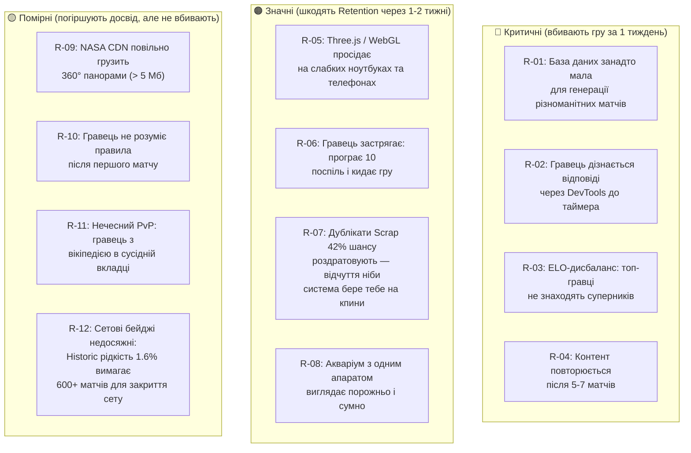

# [FEAT-10] Аудит Ризиків, Детальна Специфікація та Вирішення Проблем

> **Статус**: `DESIGN REVIEW`  
> **Версія**: `v1.0.0`  
> **Мета документа**: Аналіз усього, що може піти не так у ігровій системі (Core Game Loop, Контейнери, Міні-ігри, Профіль, Акваріум) та детальне пропрацювання кожної механіки з рішеннями.

---

## ЧАСТИНА 1: Аудит Ризиків — «Що може піти не так»



---

### R-01: База даних ЗАНАДТО МАЛА для генерації різноманітних матчів

**Проблема в деталях:**
- Якщо в БД є 30 артефактів і кожен матч вибирає 1 ціль + 3 випадкові гри, то гравець **після 10–15 матчів** починає впізнавати «ту саму панораму Opportunity» або «той самий Гаверсин для кратера Єзеро».
- Запам'ятовування відповідей = руйнування ігрового процесу.

**Рішення — 4 шари різноманітності:**

1. **Шар 1: Комбінаторний вибух параметрів.** Навіть з 30 артефактами система генерує різні питання:
   - Для AstroGuessr: один артефакт має 1 панораму, але 10 різних кутів зйомки (вибирається випадковий).
   - Для Traverse Tracer: Opportunity має 50+ waypoints — кожен матч вибирає випадковий відрізок з 4 точок.
   - Для Фальшивих фактів: дистрактори беруться випадково з усіх інших артефактів — мільйони комбінацій.

2. **Шар 2: «Параметрична Маска».** Навіть для одного артефакту система кожного разу ховає **різні поля**:
   - Матч А: сховані `launch_date` + `mass_kg` → гравець відгадує рік і масу.
   - Матч Б (той самий артефакт): сховані `location_name` + `operational_status` → гравець відгадує кратер і причину зупинки.
   - Результат: 4 поля × 6 комбінацій = **15+ унікальних варіантів питань** для кожного артефакту.

3. **Шар 3: Сезонні та тематичні ротації.** Щотижня система активує тематичний «Розрядний Комплекс»:
   - Тиждень 1: «Тільки Місячні місії» (Apollo, Lunokhod, Surveyor).
   - Тиждень 2: «Марсіанські Вояжери» (Spirit, Opportunity, Curiosity, Perseverance, Ingenuity).
   - Тиждень 3: «Зонди далекого космосу» (Pioneer, Voyager).

4. **Шар 4: Мінімальний обсяг бази для запуску.** Потрібно щонайменше **40 артефактів** та **120 наукових відкриттів** (`scientific_discoveries`) перед публічним запуском.

---

### R-02: Гравець дізнається відповіді через DevTools — Анти-Чіт

**Проблема в деталях:**
- Якщо бекенд надсилає в WebSocket подію `round.start { target_lat: -1.95, target_lon: 354.47 }` — будь-який гравець з DevTools відкриває вкладку Network і бачить правильні координати до того, як поставив пін.

**Рішення — Server-Authoritative + Zero-Knowledge Protocol:**

```
❌ НЕПРАВИЛЬНО (надсилаємо все):
  WS Event → Client: { target_lat: -1.95, target_lon: 354.47, panorama_url: "..." }

✅ ПРАВИЛЬНО (надсилаємо тільки те, що потрібно для відображення):
  WS Event → Client: {
    "round_type": "ASTRO_GUESSR",
    "panorama_url": "https://nasa.gov/.../panorama.jpg",   ← тільки картинка
    "celestial_body": "mars",
    "radius_km": 3389.5,
    "wmts_tile_url": "...",
    "time_limit_sec": 15
    // ← НІЯКИХ координат цілі! Вони залишаються на сервері.
  }
  
  Client → WS: { "action": "submit_guess", "lat": -14.5, "lon": 175.4 }
  
  Server: рахує Гаверсин, порівнює з target_lat/lon зі своєї пам'яті
  
  WS Event → Client: { "distance_km": 1240, "score": 15, "true_lat": -1.95, "true_lon": 354.47 }
  ← правда розкривається лише ПІСЛЯ того, як гравець зробив вибір
```

**Додатковий захист:**
- Таймер на сервері: якщо за `time_limit_sec` + 2 сек гравець не відповів — сервер сам зараховує 0 балів.
- Rate limiting: максимум 1 submit per round per player через Redis (захист від `spam submit`).

---

### R-03: ELO-дисбаланс при малій аудиторії

**Проблема в деталях:**
- На старті проекту є 50 гравців. ELO у всіх 1000. Пошук в ±150 ELO = весь пул. Немає проблем.
- Через 3 місяці: 10 топ-гравців мають ELO 2200+. Вони чекають суперника 30+ секунд → завжди грають проти бота → втрачають інтерес до PvP.

**Рішення — Динамічне розширення пулу пошуку:**

```
t = 0 сек:  шукаємо ±75 ELO  (вузький, якісний матч)
t = 2 сек:  шукаємо ±150 ELO
t = 4 сек:  шукаємо ±300 ELO (прийнятний суперник)
t = 6 сек:  шукаємо ±500 ELO (будь-хто онлайн)
t = 8 сек:  фолбек на бота   (гарантія моментального матчу)
```

**Захист від знеохочення топ-гравців:**
- Топ-100 гравців ELO бачать у профілі **«Відкритий Виклик»** — спеціальна кнопка для прямого виклику конкретного суперника за нікнеймом.
- Щотижневий **«Елітний Турнір»** для гравців з ELO 1800+: 8 учасників, олімпійська сітка, унікальний Anomaly-дроп переможцеві.

---

### R-04: Контент повторюється після 5-7 матчів

**Проблема в деталях:**
- Гравець бачить одну і ту саму 360° панораму Opportunity двічі за день. Ефект «я це вже бачив» руйнує ілюзію відкриття.

**Рішення — Cooldown-система контенту:**
- Бекенд зберігає в `GameMatch.selected_artifact_id` кожен зіграний матч.
- Алгоритм вибору артефакту для нового матчу **виключає** всі артефакти, з якими гравець грав за останні 72 години.
- Якщо вільних артефактів < 3 (мала база) → система розблоковує найстаріший з cooldown, але змінює набір прихованих полів.

---

### R-05: Просідання Three.js на слабких пристроях

**Проблема в деталях:**
- 360° панорама у Three.js + жива планета в «Акваріумі» + анімація контейнерів = можливе просідання до 15-20 FPS на середньому ноутбуці або телефоні.

**Рішення — Три рівні якості (Quality Tiers):**

| Рівень | Пристрій | 360° Панорама | Акваріум | Анімація |
|:--|:--|:--|:--|:--|
| **High** | ПК / MacBook Pro | Повна сфера 4K | Жива планета + рух роверів | Частинки, сяйво |
| **Medium** (авто-детект) | Середній ноутбук | 2K panorama | Статична планета, клік-анімація | Прості переходи |
| **Low / Fallback** | Телефон / слабкий ПК | Статичне фото + стрілки ← → | Плоска 2D-карта з піктограмами | Без анімацій |

- Рівень визначається автоматично через `navigator.deviceMemory` та `navigator.hardwareConcurrency` при першому завантаженні.
- Гравець може вручну перемкнути у налаштуваннях профілю.

---

### R-06: Гравець програє 10 поспіль і кидає гру (Frustration Loop)

**Проблема в деталях:**
- Новачок без знань про NASA програє підряд 5-10 матчів. ELO падає до 700. Навіть бот на мінімальній складності краще за нього. Відчуття безсилля = відтік.

**Рішення — Анти-фрустрація система «Перший Крок» (Soft Onboarding):**

1. **Перші 5 матчів**: ELO не списується при поразці (тільки нараховується за перемогу). Режим «Навчальна Експедиція».
2. **Захисна сітка**: якщо гравець програв 3 поспіль → наступний матч автоматично стає «Навчальним»:
   - 15 секунд → 25 секунд на відповідь.
   - Після вибору відображається коротке пояснення-довідка: *«Opportunity мав сонячні батареї — саме тому його зупинила пилова буря!»*
3. **Гарантований прогрес**: навіть за поразку виконуються «Щоденні Завдання» (Missions):
   - *«Зіграй 3 матчі» → 15 RP (незалежно від результату).*
   - *«Правильно вгадай планету в AstroGuessr» → 25 RP.*
   - Таким чином гравець завжди відчуває мікро-прогрес, навіть без перемог.

---

### R-07: Дублікати Scrap 42% — відчуття ошуканства

**Проблема в деталях:**
- Гравець щойно виграв важкий матч, відкриває контейнер з анімацією — і отримує «Відстріляне кріплення» (Scrap, 5 RP). Вдруге. Втретє. Злість.

**Рішення — Pity System (Система Гарантій):**

```
Лічильник без Historic+:
├── 0-20 відкриттів поспіль без Historic: звичайні шанси
├── 21-40 відкриттів: шанс Historic тихо зростає до 3.2% (+2×)
├── 41-60 відкриттів: шанс Historic зростає до 6.4% (+4×)
└── 61+ відкриттів: гарантовано Historic або вище (Hard Pity)

Лічильник без Anomaly:
└── 500 відкриттів поспіль без Anomaly → гарантований Anomaly (Hard Pity)
```

**Психологічний трюк «Суб'єктивна рідкість»:**
- Перші 5 контейнерів нового акаунту мають підвищені шанси: Scrap знижений до 20%, Specialized підвищений до 40%. Перший досвід = «ВАУ-ефект».
- Після 5 контейнерів шанси повертаються до базових.

---

### R-08: Акваріум порожній на початку (1 апарат)

**Проблема в деталях:**
- Новий гравець відкриває свій профіль — порожня сфера Марса з одним крихітним роверчиком. Виглядає сумно, а не мотивуюче.

**Рішення — Стартова «Колонія першопрохідця»:**
- При реєстрації кожен гравець **безкоштовно отримує 3 стартових артефакти**:
  1. Sojourner (1997) — Scrap тир — найменший марсохід, розміром із мікрохвильовку. Тихо котиться по кратеру.
  2. Прапор Apollo-11 (Standard) — стоїть у Морі Спокою на Місяці, злегка коливається (ефект анімації).
  3. Статична панорама Eagle Landing Site — фонова атмосфера місяця для тих, хто обрав Місяць як улюблену планету.
- Це дає одразу **жвавий, не порожній акваріум** з першого входу та мотивує дозбирати клас «Mobility & Chassis» для Sojourner.

---

### R-09: Повільне завантаження 360° панорам (> 5 Мб)

**Проблема в деталях:**
- NASA зберігає оригінальні панорами у форматі GigaPAN розміром 150–500 Мб. Навіть стиснена версія — 5–15 Мб. При поганому інтернеті гравець чекає 10+ секунд замість гри.

**Рішення — Progressive Loading + Tile-Based Streaming:**
- Не завантажуємо всю панораму одразу. Використовуємо техніку **Deep Zoom / Tile Pyramid**:
  1. При старті раунду завантажується стиснена превʼю (512×256 px, ~50 Кб) — одразу відображається.
  2. Поки гравець дивиться, у фоні підвантажуються тайли вищої роздільності тільки для поточного кута камери.
  3. Максимальна роздільність завантажується лише якщо гравець зупинив камеру та зробив зум.
- Час до інтерактивності: < 1 сек замість 10 сек.

---

### R-10: Гравець не розуміє правила після першого матчу

**Проблема в деталях:**
- Занадто складний онбординг = відтік 60-70% нових гравців ще до першого відкритого контейнера (типові показники для мобільних ігор з навчальним порогом).

**Рішення — «Ожилі Підказки» (Contextual Tooltips в реальному часі):**
- Перший матч гравця — повністю «Сімуляційний». Немає реального суперника і реального контейнера на кону.
- Під час кожної фази з'являється **анімований помічник-дрон** (ефект PNGTuber з існуючого FEAT-03), що показує:
  - *[AstroGuessr]* «Крутни камеру! Поглянь на текстуру ґрунту — це червоний марсіанський реголіт або сірий місячний пил?»
  - *[Фальшиві факти]* «Два з чотирьох фактів — брехня. Шукай анахронізми: чи міг цей прилад бути на цьому ровері?»
- Після навчального матчу: «Ти готовий! Перший справжній контейнер чекає. Вогонь!» → одразу видається 1 безкоштовний контейнер.

---

### R-11: Нечесний PvP — Вікіпедія в сусідній вкладці

**Проблема в деталях:**
- Нічого не заважає гравцеві відкрити Wikipedia або NASA.gov і за 15 секунд знайти точні координати кратера Єзеро. Це руйнує PvP-чесність.

**Рішення — Анти-Вікіпедія через дизайн запитань:**
- **Запитання ніколи не базуються на легкому пошуку.** Система не питає «Назви кратер посадки Perseverance» — це за 2 секунди знайде будь-хто.
- Натомість запитання будуються на **приховуванні «зворотних» атрибутів**:
  - *«Апарат проїхав 45.16 км і записав останнє фото в умовах пилової бурі Tau=10.8. Що сталося з його батареями за останні 100 солів?»*
  - Щоб відповісти на це — потрібно знати формулу розпаду потужності сонячних батарей, а не просто назву місії.
- **Таймер 12–15 сек** = недостатньо для пошуку навіть при відкритій вікіпедії (середній пошук займає 20–30 сек).
- **«Сканер уваги»**: якщо вкладка браузера стала неактивною (`document.visibilitychange`) під час раунду — на екрані суперника з'являється індикатор «⚠ Опонент відвернувся». Не блокує, але створює соціальний тиск.

---

### R-12: Недосяжні сетові бейджі через математику рідкостей

**Проблема в деталях:**
- Щоб закрити сет «Apollo-11» потрібно зібрати Historic-артефакт (шанс 1.6%). Статистично: 1 Historic на 62.5 відкриття. Якщо у сеті 6 Historic-предметів — потрібно в середньому 375 відкриттів контейнерів. При 1-2 контейнерах на день = **6-12 місяців суворої гри**. Це нереально для більшості гравців.

**Рішення — Прогресивний Прогрес Сету (Set Progress Bar):**
- Кожен відкритий контейнер, навіть якщо не дав потрібний предмет, дає +1% прогресу до вибраного сету.
- На 100% (навіть без всіх предметів) гравець отримує **тимчасовий бейдж** «Дослідник Apollo-11» до завершення сету.
- Постійний золотий бейдж видається при фізичному закритті всіх слотів сету.
- Це дає відчуття прогресу щодня, а не через 6 місяців.

---

## ЧАСТИНА 2: Детальна Специфікація Системи Профілю

### 2.1. Обов'язковий Мінімум Даних для Реєстрації

| Поле | Обов'язкове | Правила валідації | Примітка |
|:--|:--|:--|:--|
| `callsign` | ✅ | 3-24 символи, `[a-zA-Z0-9_-]`, унікальний | Позивний видний публічно |
| `email` | ✅ | Верифікація через OTP або Google OAuth | — |
| `password` | ⬜ | Мін. 8 символів (тільки для email-реєстрації) | Не потрібен для OAuth |
| `favorite_planet` | ⬜ | `mars` або `moon` | Визначає початковий акваріум |
| `avatar_url` | ⬜ | Граватар або дефолт за callsign | Автогенерація з ініціалів |

**Нульовий Бар'єр входу (Guest Flow):**
```
Лендінг → «Почати без реєстрації» → Guest Session (UUID в cookie)
  ├── Гравець може зіграти 2 навчальних матчі без акаунту
  ├── При першому дропі Historic+ з'являється: «Збережи цей артефакт!»
  └── Google OAuth у 1 клік → весь прогрес Guest переноситься в новий акаунт
```

---

### 2.2. Публічна Сторінка Профілю `/profile/:callsign` — Деталізація

#### Блок 1: «Командний Містком» (Commander HUD)
```
┌─────────────────────────────────────────────────────────────────┐
│  [🏅 Аватар у сяючій рамці Historic]  Callsign: «DarkStar_UA»  │
│  Ранг: Директор польотів ⭐⭐⭐⭐  |  ELO: 1847  |  Вступив: 12.10.2026  │
│                                                                   │
│  Музейний Індекс: ████████░░  67 / 180 артефактів (37% досліджено)│
│                                                                   │
│  🏆 Victories: 234  |  ⚡ Streak: 7 wins  |  🎯 Win Rate: 61%     │
│                                                                   │
│  [Відправити Виклик] [Переглянути Колекцію] [Соц. Статистика]    │
└─────────────────────────────────────────────────────────────────┘
```

**Вимоги:**
- `REQ-PROF-01`: Кнопка «Відправити Виклик» — пряме PvP-запрошення. При кліку ініціатор чекає в черзі; якщо власник профілю онлайн — отримує повідомлення «Виклик від DarkStar_UA!»
- `REQ-PROF-02`: Значок онлайн-статусу (зелена точка) — видно тільки самому гравцеві та тим, кого він додав як «Команда».
- `REQ-PROF-03`: Якщо `is_public = False` — профіль видно тільки самому гравцеві; замість публічної сторінки інші бачать «Дослідник обрав режим анонімності».

---

#### Блок 2: «Полиця Спадщини» (Heritage Shelf — 5 Showcase Slots)
```
┌──────────────────────────────────────────────────────────────────┐
│                     🏛️  ПОЛИЦЯ СПАДЩИНИ                          │
│                                                                    │
│  ┌────────┐  ┌────────┐  ┌────────┐  ┌────────┐  ┌────────┐      │
│  │  🔴    │  │  🟡    │  │  🟡    │  │  🔵    │  │  [+]   │      │
│  │Anomaly │  │Historic│  │Historic│  │Prototype│  │Пусто   │      │
│  │Voyager │  │LM Eagle│  │Lunokhod│  │  SEIS  │  │        │      │
│  │Golden  │  │Apollo11│  │  -1   │  │InSight │  │        │      │
│  │Record  │  │        │  │        │  │        │  │        │      │
│  └────────┘  └────────┘  └────────┘  └────────┘  └────────┘      │
│                                                                    │
│  Hover / клік → 3D-модель розгортається прямо на полиці           │
└──────────────────────────────────────────────────────────────────┘
```

**Вимоги:**
- `REQ-SHELF-01`: 5 слотів для showcase. Гравець перетягує предмети зі своєї колекції.
- `REQ-SHELF-02`: При наведенні предмет плавно повертається в 3D (Three.js `orbitControls` на мікро-канвасі).
- `REQ-SHELF-03`: Під кожним предметом — рядок: `«[Рідкість] • [Клас обладнання] • Місія: [назва]»`.
- `REQ-SHELF-04`: Anomaly-предмети мають пульсуючий червоний ореол. Historic — золоте сяйво. Це видно навіть без наведення.

---

#### Блок 3: «Планетарний Акваріум» (Planetary Terrarium — детальна специфікація)

**Технічна архітектура:**
```
React Component: <PlanetaryTerarium userId={...} />
  ├── Three.js Scene (WebGL Canvas 800×600 або fullscreen)
  │     ├── SphereGeometry (R=1.0) + MeshStandardMaterial (wmts_tile_url)
  │     ├── AmbientLight (0.3) + DirectionalLight (1.0) — «Сонце»
  │     ├── OrbitControls (autoRotate: true, speed: 0.3 rpm)
  │     └── [Для кожного UserInventoryItem.artifact]
  │           ├── GLTFLoader → model_3d_url → позиція за (lat, lon)
  │           ├── AnimationMixer (анімація руху / польоту)
  │           └── Raycast on click → camera fly-to + показ Engineering Card
  └── Fallback: якщо WebGL не підтримується → статична SVG-карта з піктограмами
```

**Механіка «Живого Акваріуму» — деталі по типах:**

| `artifact_type` | Поведінка в Акваріумі | Анімація | Звук (опц.) |
|:--|:--|:--|:--|
| `ROVER` | Повільно рухається по справжньому маршруту `traverse_waypoints` (loop) | Колеса крутяться, пил за коліщатами | Скрип коліс (тихий ambient) |
| `HELICOPTER` | Зависає над поверхнею, піднімається/опускається | Пропелери обертаються 2400 rpm | Гул лопатей |
| `LANDER` | Статичний, але антена повільно повертається | Мерехтіння бортових вогнів | Щоденний «пінг» (once per hour) |
| `RETRO_REFLECTOR` | Статичний. При наведенні → промінь лазера відбивається від нього | Сяйво лазерної точки | — |
| `SAMPLE_TUBE` | Лежать у конкретних координатах, мерехтять білим | Пульсація «чекаю повернення» | — |
| `ENTRY_DEBRIS` | Розкидані навколо місця посадки. Парашут колихається | Тканина флюттерує у вітрі | — |
| `DEEP_SPACE_PROBE` | Летить по орбіті навколо планети | Плавна орбітальна траєкторія, проблиски сонячних батарей | Далекий сигнал |

**Правила масштабу:**
- Реальні розміри моделей на планеті підтримувати неможливо (ровер 3 м на планеті 6779 км = пікселя). Вирішення: всі апарати масштабуються до `0.015 × R_планети` для видимості, але Engineering Card показує реальний `mass_kg`.

---

### 2.3. Система Звань та Прогресії Рангу

| Ранг | Назва | Умова отримання | Іконка | Колір |
|:--|:--|:--|:--|:--|
| 0 | **Кадет-спостерігач** | За замовчуванням | 🔵 | Синій |
| 1 | **Технік телеметрії** | 10 перемог + ELO ≥ 1100 | 🟢 | Зелений |
| 2 | **Оператор навігації** | 50 перемог + ELO ≥ 1300 | 🟡 | Жовтий |
| 3 | **Спеціаліст місії** | 100 перемог + ELO ≥ 1500 + 1 Historic | 🟠 | Помаранчевий |
| 4 | **Директор польотів** | 250 перемог + ELO ≥ 1800 + закрито 1 сет | 🔴 | Червоний |
| 5 | **Головний Астро-Археолог** | 500 перемог + ELO ≥ 2000 + 1 Anomaly | 💎 | Діамантовий |

---

## ЧАСТИНА 3: Детальна Специфікація Нових Міні-Ігор

### Гра: «Характеристики Навмання» (Random Stats Comparison)

> **Навчальна мета**: Запам'ятати реальні фізичні параметри апаратів через порівняльну гру.

**Механіка:**
1. Гравцеві показують **2 або 3 характеристики** невідомого апарата:
   - `mass_kg: 185`
   - `last_contact_sol: 5111`
   - `elevation_m: -4500`
2. Завдання — ідентифікувати **з яких апаратів** і в якому порядку ці числа.
   - Три картки з іменами апаратів (наприклад: Opportunity / Spirit / Curiosity).
   - Правильна відповідь: `mass_kg: 185 кг` → Opportunity. `Sol 5111` → Opportunity (останній контакт). `Elevation -4500 м` → Spirit (застряг у кратері).
3. **Елемент здивування**: після правильної відповіді система показує факт:
   - *«5111 солів = 14.6 земних років! Opportunity пережила 7 марсіанських зим і проїхала відстань, рівну Нью-Йорк–Бостон».*

**Бали**: +20 за кожне правильне зіставлення характеристики з апаратом.

---

### Гра: «Складання Капсули-Ракети» (Mission Stack Builder)

> **Навчальна мета**: Зрозуміти, що космічна місія — це «матрьошка» з кількох ступенів, кожен з яких скидається по дорозі.

**Механіка:**
1. На екрані вертикальна «ракета» з 5 порожніми стеками зверху вниз:
   ```
   [ Орбітальний апарат / Зонд ]
   [ Перехідний блок / Кришка ]
   [ Спусковий модуль ]
   [ Капсула / Теплозахисний щит ]
   [ Нижній ступінь / Парашут ]
   ```
2. Гравець перетягує правильні компоненти у правильний стек для конкретної місії (наприклад, Mars 2020):
   - `ENTRY_DEBRIS` (Backshell + Parachute) → нижній стек.
   - `DESCENT_STAGE` (Sky Crane) → спусковий модуль.
   - `ROVER` (Perseverance) → основний блок.
   - `HELICOPTER` (Ingenuity) → прикріплений знизу до ровера.
   - `SAMPLE_TUBE` (Three Forks Depot) → вантаж ровера.
3. При правильному розміщенні компонент клацає на місці зі звуком і анімацією болта.

**Бали**: +12 за кожен правильний компонент, +25 бонус за ідеальну збірку.

---

## ЧАСТИНА 4: Загальний Пріоритет Виправлень

| Пріоритет | Ризик | Рішення | Складність впровадження |
|:--|:--|:--|:--|
| 🔴 P0 | R-02: Анти-чіт | Zero-Knowledge WS Protocol | Середня (3–5 днів) |
| 🔴 P0 | R-04: Повтор контенту | Cooldown + параметрична маска | Мала (2–3 дні) |
| 🔴 P0 | R-07: Dupe frustration | Pity System + перший ВАУ-ефект | Мала (1–2 дні) |
| 🟠 P1 | R-06: Frustration Loop | Анти-фрустрація + щоденні місії | Середня (3–4 дні) |
| 🟠 P1 | R-08: Порожній Акваріум | 3 стартових артефакти | Мала (1 день) |
| 🟠 P1 | R-10: Незрозумілий онбординг | Навчальний матч + дрон-помічник | Велика (5–7 днів) |
| 🟡 P2 | R-01: Мала база | Мін. 40 артефактів до запуску | Залежить від данних |
| 🟡 P2 | R-05: Three.js просідання | 3 рівні якості + авто-детект | Середня (3–4 дні) |
| 🟡 P2 | R-09: Повільні панорами | Tile-based Progressive Loading | Велика (5–8 днів) |
| 🟢 P3 | R-03: ELO дисбаланс | Розширення пулу + Елітний турнір | Середня (3–5 днів) |
| 🟢 P3 | R-11: Вікіпедія-чіт | Анти-пошукові питання + таймер | Дизайнерська задача |
| 🟢 P3 | R-12: Недосяжні сети | Set Progress Bar + тимчасовий бейдж | Мала (1–2 дні) |
