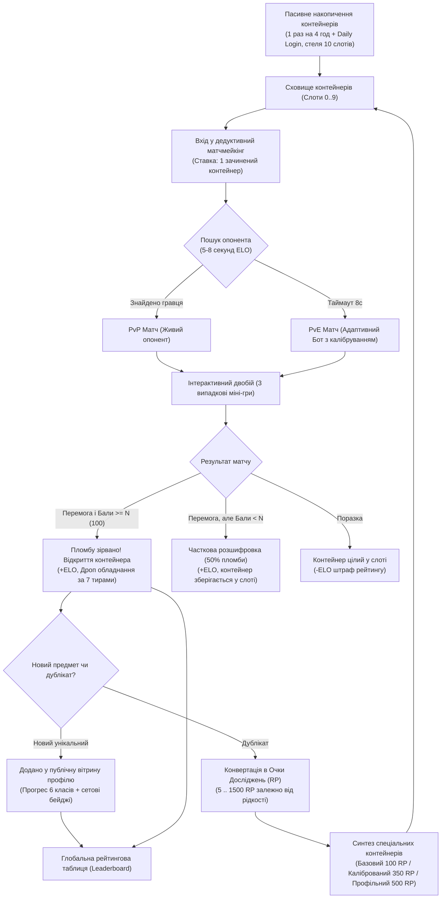
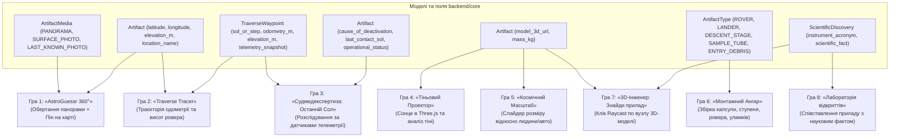

# [ID: FEAT-10] Дедуктивна міні-гра «Астро-Археологія», Щоденні контейнери, Колекція обладнання та Рейтинг (PvP/PvE)

> **Статус**: `APPROVED / ARCHITECTURE SPECIFICATION`  
> **Версія специфікації**: `v1.1.0`  
> **Пріоритет**: `HIGH ENGAGEMENT & RETENTION (Core Game Loop)`  
> **Ролі**: [`ROLE-WebUser`](../03_users/01_ROLES.md)  
> **Пов'язані сутності**: [`ENT-Artifact`](../05_domain/01_ENTITIES.md), [`ENT-Mission`](../05_domain/01_ENTITIES.md), [`ENT-ScientificDiscovery`](../05_domain/01_ENTITIES.md), [`ENT-TraverseWaypoint`](../05_domain/01_ENTITIES.md), [`ENT-ArtifactMedia`](../05_domain/01_ENTITIES.md)  
> **Архітектурний стек**: Django 5 (Channels WebSocket + REST) + React 19 (FSD v2.1, Three.js 3D / Panoramas, Chakra UI v3, Zustand, TanStack Query)

---

## 1. Концепція та Ігрова Петля (Core Game Loop)

Фіча перетворює статичну базу знань CosmoLost на інтерактивний дедуктивний батл (PvP/PvE) за принципом **«Космічного GeoGuessr та Астро-Детектива»**. Щоденна активність користувача конвертується у спроби розшифрувати архівні космічні місії та зібрати унікальну вітрину артефактів NASA у своєму профілі.



---

## 2. Система накопичення контейнерів (Idle / Daily Login)

* **`REQ-CONT-01` (Генерація контейнерів)**:
  * Гравець отримує 1 зачинений контейнер кожні 4 години пасивного таймера + 1 гарантований контейнер при першому щоденному вході (Daily Login).
  * Відсутня агресивна механіка обнулення стріків: якщо день пропущено, гравець не втрачає накопичені контейнери.
* **`REQ-CONT-02` (Ліміт сховища)**:
  * Максимальна місткість інвентарю — **10 контейнерів** у фіксованих слотах `[0..9]`.
  * При досягненні ліміту (10/10) таймер накопичення зупиняється. Це мотивує гравця зайти на портал і зіграти кілька матчів.
* **`REQ-CONT-03` (Контейнер як ключ допуску)**:
  * Контейнер не відкривається простим кліком. Він є цільовим завданням матчу.
  * Умова відкриття: перемога в матчі та набір **$\ge 100$ очок дедукції**.
  * Якщо гравець переміг, але набрав $< 100$ очок: контейнер отримує 50% прогресу зняття пломби (для відкриття знадобиться ще 1 перемога).
  * Якщо гравець програв: контейнер **не згорає** (залишається у слоті), але гравець втрачає бали рейтингу ELO.

---

## 3. Матчмейкінг та Адаптивний Бот (PvP / PvE)

* **`REQ-MM-01` (Швидкий пошук)**:
  * Вікно пошуку живого суперника становить строго **5–8 секунд**.
  * Пул підбору враховує поточний ELO-рейтинг гравця ($\pm 150$ очок з поступовим розширенням діапазону).
* **`REQ-MM-02` (Безшовний перехід на бота)**:
  * Якщо за 8 секунд живого опонента не знайдено, матч стартує без затримки проти бота з випадковим псевдонімом дослідника.
* **`REQ-MM-03` (Калібрування складності бота за ELO)**:

| Діапазон ELO гравця | Звання | Точність бота (% правильних) | Затримка реакції бота | Характер помилок бота |
| :--- | :--- | :---: | :---: | :--- |
| **0 – 999** | *Курсант* | 40% – 50% | 4.0 – 6.0 сек | Плутає роки, сусідні кратери та місії одного десятиліття |
| **1000 – 1499** | *Оператор телеметрії* | 55% – 65% | 3.0 – 4.5 сек | Робить реалістичні помилки у відсіюванні тонких фейкових фактів |
| **1500 – 1999** | *Спеціаліст місії* | 70% – 80% | 2.0 – 3.2 сек | Швидко розпізнає загальний силует, помиляється на складних приладах |
| **2000+** | *Астро-Археолог* | 85% – 92% | 1.2 – 2.2 сек | Висока дедукція, точне розпізнавання 360° панорам і тіней |

---

## 4. Повний пул інтерактивних міні-ігор на реальних даних `backend/core`

Усі ігри **на 100% генеруються процедурно** з бази даних CosmoLost без ручного написання запитань. Кожен матч вибирає 3 різні гри з цього пулу.



---

### Гра 1: «AstroGuessr 360°» (Інтерактивна панорама та пін на карті)
* **Джерела даних**: `ArtifactMedia.media_category == 'PANORAMA'` або `'SURFACE_PHOTO'`, `Artifact.latitude`, `Artifact.longitude`, `Artifact.location_name`, `CelestialBody.radius_km`, `CelestialBody.wmts_tile_url`.
* **Механіка**:
  1. Гравець опиняється всередині 360° сферичної панорами в Three.js з можливістю крутити камеру на 360° та зумити.
  2. За скелями, куполом неба, слідами коліс чи посадковими опорами гравець орієнтується на місцевості.
  3. На міні-карті NASA Treks (`CelestialBody.wmts_tile_url`) гравець ставить пін у передбачуване місце стоянки апарата.
* **Формула оцінки відстані Гаверсину**:
  $$\Delta d = 2 R \cdot \arcsin\left(\sqrt{\sin^2\left(\frac{\Delta lat}{2}\right) + \cos(lat_1)\cos(lat_2)\sin^2\left(\frac{\Delta lon}{2}\right)}\right)$$
  де $R$ — радіус планети (`radius_km`: 3389.5 км для Марса, 1737.4 км для Місяця).
  $$\text{Score} = \max\left(0, \text{round}\left(100 \cdot e^{-\frac{\Delta d}{50}}\right)\right)$$
* **Бали**: До **+100 балів** (100 при похибці $< 10$ км).

---

### Гра 2: «Traverse Tracer» (Маршрут і хронологія руху ровера)
* **Джерела даних**: `TraverseWaypoint.sol_or_step`, `TraverseWaypoint.latitude`, `longitude`, `elevation_m`, `odometry_m`, `TraverseWaypoint.story_snippet`.
* **Механіка**:
  1. На супутниковій радіальній схемі кратера показано точки стоянок ровера.
  2. Гравець отримує уривки записів бортового журналу (`story_snippet`) та кумулятивну одометрію (`odometry_m`).
  3. Завдання — з'єднати відрізки шляху в правильному хронологічному порядку від Sol 1 до фіналу (наприклад: *Посадковий кратер Ігл (0 м) $\rightarrow$ Кратер Ендюранс (700 м) $\rightarrow$ Кратер Вікторія (6 км) $\rightarrow$ Кратер Індевор (45 км)*).
* **Бали**: **+10 балів** за кожну правильно з'єднану ділянку маршруту.

---

### Гра 3: «Судмедекспертиза: Останній Сол» (Розслідування аварії / зупинки)
* **Джерела даних**: `Artifact.operational_status`, `Artifact.cause_of_deactivation`, `Artifact.last_contact_sol`, `TraverseWaypoint.telemetry_snapshot`, `ArtifactMedia.media_category == 'LAST_KNOWN_PHOTO'`.
* **Механіка**:
  1. На дисплей виводяться справжні показники останньої телеметрії:
     * `power_wh`: Залишок потужності бортового живлення (Вт·год).
     * `dust_tau`: Рівень запиленості атмосфери (оптична товщина).
     * `tilt_deg`: Кут крену корпусу (чи застряг / перекинувся апарат).
     * Останнє фото перед мовчанням (`LAST_KNOWN_PHOTO`).
  2. Гравець обирає точну інженерну причину припинення місії:
     * *«Пилова буря заблокувала сонячні батареї (Tau > 10.0, Power < 50 Wh)»* $\rightarrow$ **Opportunity**.
     * *«Застряг у прихованому піщаному наносі зі зламаним правим колесом»* $\rightarrow$ **Spirit**.
     * *«Плановий таран об ґрунт на швидкості 2.5 км/с для реєстрації сейсмічних хвиль»* $\rightarrow$ **Saturn V S-IVB (Impact Stage)**.
* **Бали**: **+35 балів** за точну причину.

---

### Гра 4: «Тіньовий Проектор» (3D Solar Shadow & Silhouette)
* **Джерела даних**: `Artifact.model_3d_url`, `Artifact.name`, `Artifact.artifact_type`.
* **Механіка**:
  1. Апарат прихований у темряві, видно **виключно тінь**, яку він відкидає на поверхню під променями Сонця.
  2. Гравець рухає повзунок висоти/азимута Сонця — тінь динамічно витягується, проявляючи характерні вузли:
     * Тонкі лопаті та ніжки-опори $\rightarrow$ **Ingenuity**.
     * Висока поворотна щогла з «головою» $\rightarrow$ **Curiosity / Perseverance**.
     * Круглі сонячні панелі у формі віял $\rightarrow$ **InSight / Phoenix**.
     * 4 характерні конічні посадкові лапи $\rightarrow$ **Apollo Lunar Module**.
  3. Потрібно натиснути на кнопку з правильною назвою до завершення 10-секундного таймера.
* **Бали**: **+30 балів**.

---

### Гра 5: «Космічний Масштаб» (Interactive Scale Matcher)
* **Джерела даних**: `Artifact.model_3d_url`, `Artifact.mass_kg`, `Artifact.artifact_type`, `CelestialBody.gravity_ms2`.
* **Механіка**:
  1. Поруч з апаратом у 3D-сцені стоїть еталон: **Астронавт у скафандрі (1.85 м)** або **Позашляховик (4.5 м)**.
  2. Гравець рухає слайдер масштабу `[0.1x ... 5.0x]`, візуально підганяючи розмір 3D-моделі під реальний.
  3. При фіксації система порівнює габарити з еталонними та показує факт:
     * *«Sojourner (1997) насправді був розміром із мікрохвильовку (65 см)!»*
     * *«Curiosity насправді більший за позашляховик Jeep Wrangler!»*
* **Бали**: **+50 балів** при похибці $< 5\%$; **+25 балів** при похибці $< 20\%$.

---

### Гра 6: «Монтажний Ангар: Збірка комплексу місії»
* **Джерела даних**: `Artifact.artifact_type` (перелік `ArtifactType`), `Mission.id`, `Mission.name`, `Mission.agency`, `Mission.landing_date`.
* **Механіка**:
  1. Кожна реальна місія складається з комплексу заліза:
     * `ENTRY_DEBRIS`: Лобовий щит, парашут, задня кришка.
     * `DESCENT_STAGE`: Посадковий Sky Crane або спусковий щабель.
     * `ROVER` / `LANDER`: Основний апарат.
     * `HELICOPTER`: Дрон-розвідник.
     * `SAMPLE_TUBE`: Залишені герметичні трубки зразків.
  2. Гравець перетягує 4 компоненти у монтажні слоти, групуючи елементи, які **прибули разом у межах однієї місії**:
     * *Марс-2020*: [Sky Crane] + [Perseverance] + [Ingenuity] + [Sample Tube Depot].
     * *Аполлон-11*: [LM Eagle Descent Stage] + [Прапор США] + [Сейсмометр PSEP] + [Відбивач LRRR].
* **Бали**: **+10 балів** за слот + бонус **+20 балів** за 100% зібраний комплекс.

---

### Гра 7: «3D-Інженер: Знайди прилад на корпусі»
* **Джерела даних**: `Artifact.model_3d_url`, `ScientificDiscovery.instrument_acronym`, `ScientificDiscovery.instrument_full_name`.
* **Механіка**:
  1. Гравець вільно обертає 3D-модель апарата на 360°.
  2. Завдання: *«Знайдіть та натисніть на джерело живлення — РІТЕГ (MMRTG)»* або *«Де розташовано лазер ChemCam?»*.
  3. Гравець здійснює клік (Raycast) безпосередньо по відповідному вузлу 3D-моделі:
     * Корма з ребрами охолодження $\rightarrow$ **Вірно! Це РІТЕГ**.
     * Щогла $\rightarrow$ **Помилка, це камери Mastcam**.
* **Бали**: **+35 балів** за точний клік.

---

### Гра 8: «Лабораторія відкриттів: Прилад ➔ Науковий факт»
* **Джерела даних**: `ScientificDiscovery.instrument_acronym`, `ScientificDiscovery.scientific_fact`.
* **Механіка**:
  1. На екрані назва приладу (наприклад, **MOXIE**, **APXS**, **SAM**, **LRRR**).
  2. Гравець обирає серед 4 карток реальне наукове відкриття, зроблене цим сенсором:
     * **MOXIE** $\leftrightarrow$ *«Вперше в історії синтезував 122 г молекулярного кисню з атмосфери Марса»*.
     * **LRRR** $\leftrightarrow$ *«Виміряв точну відстань від Землі до Місяця з точністю до міліметрів»*.
* **Бали**: **+25 балів**.

---

## 5. Градація рідкості (7 тирів) та 6 класів обладнання

### 5.1. Таблиця 7 тирів рідкості та лут-дропу

| Рідкість | Системний код | Колір бейджа | Шанс дропу | Компенсація дубліката (RP) | Приклади з бази CosmoLost |
| :--- | :--- | :---: | :---: | :---: | :--- |
| **1. Утиль (Scrap)** | `SCRAP` | `#718096` (Сірий) | **42.0%** | **5 RP** | Відстріляні кріплення, теплоізоляційна фольга, фрагменти парашутів, баластні вантажі (`ENTRY_DEBRIS`) |
| **2. Штатний (Standard)** | `STANDARD` | `#E2E8F0` (Світлий) | **28.0%** | **15 RP** | Серійні кабельні траси, антени низького підсилення (LGA), кремнієві сонячні батареї |
| **3. Спеціалізований (Specialized)** | `SPECIALIZED` | `#38A169` (Зелений) | **16.0%** | **40 RP** | Навігаційні камери Navcam/Hazcam, бури RAT, датчики пилу і тиску MEDA |
| **4. Експериментальний (Prototype)** | `PROTOTYPE` | `#3182CE` (Синій) | **8.0%** | **100 RP** | Лазерні спектрометри ChemCam/SuperCam, сейсмограф SEIS, георадар RIMFAX |
| **5. Автономний (Autonomous)** | `AUTONOMOUS` | `#805AD5` (Фіолетовий) | **4.0%** | **250 RP** | Плутонієві РІТЕГи (MMRTG), комп'ютери RAD750, автономна навігація AutoNav |
| **6. Історичний (Historic)** | `HISTORIC` | `#D69E2E` (Золотий) | **1.6%** | **600 RP** | Ступінь LM Eagle (Аполлон-11), шасі Місяцеходу-1, титанові колеса роверів |
| **7. Сингулярний (Anomaly)** | `ANOMALY` | `#E53E3E` (Неон/Червоний) | **0.4%** | **1500 RP** | Золота пластинка Voyager, лопать гвинтокрила Ingenuity, прапор посадки Apollo-11 |

### 5.2. 6 Інженерних класів обладнання (Слоти колекції)

1. **Оптика та Сенсори (`OPTICS_SENSORS`)**: Mastcam, Pancam, лазерні далекоміри, зоряні трекери.
2. **Ходова та Шасі (`MOBILITY_CHASSIS`)**: підвіска Rocker-Bogie, титанові колеса, посадкові соти.
3. **Енергосистеми та Двигуни (`POWER_PROPULSION`)**: РІТЕГи, сонячні батареї, гальмівні двигуни descent stage.
4. **Телеметрія та Зв'язок (`COMMS_AVIONICS`)**: дзеркала HGA, передавачі UHF, бортові комп'ютери.
5. **Інструменти та Лабораторії (`PAYLOAD_TOOLS`)**: бур RAT, аналізатор SAM, генератор кисню MOXIE, касети Sample Tubes.
6. **Особисті речі та Меморіали (`CREW_RELICS`)**: прапори, меморіальні таблички, куточкові відбивачі світла LRRR.

---

## 6. Економіка дублікатів (Очки Досліджень - RP) та Синтез

Отриманий дублікат автоматично конвертується в **Очки Досліджень (Research Points, RP)**:
* **Базовий контейнер (100 RP)**: стандартні шанси випадіння (від Scrap до Anomaly).
* **Калібрований контейнер (350 RP)**: повністю відсікає Scrap та Standard — гарантує дроп від `SPECIALIZED` і вище.
* **Профільний контейнер (500 RP)**: гравець сам обирає потрібний клас обладнання (наприклад, тільки `PAYLOAD_TOOLS`), що дозволяє прицільно закривати незавершені сети місій.

---

## 7. Публічна вітрина профілю та Рейтингова таблиця (Leaderboard)

### 7.1. Вітрина профілю (Curator Showcase)
* **Полиця трофеїв**: 3–5 слотів, де гравець закріплює свої найрідкісніші знахідки (з інтерактивною 3D-моделлю та неоновим сяйвом відповідного тиру).
* **Музейний прогрес**: відсоток відкритих компонентів каталогу (наприклад, `54 / 180 артефактів`).
* **Сетові нагороди**: закриття всіх 6 предметів однієї місії розблоковує спеціальну золоту рамку та бейдж у профілі.

### 7.2. Рейтинг ELO
* Розрахунок очок за формулою Ело після кожного матчу:
  $$R_{new} = R_{old} + K \cdot (S - E)$$
* Таблиця лідерів включає:
  1. **Сезонний ладдер ELO** (Топ-100 детективів місяця).
  2. **Кураторський рейтинг** (за сумарною інженерною цінністю знахідок).
  3. **Експедиція тижня** (за кількістю відкритих контейнерів).

---

## 8. Модель даних для бекенду (Django ORM)

```python
# backend/game/models.py
import uuid
from django.db import models
from django.conf import settings
from core.models import Artifact, ScientificDiscovery

class EquipmentRarity(models.TextChoices):
    SCRAP = 'SCRAP', 'Утиль'
    STANDARD = 'STANDARD', 'Штатний'
    SPECIALIZED = 'SPECIALIZED', 'Спеціалізований'
    PROTOTYPE = 'PROTOTYPE', 'Експериментальний'
    AUTONOMOUS = 'AUTONOMOUS', 'Автономний'
    HISTORIC = 'HISTORIC', 'Історичний'
    ANOMALY = 'ANOMALY', 'Сингулярний'

class EquipmentClass(models.TextChoices):
    OPTICS_SENSORS = 'OPTICS_SENSORS', 'Оптика та Сенсори'
    MOBILITY_CHASSIS = 'MOBILITY_CHASSIS', 'Ходова та Шасі'
    POWER_PROPULSION = 'POWER_PROPULSION', 'Енергосистеми та Двигуни'
    COMMS_AVIONICS = 'COMMS_AVIONICS', 'Телеметрія та Зв\'язок'
    PAYLOAD_TOOLS = 'PAYLOAD_TOOLS', 'Інструменти та Лабораторії'
    CREW_RELICS = 'CREW_RELICS', 'Особисті речі та Меморіали'

class EquipmentItem(models.Model):
    """Каталог обладнання на базі артефактів та відкриттів."""
    id = models.CharField(max_length=100, primary_key=True)
    artifact = models.ForeignKey(Artifact, on_delete=models.CASCADE, related_name='equipment_items')
    discovery = models.ForeignKey(ScientificDiscovery, null=True, blank=True, on_delete=models.SET_NULL)
    name = models.CharField(max_length=200)
    equipment_class = models.CharField(max_length=50, choices=EquipmentClass.choices)
    rarity = models.CharField(max_length=30, choices=EquipmentRarity.choices, default=EquipmentRarity.STANDARD)
    description = models.TextField()
    image_url = models.CharField(max_length=500, blank=True)

class UserGameProfile(models.Model):
    """Ігровий профіль користувача з ELO та контейнерами."""
    user = models.OneToOneField(settings.AUTH_USER_MODEL, on_delete=models.CASCADE, related_name='game_profile')
    elo_rating = models.IntegerField(default=1000, db_index=True)
    research_points = models.IntegerField(default=0)
    chests_count = models.IntegerField(default=3)  # Макс 10 слотів
    last_chest_accrual = models.DateTimeField(auto_now_add=True)
    total_matches = models.IntegerField(default=0)
    victories = models.IntegerField(default=0)

class UserInventoryItem(models.Model):
    """Отримане користувачем обладнання."""
    user = models.ForeignKey(settings.AUTH_USER_MODEL, on_delete=models.CASCADE, related_name='inventory')
    equipment = models.ForeignKey(EquipmentItem, on_delete=models.CASCADE)
    acquired_at = models.DateTimeField(auto_now_add=True)
    is_showcased = models.BooleanField(default=False)

    class Meta:
        unique_together = ('user', 'equipment')

class GameMatch(models.Model):
    """Сесія дедуктивного двобою."""
    id = models.UUIDField(primary_key=True, default=uuid.uuid4)
    player1 = models.ForeignKey(settings.AUTH_USER_MODEL, on_delete=models.CASCADE, related_name='matches_as_p1')
    player2 = models.ForeignKey(settings.AUTH_USER_MODEL, null=True, blank=True, on_delete=models.SET_NULL, related_name='matches_as_p2')
    is_bot = models.BooleanField(default=False)
    target_artifact = models.ForeignKey(Artifact, on_delete=models.CASCADE)
    selected_mini_games = models.JSONField(default=list)  # Список з 3 обраних міні-ігор
    score_p1 = models.IntegerField(default=0)
    score_p2 = models.IntegerField(default=0)
    winner_id = models.IntegerField(null=True, blank=True)
    is_chest_unlocked = models.BooleanField(default=False)
    created_at = models.DateTimeField(auto_now_add=True)
```

---

## 9. Фронтенд-архітектура за FSD (Feature-Sliced Design v2.1)

```
web-client/src/
├── entities/
│   ├── game/               # Стан матчу, розрахунок ELO, таймери
│   ├── container/          # Стан слотів (0..9), статус пломби (0%/50%/100%)
│   └── inventory/          # Картки артефактів за 7 тирами рідкості
├── features/
│   ├── matchmaking/        # Вікно черги пошуку 5-8с, перехід на бота
│   ├── astro-guessr/       # Three.js 360° панорама, пін на WMTS карті
│   ├── traverse-tracer/    # Інтерактивне креслення маршруту одометрії
│   ├── forensic-sol/       # Аналіз останнього сола та телеметрії живлення
│   ├── shadow-projector/   # Динамічне сонячне освітлення та розпізнавання тіні
│   ├── scale-matcher/      # 3D-слайдер масштабування відносно людини
│   ├── mission-hangar/     # Драг-енд-дроп збірка комплексу місії
│   ├── component-dissect/  # Raycast клік по вузлу 3D-моделі
│   └── chest-opening/      # 3D розпакування контейнера, анімація дропу, конвертація RP
├── widgets/
│   ├── battle-arena/       # Повний екран дедуктивного поєдинку з HUD
│   ├── curator-showcase/   # Публічна вітрина полиці профілю користувача
│   └── leaderboard-table/  # Рейтингова таблиця за ELO та закритими сетами
└── pages/
    ├── arena/              # /arena — центр запусків дедуктивних дуелей
    ├── showcase/           # /profile/:username — музейна полиця трофеїв
    └── leaderboards/       # /leaderboard — загальний ладдер детективів
```
