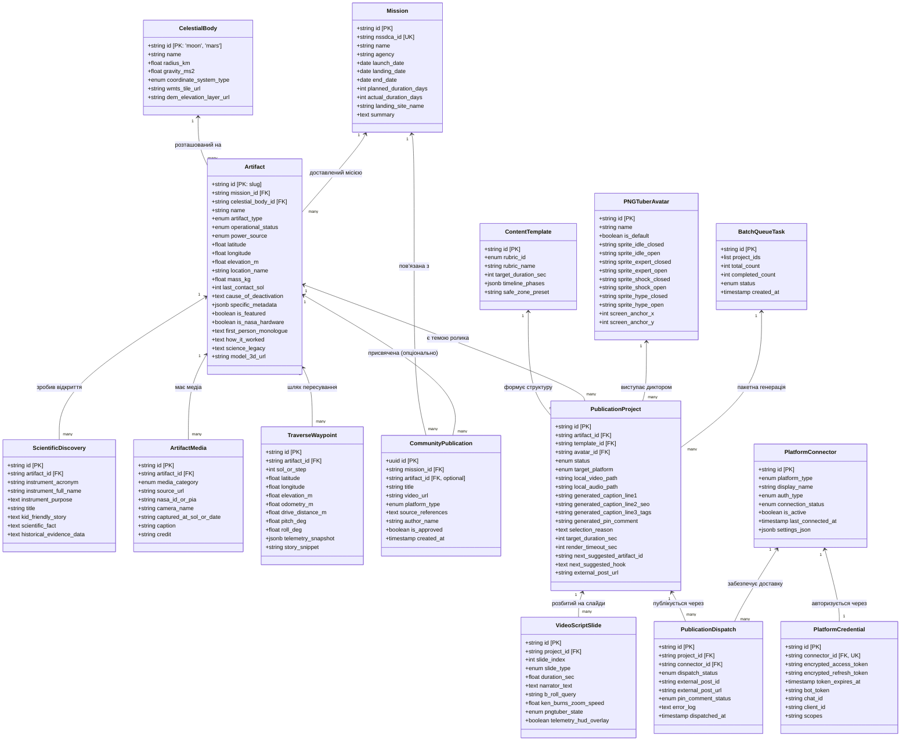

# Повний Реєстр Доменних Сутностей (01_ENTITIES.md)

> **Статус**: `APPROVED`  
> **Версія специфікації**: `v0.4.0`  
> **Джерела даних**: `inbox/Ресурси та API для космічного челенджу.md` (каталоги NASA, телеметрія, прилади) та `inbox/Створення IT-контенту для соцмереж.md` (SMM, PNGTuber, Safe Zones, черги)

---

## 1. Діаграма сутностей предметної області (Mermaid Class Diagram)

---

## 2. Детальний опис сутностей

### 2.1. Доменні сутності NASA та Космічної бази даних

#### [ENT-01] `CelestialBody` (Небесне тіло / Сцена)
* **Призначення**: Фізичні та картографічні параметри планетного сфероїда для Three.js мапи.
* **Поля**:
  * `id`: "moon", "mars" (PK).
  * `name`: "Місяць", "Марс".
  * `radius_km`: 1737.4 (Місяць), 3396.2 (Марс) — для формули $X,Y,Z$ мапінгу координат.
  * `gravity_ms2`: 1.62 (Місяць), 3.72 (Марс).
  * `coordinate_system_type` (Enum):
    * `SELENOGRAPHIC`: для Місяця (довгота $[-180^\circ..180^\circ]$).
    * `PLANETOCENTRIC_360`: для Марса за каталогами IAU 2000 (східна довгота $[0^\circ..360^\circ]$).
  * `wmts_tile_url`: URL тайлових мозаїк NASA Treks.
  * `dem_elevation_layer_url`: Карта висот (LOLA для Місяця, MOLA для Марса).

#### [ENT-02] `Mission` (Космічна місія)
* **Призначення**: Офіційна наукова експедиція з архівів NSSDCA.
* **Поля**:
  * `id`: унікальний слаг ("apollo-15", "mars-2020").
  * `nssdca_id`: офіційний код запуску (наприклад, "1971-063A").
  * `name`: назва місії.
  * `agency`: "NASA", "NASA / JPL".
  * `launch_date`, `landing_date`, `end_date`: часові рамки.
  * `planned_duration_days`, `actual_duration_days`: плановий та реальний термін служби (контраст для сторітелінгу).
  * `landing_site_name`: географічний район посадки ("Hadley Rille", "Meridiani Planum").

#### [ENT-03] `Artifact` (Покинутий об'єкт / Артефакт)
* **Призначення**: Центральна сутність каталогу та сторітелінгу.
* **Поля**:
  * `id`: унікальний слаг (PK, наприклад "opportunity-rover").
  * `name`: повна назва апарата ("Opportunity Rover (MER-B)").
  * `artifact_type` (Enum):
    * `ROVER`: мобільні марсоходи та місячні ровери (Spirit, Opportunity, Apollo LRV).
    * `HELICOPTER`: марсіанський дрон (Ingenuity).
    * `LANDER`: посадковий модуль (Viking 1, InSight).
    * `DESCENT_STAGE`: спускний ступінь (Apollo 11 LM Eagle).
    * `IMPACT_STAGE`: навмисно розбитий ступінь ракети для сейсмічних тестів (Saturn V S-IVB).
    * `INSTRUMENT`: науковий прилад (сейсмометри ALSEP, SEIS).
    * `RETRO_REFLECTOR`: лазерний відбивач, що працює пасивно (Apollo 11/14/15 LRRR).
    * `SAMPLE_TUBE`: титанова пробірка зі зразками ґрунту (Three Forks Sample Depot).
    * `ENTRY_DEBRIS`: скинутий тепловий щит або парашут (Backshell, Parachute).
    * `DEEP_SPACE_PROBE`: зонд у глибокому космосі (Voyager 1/2, Pioneer 10/11).
  * `operational_status` (Enum):
    * `DORMANT`: вимкнений / розряджений апарат.
    * `DESTROYED_ON_IMPACT`: розбитий об поверхню для сейсмічного експерименту.
    * `PASSIVE_ACTIVE`: пасивно працює без джерел живлення (ретрорефлектори).
    * `ACTIVE_TRANSMITTING`: продовжує передавати радіосигнал (Voyager 1/2).
  * `power_source`: `SOLAR` (сонячні панелі), `RTG` (радіоізотопний плутонієвий генератор), `BATTERY` (хімічні батареї), `PASSIVE`.
  * `latitude`, `longitude`, `elevation_m`: точні координати знаходження.
  * `mass_kg`: суха маса на поверхні з каталогу NASA.
  * `cause_of_deactivation`: інженерна причина замовкання (пилова буря, злам лопаті ротора на Sol 1035, замерзання в піску Troy).
  * `specific_metadata` (JSONB):
    * Для роверів: `total_odometry_km` (45.16 км Opportunity), `final_tilt_pitch_deg` (нахил застрягання Spirit).
    * Для гелікоптера: `total_flights` (72 польоти), `total_flight_time_min` (128.8 хв), `damage_description`.
    * Для пасивних дзеркал: `corner_cubes_count` (100 або 300 кварцових призм), `still_used_by_earth: true`.
    * Для пробірок: `sample_number`, `rock_type`.
    * Для глибокого космосу: `distance_from_earth_au`, `signal_roundtrip_hours`.
  * `is_featured`: прапорець пріоритетного кураторського артефакту (Tier 1).
  * `is_nasa_hardware`: прапорець приналежності до обладнання NASA (за замовчуванням `true`). Якщо `false` — позначає міжнародні апарати, внесені до офіційних каталогів NASA (наприклад, радянські лазерні відбивачі Луноход-1/2, відвіданий апарат Surveyor 3, або європейські прилади місій).
  * `first_person_monologue`: художній атмосферний текст від імені машини (зберігається строго **англійською мовою (en-US)** для міжнародного журі NASA без ускладнення моделі даних зайвими таблицями).
  * `how_it_worked`: проста аналогія принципу роботи приладу для школярів англійською мовою.
  * `science_legacy`: підсумок внеску в науку для майбутніх місій Artemis / Mars Sample Return англійською мовою.
  * `model_3d_url`: прямий лінк на `.glb` файл у відкритому репозиторії NASA 3D Resources.

#### [ENT-04] `TraverseWaypoint` (Точка зупинки маршруту)
* **Призначення**: Точки пересування та телеметрія роверів/дронів з відкритих файлів NASA MMGIS.
* **Поля**: `id`, `artifact_id`, `sol_or_step`, `latitude`, `longitude`, `elevation_m`, `odometry_m`, `drive_distance_m`, `pitch_deg`, `roll_deg`, `telemetry_snapshot` (JSONB: виробіток енергії `power_wh`, запиленість неба `dust_tau`, температура `temp_c`), `story_snippet` (коротка подія на зупинці).

#### [ENT-05] `ScientificDiscovery` (Наукове відкриття)
* **Призначення**: Наукова спадщина апарата з каталогів NSSDCA Experiment Catalog.
* **Поля**: `id`, `artifact_id`, `instrument_acronym` (Pancam, APXS, SEIS), `instrument_full_name`, `instrument_purpose`, `title`, `kid_friendly_story`, `scientific_fact`, `historical_evidence_data`.

#### [ENT-06] `ArtifactMedia` (Медіафайл артефакту)
* **Призначення**: Знімки та аудіо з відкритих архівів NASA.
* **Поля**: `id`, `artifact_id`, `media_category` (Enum: `SURFACE_FIRST_PERSON`, `LAST_KNOWN_PHOTO`, `ORBITAL_PROOF_LROC_HIRISE`, `MODEL_3D`, `AUDIO_RECORDING`), `source_url`, `nasa_id_or_pia` (наприклад, "PIA22521"), `camera_name`, `captured_at_sol_or_date`, `caption`, `credit`.

#### [ENT-07] `CommunityPublication` (Публікація спільноти / Користувацьке відео)
* **Призначення**: Збереження посилань на створені відеоролики (YouTube Shorts, TikTok тощо) та прив'язка їх до конкретної місії або артефакту для подальшого виведення на вебпорталі.
* **Політика збереження відео**: Самі важкі відеофайли **ніколи не зберігаються в базі даних**. Вони хостяться безпосередньо на відеохостингах (YouTube/TikTok) або локально на комп'ютері автора. В БД зберігається лише легкий метаданий запис із посиланням на ролик та переліком першоджерел.
* **Статус клієнтської інтеграції**: В БД та API структура повноцінно закладена для бекенду. На клієнтській стороні (десктопний додаток та вебпортал) інтерфейс подачі користувацьких відео позначено як плановий беклог `[AI-DRAFT]`.
* **Поля**:
  * `id`: унікальний UUID запису (PK).
  * `mission_id`: зовнішній ключ на `Mission` (FK) — обов'язкова прив'язка до космічної місії.
  * `artifact_id`: зовнішній ключ на `Artifact` (FK, nullable) — опціональна точкова прив'язка до конкретного апарата.
  * `title`: назва ролика або публікації.
  * `video_url`: пряме посилання на відео (`https://youtube.com/shorts/...`, `https://tiktok.com/@...`).
  * `platform_type` (Enum): `YOUTUBE`, `TIKTOK`, `REELS`, `OTHER`.
  * `source_references`: перелік використаних джерел контенту (посилання на NASA Photojournal PIA, каталоги PDS, наукові статті).
  * `author_name`: ім'я чи нікнейм автора контенту.
  * `is_approved`: булевий прапорець премодерації (`false` за замовчуванням, `true` для показу на порталі).
  * `created_at`: дата та час створення запису.

---

### 2.2. Доменні сутності «Фабрики контенту» (Локальні для десктопного редактора Tauri)

> **Архітектурне правило**: Наведені нижче сутності ([ENT-08] - [ENT-14]) обслуговують інтерфейс монтажу, локальний рендеринг і пряму відправку в соцмережі. Вони функціонують за принципом **Local-First** у десктопному клієнті (Tauri, `%APPDATA%/CosmoLost/`) і не перевантажують серверну базу даних важкими блоками слайдів чи токенами доступу.

#### [ENT-08] `ContentRubric` / `ContentTemplate` (Шаблон рубрики контенту)
* **Призначення**: Фіксована інженерна рамка виробництва контенту на основі SMM-дослідження.
* **Канонічний реєстр 5 рубрик**:
  1. `RUBRIC_LAST_SOL_DRAMA` («Останній сол»): емоційна трагедія замовклого робота (Opportunity, Spirit, InSight, Pioneer). Хронометраж: 30–40с. Хук: фатальна подія (Sol 5111, засипані пилом батареї).
  2. `RUBRIC_TECH_EXPLAIN` («Як це працює простими словами»): пояснення складних космічних деталей через земні аналогії (термоелектричний плутонієвий генератор RTG, лазерні куточкові відбивачі, титанові пробірки). Хронометраж: 20–30с.
  3. `RUBRIC_LUNAR_MYSTERIES` («Таємниці Місяця»): забуті артефакти та секрети програми Аполлон (розбиті ступені S-IVB як джерело сейсмічних хвиль, зрізана камера Surveyor 3). Хронометраж: 35–45с.
  4. `RUBRIC_BILLION_CRASH` («Краш-тест за мільярд»): інженерні факапи та космічні катастрофи (Mars Climate Orbiter через плутанину фунтів і ньютонів, Genesis через перевернуті датчики). Хронометраж: 25–35с.
  5. `RUBRIC_BUILD_IN_PUBLIC` («Створюємо проєкт у прямому ефірі»): щоденник хакатону NASA Space Apps від команди «Space Ліхтар» (як працює Three.js рендеринг, підключення FastMCP без RAG). Хронометраж: 15–25с.
* **Поля**:
  * `id`: унікальний слаг ("last-sol-drama", "tech-explain", "lunar-mysteries", "billion-crash", "build-in-public").
  * `rubric_id`: Enum рубрики.
  * `rubric_name`: Назва рубрики.
  * `target_duration_sec`: Рекомендований хронометраж (15–45 секунд).
  * `timeline_phases`: JSON конфігурація фаз (Хук 0–3с, М'ясо 3–35с, Loop 35–45с).
  * `hook_prompt_template`: Шаблон системного промпта для генерації перших 3 секунд ролика.
  * `debate_comment_prompt`: Шаблон формування провокативного питання для першого закріпленого коментаря (Pin Comment).
  * `safe_zone_preset`: "9_16_MOBILE_SAFE_ZONES".

#### [ENT-08] `VideoScriptSlide` (Слайд відеосценарію)
* **Призначення**: Атомарний блок таймлайну ролика в нодовому редакторі.
* **Поля**:
  * `id`: UUID.
  * `project_id`: зв'язок з проєктом публікації.
  * `slide_index`: порядковий номер (1..N).
  * `slide_type`: Enum (`HOOK`, `B_ROLL_MEAT`, `DRAMA_PEAK`, `SEAMLESS_LOOP`).
  * `duration_sec`: хронометраж слайда.
  * `narrator_text`: текст диктора для цього фрагмента.
  * `b_roll_query`: пошуковий запит фотографії або схеми NASA.
  * `ken_burns_zoom_speed`: швидкість зуму у фільтрі zoompan.
  * `pngtuber_state`: стан аватара (`STATE_IDLE`, `STATE_EXPERT`, `STATE_SHOCK`, `STATE_HYPE`).
  * `telemetry_hud_overlay`: чи накладати напівпрозорий блок телеметрії збоку.

#### [ENT-09] `PNGTuberAvatar` (Реактивний аватар)
* **Призначення**: Віртуальний диктор контенту.
* **Поля**:
  * `id`, `name`: ідентифікатор.
  * `is_default`: прапорець фірмового аватара від дизайнера Віолетти.
  * Набір спрайтів (8 PNG-файлів): `sprite_idle_closed`, `sprite_idle_open`, `sprite_expert_closed`, `sprite_expert_open`, `sprite_shock_closed`, `sprite_shock_open`, `sprite_hype_closed`, `sprite_hype_open`.
  * `screen_anchor_x`, `screen_anchor_y`: координати розміщення аватара над нижньою мертвою зоною.

#### [ENT-10] `PublicationProject` (Проєкт публікації)
* **Призначення**: Сесія генерації, рендерингу та дистрибуції ролика.
* **Централізоване збереження текстів**: Усі текстові поля проєкту (сценарії слайдів, монологи, описи, коментарі та причини вибору) **зберігаються на центральному сервері в PostgreSQL**, забезпечуючи збереження чернеток, аналітику та синхронізацію між пристроями автора без навантаження сервера важкими медіафайлами.
* **Поля**:
  * `id`: UUID проєкту.
  * `artifact_id`: зовнішній ключ на цільовий артефакт.
  * `template_id`: зовнішній ключ на шаблон рубрики.
  * `avatar_id`: зовнішній ключ на аватар диктора.
  * `status`: `DRAFT` $\to$ `RENDERING` $\to$ `RENDERED` $\to$ `PUBLISHED` (або `PARTIALLY_PUBLISHED`, `PUBLISHED_MANUALLY`, `FAILED`).
  * `selection_reason`: текстове обґрунтування вибору артефакту автором (наприклад: *«Річниця засипання пилом сонячних батарей»*, *«Контраст з Аполлон-11»*). Використовується рушієм `REQ-FAC-13` для підбору наступної теми.
  * `target_duration_sec`: планова тривалість ролика (за замовчуванням **40 секунд**, допустимий діапазон 15–60 с).
  * `render_timeout_sec`: адаптивний таймаут рендерингу FFmpeg (за замовчуванням **40 секунд**, налаштовується користувачем у межах 30–300 секунд під слабкі/інтегровані GPU).
  * `next_suggested_artifact_id`: ідентифікатор рекомендованого наступного артефакту для серійності контенту.
  * `next_suggested_hook`: згенерований рушієм вступний гачок для зв'язування з наступним роликом.
  * `local_video_path`: абсолютний шлях до фінального файлу `.mp4` на локальному диску автора.
  * `local_audio_path`: шлях до згенерованого `.wav`/`.mp3` файлу диктора на диску.
  * `generated_caption_line1`: перший рядок опису (байт на розкриття «...ще»).
  * `generated_caption_line2_seo`: другий рядок опису (SEO-ключовики та лінк на CosmoLost).
  * `generated_caption_line3_tags`: третій рядок опису (4–5 хештегів).
  * `generated_pin_comment`: текст першого дискусійного коментаря.
  * `created_at`, `updated_at`: часові мітки життєвого циклу.

#### [ENT-11] `BatchQueueTask` (Завдання пакетної генерації)
* **Призначення**: Черга пакетного монтажу 5–10 роликів «у стіл».
* **Поля**: `id`, `project_ids` (масив ID проєктів), `total_count`, `completed_count`, `status` (`PENDING`, `IN_PROGRESS`, `COMPLETED`, `CANCELLED`), `created_at`.

#### [ENT-12] `PlatformConnector` (Конектор соціальної платформи)
* **Призначення**: Конфігурація інтеграційного плагіна зовнішньої соцмережі у десктопному додатку.
* **Поля**:
  * `id`: унікальний слаг ("youtube-shorts-main", "telegram-channel-hq", "tiktok-direct", "local-folder-exporter").
  * `platform_type` (Enum): `YOUTUBE_SHORTS`, `TELEGRAM_CHANNEL`, `TIKTOK`, `INSTAGRAM_REELS`, `THREADS`, `LOCAL_FOLDER_EXPORTER`.
  * `display_name`: назва підключеного каналу або дії ("CosmoLost YouTube Channel", "Space Ліхтар TG", "Відкрити папку з відео").
  * `auth_type` (Enum): `OAUTH2_PKCE`, `BOT_TOKEN`, `API_KEY_SECRET`, `NATIVE_LOCAL`.
  * `connection_status` (Enum): `DISCONNECTED`, `CONNECTING`, `CONNECTED`, `EXPIRED`, `ERROR`.
  * `is_active`: активність конектора для вибору у формі публікації.
  * `last_connected_at`: дата та час останньої успішної валідації токена.
  * `settings_json` (JSONB): специфічні налаштування платформи (наприклад: `default_privacy`: `public`/`unlisted`, `auto_pin_comment`: `true`, `default_language`: `uk`/`en`).

#### [ENT-13] `PlatformCredential` (Захищені облікові дані платформи)
* **Призначення**: Безпечне локальне зберігання секретів та токенів авторизації.
* **Політика безпеки**: Зберігаються виключно локально на машині користувача у системному сховищі паролів (OS Keychain / Windows Credential Manager / SQLite DB) і ніколи не передаються на публічний бекенд (Zero-Trust).
* **Поля**:
  * `id`: UUID облікового запису.
  * `connector_id`: зовнішній ключ на `PlatformConnector` (1:1).
  * `encrypted_access_token`: шифрований токен доступу API.
  * `encrypted_refresh_token`: шифрований рефреш-токен для автоматичного поновлення доступу (для Google OAuth2).
  * `token_expires_at`: часова мітка закінчення дії токена доступу.
  * `bot_token`: токен Telegram-бота (для Telegram Bot API).
  * `chat_id`: цільовий юзернейм або ID каналу (наприклад, `@cosmolost_hq` або `-1001234567890`).
  * `client_id`: OAuth Client ID користувача (за потреби використання власного Google Cloud проєкту).
  * `scopes`: список наданих дозволів доступу.

#### [ENT-14] `PublicationDispatch` (Диспетчеризація публікації у канал)
* **Призначення**: Атомарне завдання доставки конкретного ролика у вибрану соціальну мережу.
* **Поля**:
  * `id`: UUID завдання дистрибуції.
  * `project_id`: зовнішній ключ на `PublicationProject`.
  * `connector_id`: зовнішній ключ на `PlatformConnector`.
  * `dispatch_status` (Enum):
    * `PENDING`: очікує в черзі на відправку.
    * `UPLOADING`: виконується потокове завантаження файлу або запуск провідника.
    * `PUBLISHED`: відео успішно розміщено на платформі.
    * `MANUAL_EXPORTED`: папка відкрита в ОС, опис скопійовано в буфер обміну.
    * `FAILED`: сталася помилка API або відмова мережі.
  * `external_post_id`: ідентифікатор створеного допису (наприклад, YouTube `video_id`, Telegram `message_id`).
  * `external_post_url`: пряме посилання на опублікований ролик (`https://youtube.com/shorts/{id}`, `https://t.me/cosmolost_hq/142`).
  * `pin_comment_status` (Enum):
    * `NOT_APPLICABLE`: платформа не підтримує коментарі від бота.
    * `PENDING`: очікує завершення завантаження відео.
    * `POSTED`: коментар опубліковано.
    * `PINNED`: коментар успішно закріплено у верхівці гілки обговорення.
    * `MANUAL_COPIED`: текст скопійовано користувачем для ручної вставки.
    * `FAILED`: помилка створення або закріплення коментаря.
  * `error_log`: текст помилки у разі збою відправки.
  * `dispatched_at`: дата та час завершення операції доставки.
