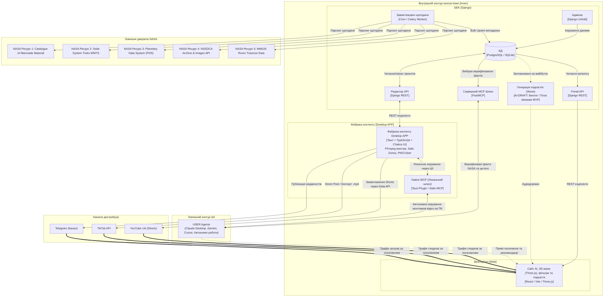
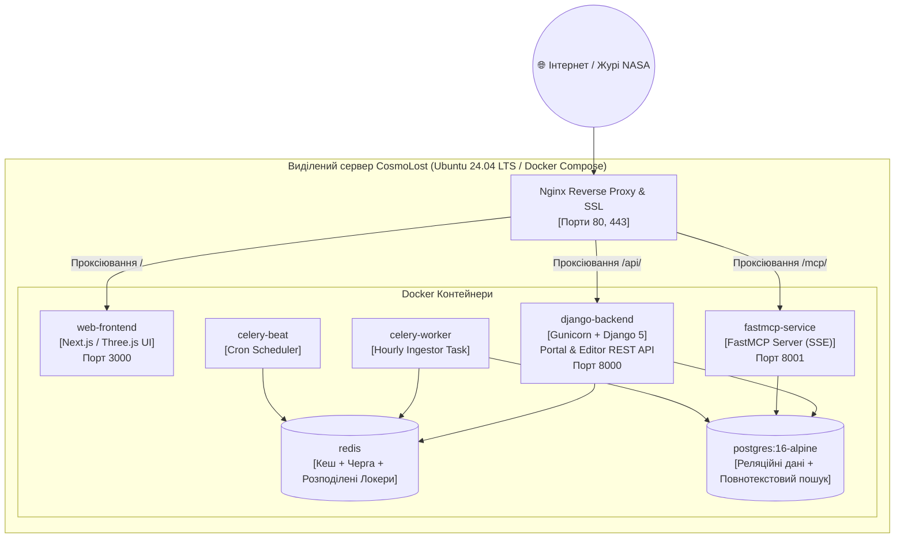

# Архітектура Системи: C4 Діаграми (01_C4_SYSTEM_CONTEXT.md)

> **Статус**: `APPROVED`  
> **Версія специфікації**: `v0.3.0`  
> **Стандарт**: C4 Model (Context & Container) на основі затвердженої архітектурної схеми команди `arhitech.png`

---

## 1. C4 Рівень 1: Системний контекст (System Context Diagram)

```mermaid
flowchart TD
    subgraph Users["Користувачі та Агенти"]
        WebUser["Школяр / Ентузіаст космосу<br>[ROLE-WebUser]"]
        Creator["Контент-креатор<br>[ROLE-Creator]"]
        UserAgents["ШІ-агенти (Gemini / Claude / Локальні роботи)<br>[ROLE-AIAgent]"]
        Admin["Адміністратор / Тімлід<br>[ROLE-Admin]"]
    end

    subgraph CosmoLostSystem["Екосистема CosmoLost"]
        System["Платформа CosmoLost<br>(Вебпортал + Фабрика контенту + Двоконтурний MCP + Django API)"]
    end

    subgraph ExternalServices["Зовнішні сервіси та API"]
        NASA["Ресурси NASA 1..5<br>(Catalogue, Treks WMTS, NSSDCA, PDS, Images API)"]
        YouTube["YouTube Data API v3 (Shorts)"]
        TikTok["TikTok API (Direct Post / Manual)"]
        Telegram["Telegram Bot API (Канал)"]
    end

    WebUser -->|Досліджує 3D-мапу та історії| System
    Creator -->|Генерує вірусні Shorts/Reels| System
    UserAgents <-->|Серверний MCP (факти) & Native MCP (керування фабрикою)| System
    Admin -->|Адмініструє БД та парсери| System

    System -->|Щогодинний парсинг даних| NASA
    System -->|Публікація контенту| YouTube
    System -->|Публікація контенту| TikTok
    System -->|Публікація контенту| Telegram

    YouTube -.->|Трафік із соцмереж| WebUser
    TikTok -.->|Трафік із соцмереж| WebUser
    Telegram -.->|Трафік із соцмереж| WebUser
```

---

## 2. C4 Рівень 2: Діаграма контейнерів (Containers Diagram за схемою `arhitech.png`)



---

## 3. Опис ключових архітектурних вузлів

1. **Двоконтурна система MCP (Dual MCP Architecture)**:
   * **Серверний MCP (Server MCP)**: Працює на Django-бекенді. Надає `USER Agents` доступ до бази знань NASA (координати, відкриття, причини замовкання).
   * **Нативний десктопний MCP (Native MCP)**: Вбудований у додаток Tauri на машині користувача. Дозволяє локальним ШІ-агентам автономно ставити завдання на рендеринг відео, вибирати шаблони рубрик і запускати публікацію без участі людини (план «Джекпот для журі»).
2. **Розподіл API бекенду**:
   * **Portal API**: Оптимізований для швидкого читання та кешування даних для вебпорталу (`/api/v1/portal/...`).
   * **Редактор API (Editor API)**: Спеціалізований інтерфейс для «Фабрики контенту» (`/api/v1/editor/...`) з підтримкою DTO шаблонів, медіа-асетів та метаданих публікацій.
3. **Завантажувач щогодини (Hourly Ingestor)**:
   * Фоновий воркер, що за розкладом опитує 5 незалежних ресурсів NASA та підтримує локальну БД у стані 100% актуальності.
4. **Контур замикання трафіку (Traffic Funnel)**:
   * Відео з десктопу публікуються у соцмережі (YouTube Shorts, TikTok, Telegram), звідки глядачі переходять за посиланнями на інтерактивний вебпортал із 3D-мапою та панорамами.

---

## 4. Серверний Стек Розгортання (Docker Compose Stack)

Бекенд та вебпортал розгортаються на виділеному сервері за допомогою єдиного оркестраційного маніфесту `docker-compose.yml`:



### 4.1. Розподілені блокування (Distributed Task Locks)
* **Механізм захисту**: Для запобігання паралельним конфліктам при щогодинному завантаженні каталогів NASA використовується механізм `Redis Lock` (червоні локери / Redlock з TTL 1800 сек).
* **Принцип дії**: Фоновий воркер `celery-worker` перед початком парсингу захоплює унікальний ключ `lock:ingestion:nasa_catalog`. Якщо попередня сесія завантаження ще не завершилась — новий запуск коректно пропускається без дублювання записів.

### 4.2. Гарантія нульового навантаження від «Фабрики контенту»
* Сервер **не містить** контейнерів для рендерингу відео або конвертації аудіо.
* Усі витрати на CPU/GPU для монтажу відео повністю ізольовані на клієнтських комп'ютерах користувачів. Сервер лише обслуговує легкі HTTP GET/POST запити метаданих.
