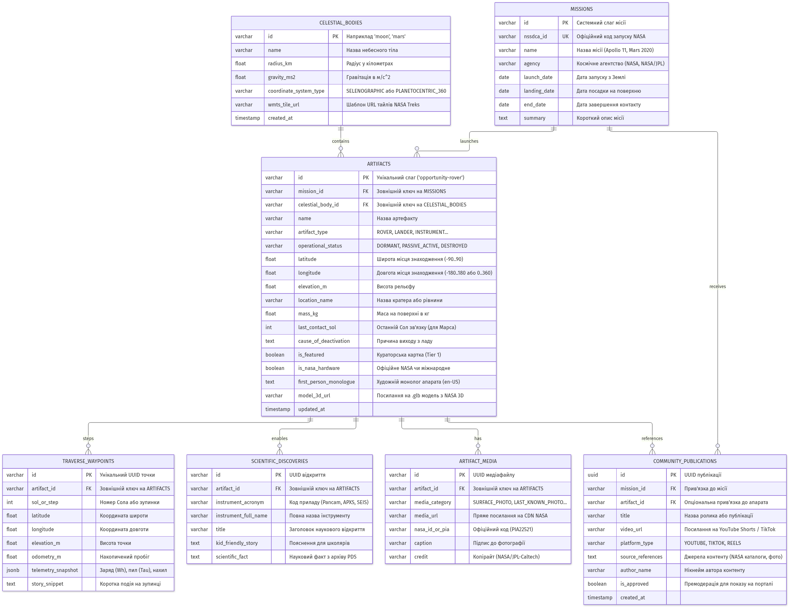
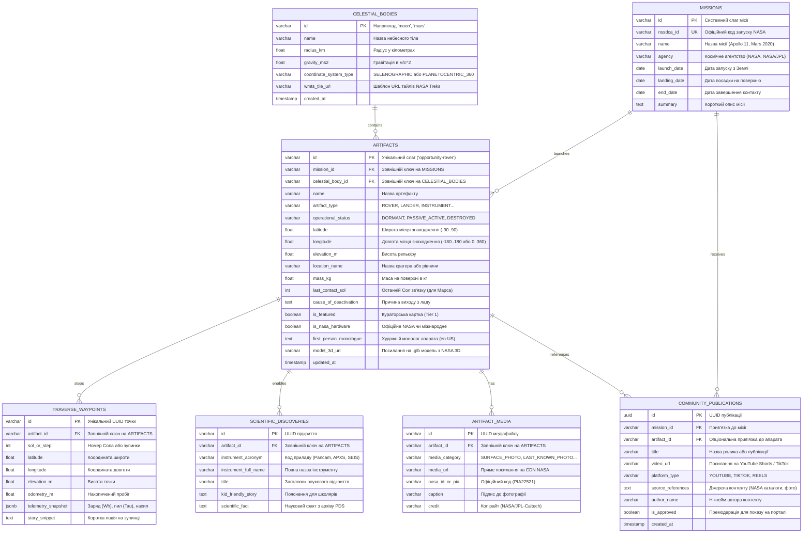

# Фізична Модель Бази Даних (02_DATA_MODEL_ERD.md)

> **Статус**: `APPROVED`  
> **Версія специфікації**: `v0.5.8`  
> **СУБД**: PostgreSQL 16 (або SQLite для швидкого хакатон-деплою) / Django ORM  
> **Згенерована схема**: [`images/erd.png`](./images/erd.png) (612 KB)

---

## 1. Візуальна схема бази даних (Rendered ERD PNG)

---

## 2. Діаграма сутностей та зв'язків серверної бази даних (Mermaid ERD)

> **Примітка щодо десктопного редактора (Tauri)**:  
> Всі сутності локального монтажу (`VideoScriptSlide`, `BatchQueueTask`, локальні шляхи `.mp4`, токени соцмереж) зберігаються **виключно локально** на машині креатора в `%APPDATA%/CosmoLost/` (SQLite / JSON) і не навантажують серверну БД. Відеофайли залишаються на ПК автора або заливаються напряму на YouTube/TikTok.

---

## 3. Реєстр переліків серверної бази даних (Enums)

### 3.1. `CoordinateSystemType` (Система координат небесного тіла)
* `SELENOGRAPHIC` — селенографічна система для Місяця (довгота $[-180^\circ..180^\circ]$).
* `PLANETOCENTRIC_360` — планетоцентрична система для Марса за каталогами IAU 2000 (східна довгота $[0^\circ..360^\circ]$).

### 3.2. `ArtifactType` (Класифікатор 10 типів обладнання NASA)
* `ROVER` — колісні марсоходи та місячні ровери (Spirit, Opportunity, Apollo LRV).
* `HELICOPTER` — марсіанський атмосферний дрон (Ingenuity).
* `LANDER` — стаціонарні посадочні модулі (Viking 1/2, InSight, Phoenix).
* `DESCENT_STAGE` — посадкові ступені пілотованих кораблів (Apollo 11 LM Eagle).
* `IMPACT_STAGE` — ступені ракет, навмисно розбиті об ґрунт для сейсміки (Saturn V S-IVB).
* `INSTRUMENT` — автономні наукові прилади на поверхні (сейсмометри ALSEP, SEIS).
* `RETRO_REFLECTOR` — пасивні куточкові лазерні відбивачі (Apollo 11/14/15 LRRR).
* `SAMPLE_TUBE` — герметичні титанові трубки зі зразками ґрунту (Three Forks Depot).
* `ENTRY_DEBRIS` — скинуті компоненти посадки (Backshell, теплові щити, парашути).
* `DEEP_SPACE_PROBE` — автоматичні апарати далекого космосу (Voyager 1/2, Pioneer 10/11).

### 3.3. `OperationalStatus` (Робочий статус апарата)
* `DORMANT` — знеструмлений / засипаний піском (завершив роботу, очікує повернення людей).
* `PASSIVE_ACTIVE` — пасивно відбиває земні лазерні промені без живлення (ретрорефлектори).
* `DESTROYED_ON_IMPACT` — зруйнований при запланованому зіткненні для сейсмічного аналізу.
* `ACTIVE_TRANSMITTING` — продовжує радіозв'язок із Землею через Deep Space Network.

### 3.4. `MediaCategory` (Категорія архівного медіа)
* `SURFACE_FIRST_PERSON` — знімки з бортових камер апарата на поверхні.
* `LAST_KNOWN_PHOTO` — фінальний знімок перед остаточним замовканням станції.
* `ORBITAL_PROOF_LROC_HIRISE` — супутникове підтвердження точки з орбіти (LROC, HiRISE).
* `MODEL_3D` — посилання на 3D-модель `.glb` у відкритому репозиторії NASA.
* `AUDIO_RECORDING` — записи звуків посадки або вітру (мікрофони InSight, Perseverance).

### 3.5. `PlatformType` (Платформа зовнішньої публікації)
* `YOUTUBE` — YouTube Shorts або довгі відео.
* `TIKTOK` — вертикальні відео TikTok.
* `REELS` — Instagram Reels.
* `OTHER` — інші зовнішні відеохостинги.

---

## 4. Специфікація 8 серверних таблиць (PostgreSQL / Django ORM)

| № | Таблиця | Опис | Кількість полів | Зовнішні ключі (FK) |
|---|---|---|---|---|
| 1 | `CELESTIAL_BODIES` | Небесні тіла (Місяць, Марс) для 3D-глобуса | 7 | — |
| 2 | `MISSIONS` | Космічні місії та програми запуску NASA | 8 | — |
| 3 | `ARTIFACTS` | Покинуті апарати, монолог en-US, 3D .glb | 17 | `mission_id`, `celestial_body_id` |
| 4 | `TRAVERSE_WAYPOINTS` | Точки треку та телеметрія роверів/дронів | 9 | `artifact_id` |
| 5 | `SCIENTIFIC_DISCOVERIES`| Наукові факти та прилади місій | 7 | `artifact_id` |
| 6 | `ARTIFACT_MEDIA` | Фотоархів NASA (PIA-коди, CDN-посилання) | 8 | `artifact_id` |
| 7 | `COMMUNITY_PUBLICATIONS`| Посилання на відео користувачів з джерелами | 9 | `mission_id`, `artifact_id` (opt) |

> **Примітка щодо `COMMUNITY_PUBLICATIONS`**:  
> Таблиця розроблена на майбутнє для агрегації роликів користувачів (YouTube Shorts / TikTok) за місіями з обов'язковим зазначенням першоджерел контенту. На бекенді готова; клієнтський інтерфейс внесення/перегляду перебуває у статусі беклогу `[AI-DRAFT]`.

