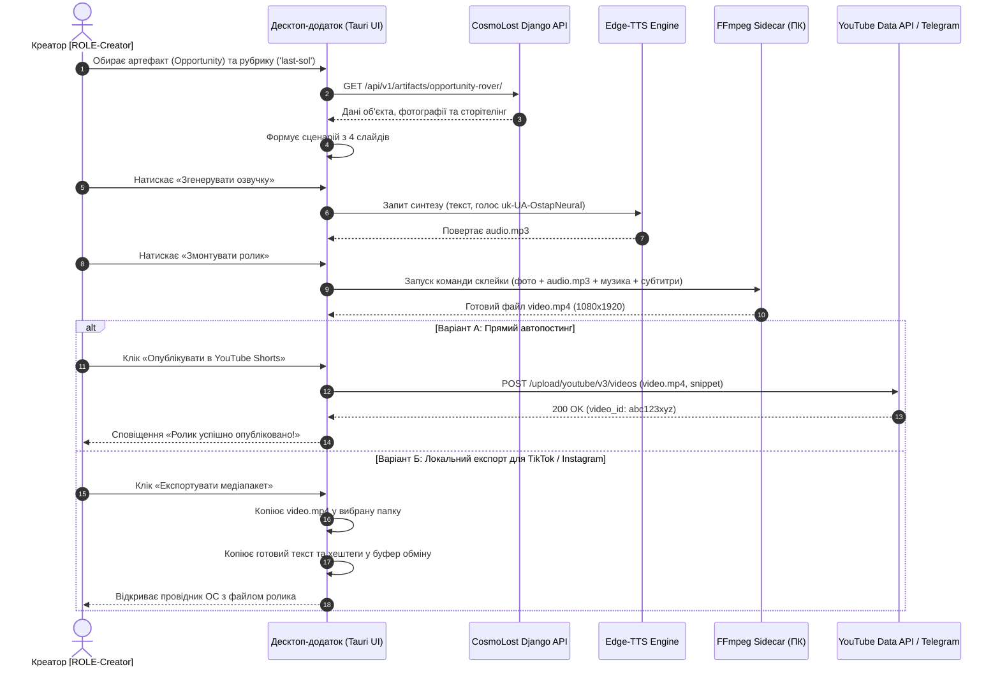
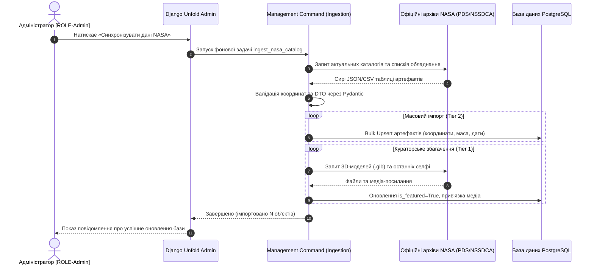
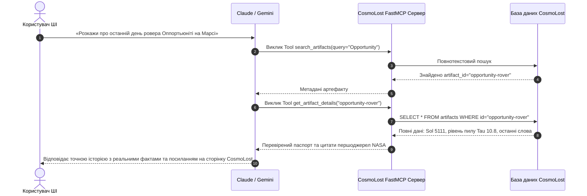

# Діаграми Послідовності (04_SEQUENCES.md)

> **Статус**: `APPROVED`  
> **Версія специфікації**: `v0.2.0`  
> **Стандарт**: Mermaid Sequence Diagram

---

## 1. Сценарій: Генерація та публікація ролика у «Фабриці контенту»

---

## 2. Сценарій: Завантаження та збагачення даних NASA (Ingestion Pipeline)

---

## 3. Сценарій: Запит ШІ-агента через FastMCP Шлюз

