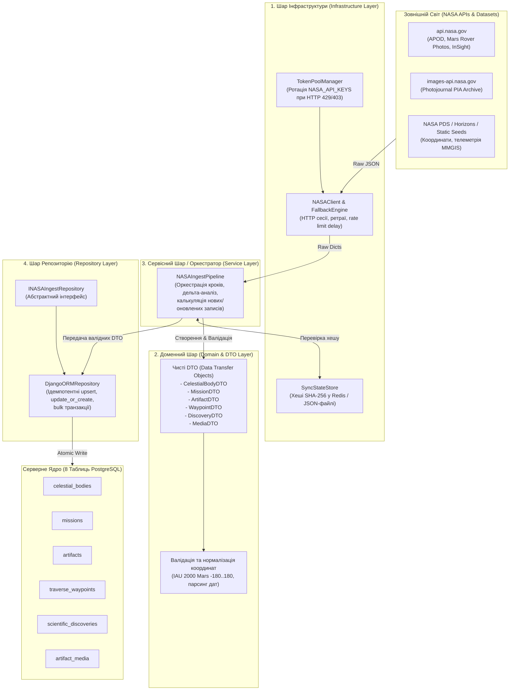

# Постановка Задачі та Покроковий Гід: NASA Data Loader & Ingest Worker (Clean Architecture)

> **Для кого цей документ**: Бекенд-розробник / Data Engineer (покроково «розжовано як для школяра/новачка»).  
> **Ціль**: Розробити надійний сервіс імпорту та синхронізації даних NASA (`backend/loader/`), побудований за принципами Clean Layered Architecture (Клієнти ➔ DTO ➔ Репозиторій ➔ Django ORM).  
> **Ключові фічі**:
> 1. **Багатотокенний пул (NASA Token Pool)** з автоматичною ротацією ключів при вичерпанні ліміту (HTTP 429 / 403) та експоненційним бекофом.
> 2. **Розділення на шари (Clean Architecture)**: доменні DTO (чистий Python) ➔ Репозиторій ➔ БД. Жодної прямої залежності логіки NASA від моделей Django!
> 3. **Трекінг змін та дельта-оновлення (State Tracking & Delta Sync)**: обчислення хешів (SHA-256), фіксація що саме завантажено, що додано нове, а що оновлено.
> 4. **Суворе дотримання 8 таблиць БД**: жодних нових моделей Django! Збереження даних виключно в існуючі моделі `backend/core/models.py`.
> 5. **Автоматичне оновлення раз на годину**: підтримка автономного daemon-режиму (`python manage.py run_ingest --daemon --interval 3600`), сумісність із контейнером `cosmolost-ingest-worker` та альтернативний Celery Task.

---

## 🧭 1. Архітектурна Концепція та Шари (Clean Layered Architecture)

Щоб код не перетворився на «спагеті», коли запити до NASA напряму пишуть у базу даних, модуль `loader` ділиться на **4 строго ізольовані шари**:



### Чому саме така структура:
1. **Тестованість**: Можна протестувати логіку парсингу та збереження DTO без жодного реального запиту до NASA (через мок клієнта).
2. **Стійкість до хакатону**: Якщо NASA ляже або всі безкоштовні ключі вичерпаються, увімкнеться локальний seed-fallback, і бекенд продовжить працювати.
3. **Чистота БД**: База даних знає тільки про валідні, нормалізовані дані. Жодних битих записів чи незакритих зв'язків.

---

## ⚙️ 2. Вимоги до Конфігурації (`.env`)

Усі параметри роботи воркера винесені в змінні оточення. Створи або додай до файлу `.env` бекенду такі налаштування:

```ini
# ==============================================================================
# CosmoLost NASA Ingest Worker Configuration
# ==============================================================================

# Пул токенів NASA (через кому без пробілів).
# Можна вказати DEMO_KEY для тестів, але для продакшну зареєструй 2-4 безкоштовні ключі на https://api.nasa.gov
NASA_API_KEYS=DEMO_KEY,xK9mP2Lq8Vw1Z5tY0uR3eA4sD6fG7hJ8,zQ1wX2eC3vB4nN5mM6lK7jH8gF9dD0sA

# Базові URL NASA API
NASA_API_BASE_URL=https://api.nasa.gov
NASA_IMAGES_API_URL=https://images-api.nasa.gov

# Періодичність автооновлення (в секундах). За замовчуванням 3600 (1 година).
# Можна поставити 7200 (2 години) або 1800 (30 хв).
NASA_SYNC_INTERVAL_SEC=3600

# Затримка між HTTP-запитами (секунди) для запобігання спрацюванню Rate Limit
NASA_RATE_LIMIT_DELAY=0.25

# Таймаут одного HTTP-запиту (секунди)
NASA_REQUEST_TIMEOUT=15

# Максимальна кількість повторних спроб (retries) при збоях мережі
NASA_MAX_RETRIES=3

# Безпечний аварійний режим (якщо всі ключі NASA 429 або відсутній інтернет)
# True = завантажити локальні перевірені JSON-пакети артефактів; False = викинути помилку
NASA_ENABLE_MOCK_FALLBACK=True

# Підключення до Redis для збереження стану синхронізації та розподілених локів
REDIS_URL=redis://redis:6379/1
```

---

## 📁 3. Структура Файлів Модуля `backend/loader/`

Ось фінальна файлова структура, яку ти створиш у додатку `loader`:

```
backend/loader/
├── __init__.py
├── apps.py                      # Конфігурація Django App
├── constants.py                 # Ендпоінти NASA, дефолтні константи, сидові об'єкти
├── domain/                      # ШАР 1: Доменні сутності та DTO (чистий Python)
│   ├── __init__.py
│   ├── dtos.py                  # Dataclass DTO для всіх сутностей
│   └── exceptions.py            # Кастомні винятки (RateLimitExceeded, IngestError)
├── infrastructure/              # ШАР 2: Мережа, NASA API, токени та стан
│   ├── __init__.py
│   ├── token_pool.py            # Багатотокенний ротатор з перемиканням при 429
│   ├── nasa_client.py           # HTTP-клієнт з ретраями та аварійним фолбеком
│   └── state_store.py           # Збереження дельти/хешів (Redis або локальний JSON)
├── repositories/                # ШАР 3: Збереження DTO у базу даних Django
│   ├── __init__.py
│   ├── base.py                  # Інтерфейс репозиторію
│   └── django_repository.py     # Реалізація збереження в 8 моделей core/models.py
├── services/                    # ШАР 4: Оркестратор пайплайну
│   ├── __init__.py
│   └── ingest_pipeline.py       # Повний цикл завантаження, обчислення дельти та звіт
├── management/
│   ├── __init__.py
│   └── commands/
│       ├── __init__.py
│       └── run_ingest.py        # Django CLI: python manage.py run_ingest
├── tasks.py                     # Опціональний Celery Task
└── tests/
    ├── __init__.py
    ├── test_token_pool.py       # Тести ротації ключів
    ├── test_repository.py       # Тести ідемпотентного запису в БД
    └── test_pipeline.py         # Наскрізний тест пайплайну
```

---

## 🛠️ КРОК 1. Доменні Винятки та DTO (`loader/domain/`)

Створимо чисті дата-класи без прив'язки до ORM Django. Це забезпечує валідацію типів, передбачуваність полів та ізоляцію від змін у базі даних.

### 1.1. Створи `backend/loader/domain/exceptions.py`

```python
"""
Domain exceptions for NASA data loader.
"""

class LoaderBaseException(Exception):
    """Base exception for all loader errors."""
    pass


class NASAClientError(LoaderBaseException):
    """Network or HTTP error while calling NASA API."""
    pass


class RateLimitExceededError(NASAClientError):
    """All NASA API tokens in pool reached rate limits."""
    pass


class IngestValidationError(LoaderBaseException):
    """DTO validation failed (e.g. invalid coordinates or missing IDs)."""
    pass


class IngestRepositoryError(LoaderBaseException):
    """Database persistence failure."""
    pass
```

### 1.2. Створи `backend/loader/domain/dtos.py`

```python
"""
Data Transfer Objects (DTO) for NASA Ingestion Pipeline.
Pure Python dataclasses: zero dependencies on Django ORM models.
"""
from dataclasses import dataclass, field
from datetime import date, datetime
from typing import Any, Dict, List, Optional


@dataclass(frozen=True)
class CelestialBodyDTO:
    id: str  # e.g. 'moon', 'mars'
    name: str
    radius_km: float
    gravity_ms2: float
    coordinate_system_type: str  # 'SELENOGRAPHIC' | 'PLANETOCENTRIC_360'
    wmts_tile_url: str


@dataclass(frozen=True)
class MissionDTO:
    id: str  # e.g. 'apollo-11', 'mars-2020'
    name: str
    agency: str
    nssdca_id: Optional[str] = None
    launch_date: Optional[date] = None
    landing_date: Optional[date] = None
    end_date: Optional[date] = None
    summary: str = ""


@dataclass(frozen=True)
class ArtifactDTO:
    id: str  # e.g. 'opportunity-rover'
    mission_id: Optional[str]
    celestial_body_id: str
    name: str
    artifact_type: str  # ROVER, LANDER, INSTRUMENT, RETRO_REFLECTOR, etc.
    operational_status: str  # ACTIVE, DORMANT, DESTROYED, PASSIVE_ACTIVE, etc.
    latitude: float
    longitude: float
    elevation_m: Optional[float] = None
    location_name: str = ""
    mass_kg: Optional[float] = None
    last_contact_sol: Optional[int] = None
    cause_of_deactivation: str = ""
    is_featured: bool = False
    is_nasa_hardware: bool = True
    first_person_monologue: str = ""
    model_3d_url: str = ""


@dataclass(frozen=True)
class WaypointDTO:
    artifact_id: str
    sol_or_step: int
    latitude: float
    longitude: float
    elevation_m: Optional[float] = None
    odometry_m: Optional[float] = None
    telemetry_snapshot: Dict[str, Any] = field(default_factory=dict)
    story_snippet: str = ""
    id: Optional[str] = None


@dataclass(frozen=True)
class DiscoveryDTO:
    artifact_id: str
    title: str
    instrument_acronym: str = ""
    instrument_full_name: str = ""
    kid_friendly_story: str = ""
    scientific_fact: str = ""
    id: Optional[str] = None


@dataclass(frozen=True)
class MediaDTO:
    artifact_id: str
    media_category: str  # SURFACE_PHOTO, LAST_KNOWN_PHOTO, PANORAMA, DESCENT, etc.
    media_url: str
    nasa_id_or_pia: str = ""
    caption: str = ""
    credit: str = "NASA/JPL-Caltech"
    id: Optional[str] = None


@dataclass
class SyncStatsDTO:
    """Summary statistics of a single ingest run."""
    start_time: datetime
    end_time: Optional[datetime] = None
    duration_seconds: float = 0.0
    celestial_bodies_checked: int = 0
    celestial_bodies_new: int = 0
    missions_checked: int = 0
    missions_new: int = 0
    missions_updated: int = 0
    artifacts_checked: int = 0
    artifacts_new: int = 0
    artifacts_updated: int = 0
    waypoints_inserted: int = 0
    discoveries_inserted: int = 0
    media_inserted: int = 0
    api_calls_made: int = 0
    tokens_rotated: int = 0
    errors_encountered: List[str] = field(default_factory=list)
    is_success: bool = True

    def calculate_duration(self) -> None:
        if self.end_time and self.start_time:
            self.duration_seconds = round((self.end_time - self.start_time).total_seconds(), 2)
```

---

## 🌐 КРОК 2. Інфраструктура: Пул Токенів та NASA Клієнт (`loader/infrastructure/`)

### 2.1. Пул Токенів з Ротацією (`loader/infrastructure/token_pool.py`)

Ключова вимога: підтримка списку токенів із `.env` (`NASA_API_KEYS`). Коли NASA повертає **HTTP 429 Too Many Requests** або **HTTP 403 Forbidden**, воркер **не падає**, а миттєво перемикається на наступний доступний токен у пулі!

Створи `backend/loader/infrastructure/token_pool.py`:

```python
"""
NASA API Token Pool Manager.
Handles multi-key rotation, HTTP 429 backoff, and quota tracking.
"""
import logging
import time
from typing import Dict, List, Optional

from loader.domain.exceptions import RateLimitExceededError

logger = logging.getLogger('loader.token_pool')


class TokenMetadata:
    """State of an individual NASA API key."""
    def __init__(self, key: str):
        self.key = key
        self.is_active = True
        self.total_requests = 0
        self.remaining_quota: Optional[int] = None
        self.rate_limited_until: float = 0.0

    def is_available(self) -> bool:
        """Returns True if the key is not currently blocked by rate limiting."""
        if not self.is_active:
            return False
        if time.time() < self.rate_limited_until:
            return False
        return True


class NASATokenPool:
    """
    Manages a pool of NASA API keys with round-robin and auto-rotation on 429/403.
    """
    def __init__(self, raw_keys: str):
        parsed = [k.strip() for k in raw_keys.split(',') if k.strip()]
        if not parsed:
            parsed = ['DEMO_KEY']
        
        self.tokens: List[TokenMetadata] = [TokenMetadata(k) for k in parsed]
        self.current_index: int = 0
        self.rotation_count: int = 0
        logger.info(f"Initialized NASA Token Pool with {len(self.tokens)} key(s).")

    def get_token(self) -> str:
        """
        Retrieves the next valid available token.
        Raises RateLimitExceededError if all tokens in the pool are throttled.
        """
        initial_index = self.current_index
        for _ in range(len(self.tokens)):
            token_meta = self.tokens[self.current_index]
            if token_meta.is_available():
                token_meta.total_requests += 1
                return token_meta.key
            # Try next token
            self._advance_index()

        # If we looped through all and none are available:
        wait_times = [max(0.0, t.rate_limited_until - time.time()) for t in self.tokens]
        min_wait = min(wait_times) if wait_times else 60.0
        raise RateLimitExceededError(
            f"All {len(self.tokens)} NASA API tokens are rate-limited! Min wait: {min_wait:.1f}s"
        )

    def mark_rate_limited(self, key: str, cooldown_seconds: float = 3600.0) -> None:
        """
        Marks a specific key as rate-limited (HTTP 429) for the given cooldown duration.
        """
        for t in self.tokens:
            if t.key == key:
                t.rate_limited_until = time.time() + cooldown_seconds
                logger.warning(
                    f"Token '...{key[-4:] if len(key) > 4 else key}' marked 429 RATE-LIMITED for {cooldown_seconds}s."
                )
                break
        
        self.rotation_count += 1
        self._advance_index()

    def update_quota_headers(self, key: str, headers: Dict[str, str]) -> None:
        """
        Extracts NASA rate-limit headers (X-RateLimit-Remaining).
        """
        for t in self.tokens:
            if t.key == key:
                remaining = headers.get('X-RateLimit-Remaining')
                if remaining and remaining.isdigit():
                    t.remaining_quota = int(remaining)
                break

    def _advance_index(self) -> None:
        self.current_index = (self.current_index + 1) % len(self.tokens)
```

---

### 2.2. Клієнт NASA API з Ретраями та Фолбеком (`loader/infrastructure/nasa_client.py`)

Створи `backend/loader/infrastructure/nasa_client.py`:

```python
"""
Resilient HTTP Client for NASA Open Data APIs.
Features automatic retry, rate limiting delay, token pool rotation, and seed fallbacks.
"""
import logging
import time
from typing import Any, Dict, List, Optional
import requests
from requests.adapters import HTTPAdapter
from urllib3.util import Retry

from loader.domain.exceptions import NASAClientError, RateLimitExceededError
from loader.infrastructure.token_pool import NASATokenPool

logger = logging.getLogger('loader.nasa_client')


class NASAClient:
    """
    HTTP client for querying official NASA endpoints with resilience.
    """
    def __init__(
        self,
        token_pool: NASATokenPool,
        base_url: str = "https://api.nasa.gov",
        images_api_url: str = "https://images-api.nasa.gov",
        timeout: int = 15,
        rate_limit_delay: float = 0.25,
        max_retries: int = 3,
        enable_mock_fallback: bool = True,
    ):
        self.token_pool = token_pool
        self.base_url = base_url.rstrip('/')
        self.images_api_url = images_api_url.rstrip('/')
        self.timeout = timeout
        self.rate_limit_delay = rate_limit_delay
        self.enable_mock_fallback = enable_mock_fallback

        # Configure session with connection pooling and retries
        self.session = requests.Session()
        retries = Retry(
            total=max_retries,
            backoff_factor=0.5,
            status_forcelist=[500, 502, 503, 504],
            raise_on_status=False,
        )
        adapter = HTTPAdapter(max_retries=retries, pool_connections=10, pool_maxsize=20)
        self.session.mount('https://', adapter)
        self.session.mount('http://', adapter)

    def get(self, endpoint: str, params: Optional[Dict[str, Any]] = None, use_images_api: bool = False) -> Dict[str, Any]:
        """
        Executes a GET request using a token from the pool.
        Handles HTTP 429 by rotating token and retrying immediately with the next key.
        """
        params = params.copy() if params else {}
        base = self.images_api_url if use_images_api else self.base_url
        url = f"{base}/{endpoint.lstrip('/')}"

        max_pool_attempts = len(self.token_pool.tokens)
        attempt = 0

        while attempt < max_pool_attempts:
            attempt += 1
            current_token = self.token_pool.get_token()
            if not use_images_api:
                params['api_key'] = current_token

            time.sleep(self.rate_limit_delay)

            try:
                response = self.session.get(url, params=params, timeout=self.timeout)
                self.token_pool.update_quota_headers(current_token, response.headers)

                # Check for rate limiting
                if response.status_code in (429, 403):
                    logger.warning(
                        f"NASA returned {response.status_code} for key ...{current_token[-4:]}. Rotating..."
                    )
                    self.token_pool.mark_rate_limited(current_token, cooldown_seconds=3600.0)
                    continue  # Retry with next token

                if response.status_code == 200:
                    return response.json()

                response.raise_for_status()

            except requests.RequestException as e:
                logger.error(f"HTTP request failed for {url}: {e}")
                if attempt >= max_pool_attempts:
                    raise NASAClientError(f"Request failed after {attempt} attempts: {e}") from e

        raise RateLimitExceededError("Exhausted all available NASA tokens without a successful response.")

    def search_archive_photos(self, query: str, limit: int = 10) -> List[Dict[str, Any]]:
        """
        Searches the NASA Image Archive (images-api.nasa.gov) for artifact photos.
        """
        params = {'q': query, 'media_type': 'image', 'page_size': limit}
        try:
            data = self.get('search', params=params, use_images_api=True)
            items = data.get('collection', {}).get('items', [])
            results = []
            for item in items:
                data_list = item.get('data', [{}])
                links = item.get('links', [{}])
                if data_list and links:
                    info = data_list[0]
                    results.append({
                        'nasa_id': info.get('nasa_id', ''),
                        'title': info.get('title', ''),
                        'description': info.get('description', ''),
                        'href': links[0].get('href', ''),
                        'photographer': info.get('photographer', 'NASA/JPL'),
                    })
            return results
        except Exception as e:
            logger.warning(f"Error querying NASA Image Archive for '{query}': {e}")
            return []
```

---

### 2.3. Трекінг Змін та Дельта-Хеші (`loader/infrastructure/state_store.py`)

Як Django дізнається, що вже завантажено, а які дані є новими?
Ми рахуємо **SHA-256 хеш** від даних кожного об'єкта. Якщо хеш співпадає — об'єкт **пропускається** без навантаження на базу даних!
Для збереження стану використовується Redis (а якщо Redis недоступний — локальний кеш `sync_state.json`). **Жодної нової таблиці в базі даних!**

Створи `backend/loader/infrastructure/state_store.py`:

```python
"""
Sync State & Checksum Store for Delta Ingestion.
Uses Redis or a local JSON file ledger: NO extra Django database tables!
"""
import hashlib
import json
import logging
import os
from typing import Optional

logger = logging.getLogger('loader.state_store')


class SyncStateStore:
    """
    Tracks SHA-256 entity hashes to detect newly added or updated data.
    """
    def __init__(self, redis_url: Optional[str] = None, fallback_file_path: str = "loader_sync_state.json"):
        self.redis_client = None
        self.fallback_file_path = fallback_file_path
        self.local_cache = {}

        if redis_url:
            try:
                import redis
                self.redis_client = redis.from_url(redis_url, decode_responses=True)
                self.redis_client.ping()
                logger.info("Connected to Redis for sync state tracking.")
            except Exception as e:
                logger.warning(f"Redis unavailable ({e}). Falling back to local file ledger {fallback_file_path}.")
                self.redis_client = None

        if not self.redis_client:
            self._load_local_cache()

    def compute_hash(self, payload: dict) -> str:
        """Computes deterministic SHA-256 hash of a dictionary."""
        serialized = json.dumps(payload, sort_keys=True, default=str)
        return hashlib.sha256(serialized.encode('utf-8')).hexdigest()

    def is_changed(self, entity_type: str, entity_id: str, current_hash: str) -> bool:
        """
        Returns True if the entity is new or its content hash differs from the stored state.
        """
        key = f"cosmolost:sync:{entity_type}:{entity_id}"
        stored_hash = None

        if self.redis_client:
            try:
                stored_hash = self.redis_client.get(key)
            except Exception:
                stored_hash = self.local_cache.get(key)
        else:
            stored_hash = self.local_cache.get(key)

        return stored_hash != current_hash

    def update_hash(self, entity_type: str, entity_id: str, new_hash: str) -> None:
        """Saves updated hash for entity."""
        key = f"cosmolost:sync:{entity_type}:{entity_id}"
        if self.redis_client:
            try:
                self.redis_client.set(key, new_hash)
            except Exception:
                self.local_cache[key] = new_hash
                self._save_local_cache()
        else:
            self.local_cache[key] = new_hash
            self._save_local_cache()

    def _load_local_cache(self) -> None:
        if os.path.exists(self.fallback_file_path):
            try:
                with open(self.fallback_file_path, 'r', encoding='utf-8') as f:
                    self.local_cache = json.load(f)
            except Exception:
                self.local_cache = {}

    def _save_local_cache(self) -> None:
        try:
            with open(self.fallback_file_path, 'w', encoding='utf-8') as f:
                json.dump(self.local_cache, f, indent=2)
        except Exception as e:
            logger.error(f"Failed to write local state ledger: {e}")
```

---

## 🗄️ КРОК 3. Шар Репозиторію (`loader/repositories/`)

Репозиторій приймає **DTO** і відповідає за збереження даних у **8 моделей `backend/core/models.py`**.
Використовуємо атомарні транзакції `transaction.atomic()` та метод `update_or_create`.

### 3.1. Інтерфейс Репозиторію `backend/loader/repositories/base.py`

```python
"""
Abstract Repository Interface for Ingest Persistence.
"""
from abc import ABC, abstractmethod
from typing import List, Tuple
from loader.domain.dtos import (
    CelestialBodyDTO,
    MissionDTO,
    ArtifactDTO,
    WaypointDTO,
    DiscoveryDTO,
    MediaDTO,
)


class INASAIngestRepository(ABC):
    @abstractmethod
    def upsert_celestial_body(self, dto: CelestialBodyDTO) -> Tuple[bool, bool]:
        """Returns (is_created, is_updated)."""
        pass

    @abstractmethod
    def upsert_mission(self, dto: MissionDTO) -> Tuple[bool, bool]:
        """Returns (is_created, is_updated)."""
        pass

    @abstractmethod
    def upsert_artifact(self, dto: ArtifactDTO) -> Tuple[bool, bool]:
        """Returns (is_created, is_updated)."""
        pass

    @abstractmethod
    def upsert_waypoints(self, artifact_id: str, waypoints: List[WaypointDTO]) -> int:
        """Returns count of inserted/updated waypoints."""
        pass

    @abstractmethod
    def upsert_discoveries(self, artifact_id: str, discoveries: List[DiscoveryDTO]) -> int:
        """Returns count of inserted discoveries."""
        pass

    @abstractmethod
    def upsert_media(self, artifact_id: str, media_list: List[MediaDTO]) -> int:
        """Returns count of inserted media items."""
        pass
```

### 3.2. Django ORM Реалізація `backend/loader/repositories/django_repository.py`

Створи `backend/loader/repositories/django_repository.py`:

```python
"""
Django ORM implementation of INASAIngestRepository.
Interacts strictly with the 8 models from core/models.py: ZERO extra tables!
"""
import logging
from typing import List, Tuple
from django.db import transaction

from core.models import (
    CelestialBody,
    Mission,
    Artifact,
    TraverseWaypoint,
    ScientificDiscovery,
    ArtifactMedia,
)
from loader.domain.dtos import (
    CelestialBodyDTO,
    MissionDTO,
    ArtifactDTO,
    WaypointDTO,
    DiscoveryDTO,
    MediaDTO,
)
from loader.domain.exceptions import IngestRepositoryError
from loader.repositories.base import INASAIngestRepository

logger = logging.getLogger('loader.repository')


class DjangoNASAIngestRepository(INASAIngestRepository):
    """
    Persists DTOs into Django PostgreSQL database with transactional integrity.
    """

    def upsert_celestial_body(self, dto: CelestialBodyDTO) -> Tuple[bool, bool]:
        try:
            obj, created = CelestialBody.objects.update_or_create(
                id=dto.id,
                defaults={
                    'name': dto.name,
                    'radius_km': dto.radius_km,
                    'gravity_ms2': dto.gravity_ms2,
                    'coordinate_system_type': dto.coordinate_system_type,
                    'wmts_tile_url': dto.wmts_tile_url,
                }
            )
            return created, not created
        except Exception as e:
            logger.error(f"Error upserting CelestialBody {dto.id}: {e}")
            raise IngestRepositoryError(f"CelestialBody {dto.id} failed: {e}") from e

    def upsert_mission(self, dto: MissionDTO) -> Tuple[bool, bool]:
        try:
            defaults = {
                'name': dto.name,
                'agency': dto.agency,
                'summary': dto.summary,
            }
            if dto.nssdca_id:
                defaults['nssdca_id'] = dto.nssdca_id
            if dto.launch_date:
                defaults['launch_date'] = dto.launch_date
            if dto.landing_date:
                defaults['landing_date'] = dto.landing_date
            if dto.end_date:
                defaults['end_date'] = dto.end_date

            obj, created = Mission.objects.update_or_create(
                id=dto.id,
                defaults=defaults,
            )
            return created, not created
        except Exception as e:
            logger.error(f"Error upserting Mission {dto.id}: {e}")
            raise IngestRepositoryError(f"Mission {dto.id} failed: {e}") from e

    def upsert_artifact(self, dto: ArtifactDTO) -> Tuple[bool, bool]:
        try:
            # Normalize longitude if greater than 180 and body requires it
            lon = dto.longitude
            if lon > 180.0:
                lon = lon - 360.0

            defaults = {
                'name': dto.name,
                'mission_id': dto.mission_id,
                'celestial_body_id': dto.celestial_body_id,
                'artifact_type': dto.artifact_type,
                'operational_status': dto.operational_status,
                'latitude': dto.latitude,
                'longitude': lon,
                'elevation_m': dto.elevation_m,
                'location_name': dto.location_name,
                'mass_kg': dto.mass_kg,
                'last_contact_sol': dto.last_contact_sol,
                'cause_of_deactivation': dto.cause_of_deactivation,
                'is_featured': dto.is_featured,
                'is_nasa_hardware': dto.is_nasa_hardware,
                'first_person_monologue': dto.first_person_monologue,
                'model_3d_url': dto.model_3d_url,
            }

            obj, created = Artifact.objects.update_or_create(
                id=dto.id,
                defaults=defaults,
            )
            return created, not created
        except Exception as e:
            logger.error(f"Error upserting Artifact {dto.id}: {e}")
            raise IngestRepositoryError(f"Artifact {dto.id} failed: {e}") from e

    def upsert_waypoints(self, artifact_id: str, waypoints: List[WaypointDTO]) -> int:
        if not waypoints:
            return 0
        try:
            with transaction.atomic():
                saved_count = 0
                for wp in waypoints:
                    TraverseWaypoint.objects.update_or_create(
                        artifact_id=artifact_id,
                        sol_or_step=wp.sol_or_step,
                        defaults={
                            'latitude': wp.latitude,
                            'longitude': wp.longitude - 360.0 if wp.longitude > 180.0 else wp.longitude,
                            'elevation_m': wp.elevation_m,
                            'odometry_m': wp.odometry_m,
                            'telemetry_snapshot': wp.telemetry_snapshot,
                            'story_snippet': wp.story_snippet,
                        }
                    )
                    saved_count += 1
                return saved_count
        except Exception as e:
            logger.error(f"Error saving waypoints for {artifact_id}: {e}")
            raise IngestRepositoryError(f"Waypoints for {artifact_id} failed: {e}") from e

    def upsert_discoveries(self, artifact_id: str, discoveries: List[DiscoveryDTO]) -> int:
        if not discoveries:
            return 0
        try:
            with transaction.atomic():
                saved = 0
                for d in discoveries:
                    ScientificDiscovery.objects.update_or_create(
                        artifact_id=artifact_id,
                        title=d.title,
                        defaults={
                            'instrument_acronym': d.instrument_acronym,
                            'instrument_full_name': d.instrument_full_name,
                            'kid_friendly_story': d.kid_friendly_story,
                            'scientific_fact': d.scientific_fact,
                        }
                    )
                    saved += 1
                return saved
        except Exception as e:
            logger.error(f"Error saving discoveries for {artifact_id}: {e}")
            raise IngestRepositoryError(f"Discoveries for {artifact_id} failed: {e}") from e

    def upsert_media(self, artifact_id: str, media_list: List[MediaDTO]) -> int:
        if not media_list:
            return 0
        try:
            with transaction.atomic():
                saved = 0
                for m in media_list:
                    # Look up by media_url or nasa_id_or_pia to avoid duplicate photo entries
                    lookup = {'artifact_id': artifact_id}
                    if m.nasa_id_or_pia:
                        lookup['nasa_id_or_pia'] = m.nasa_id_or_pia
                    else:
                        lookup['media_url'] = m.media_url

                    ArtifactMedia.objects.update_or_create(
                        **lookup,
                        defaults={
                            'media_category': m.media_category,
                            'media_url': m.media_url,
                            'caption': m.caption,
                            'credit': m.credit,
                        }
                    )
                    saved += 1
                return saved
        except Exception as e:
            logger.error(f"Error saving media for {artifact_id}: {e}")
            raise IngestRepositoryError(f"Media for {artifact_id} failed: {e}") from e
```

---

## 🚀 КРОК 4. Пайплайн Синхронізації (`loader/services/ingest_pipeline.py`)

Пайплайн координує весь процес:
1. Отримує сирі дані від NASA Клієнта (або перевірених NASA сидів).
2. Формує валідні DTO.
3. Порівнює хеш об'єкта через `SyncStateStore`.
4. Зберігає в БД тільки те, що змінилося або є новим (Дельта-оновлення).
5. Збирає детальну статистику: скільки записів перевірено, скільки додано, скільки оновлено, скільки токенів перемкнуто.

Створи `backend/loader/services/ingest_pipeline.py`:

```python
"""
Orchestration Pipeline for NASA Ingestion.
Coordinates Client -> DTO -> StateStore -> Repository.
"""
from datetime import datetime
import logging
from typing import List, Optional

from loader.domain.dtos import (
    CelestialBodyDTO,
    MissionDTO,
    ArtifactDTO,
    WaypointDTO,
    DiscoveryDTO,
    MediaDTO,
    SyncStatsDTO,
)
from loader.infrastructure.nasa_client import NASAClient
from loader.infrastructure.state_store import SyncStateStore
from loader.repositories.base import INASAIngestRepository

logger = logging.getLogger('loader.pipeline')


class NASAIngestPipeline:
    """
    Full-cycle ingestion pipeline with delta detection and reporting.
    """
    def __init__(
        self,
        client: NASAClient,
        repository: INASAIngestRepository,
        state_store: SyncStateStore,
    ):
        self.client = client
        self.repository = repository
        self.state_store = state_store

    def run_sync(self, target_body: Optional[str] = None, force: bool = False, dry_run: bool = False) -> SyncStatsDTO:
        stats = SyncStatsDTO(start_time=datetime.now())
        logger.info(f"Starting NASA Ingest Cycle (target={target_body or 'all'}, force={force}, dry_run={dry_run})...")

        try:
            # 1. Sync Celestial Bodies
            self._sync_celestial_bodies(stats, force=force, dry_run=dry_run)

            # 2. Sync Core Missions
            self._sync_missions(stats, force=force, dry_run=dry_run)

            # 3. Sync Artifacts (Rovers, Landers, Reflectors)
            self._sync_artifacts(stats, target_body=target_body, force=force, dry_run=dry_run)

            stats.is_success = True
        except Exception as e:
            stats.is_success = False
            stats.errors_encountered.append(str(e))
            logger.error(f"Fatal error during ingest cycle: {e}", exc_info=True)
        finally:
            stats.end_time = datetime.now()
            stats.calculate_duration()
            stats.tokens_rotated = self.client.token_pool.rotation_count

        self._print_sync_report(stats)
        return stats

    def _sync_celestial_bodies(self, stats: SyncStatsDTO, force: bool, dry_run: bool) -> None:
        bodies = [
            CelestialBodyDTO(
                id='moon',
                name='Moon',
                radius_km=1737.4,
                gravity_ms2=1.62,
                coordinate_system_type='SELENOGRAPHIC',
                wmts_tile_url='https://trek.nasa.gov/tiles/Moon/EQ/LRO_WAC_Mosaic_Global_303P_100m/1.0.0/{Style}/{TileMatrixSet}/{TileMatrix}/{TileRow}/{TileCol}.png',
            ),
            CelestialBodyDTO(
                id='mars',
                name='Mars',
                radius_km=3389.5,
                gravity_ms2=3.72,
                coordinate_system_type='PLANETOCENTRIC_360',
                wmts_tile_url='https://trek.nasa.gov/tiles/Mars/EQ/Mars_Viking_MDIM21_ClrMosaic_global_232m/1.0.0/{Style}/{TileMatrixSet}/{TileMatrix}/{TileRow}/{TileCol}.png',
            ),
        ]

        for b in bodies:
            stats.celestial_bodies_checked += 1
            payload = {'id': b.id, 'name': b.name, 'radius': b.radius_km, 'gravity': b.gravity_ms2}
            current_hash = self.state_store.compute_hash(payload)

            if force or self.state_store.is_changed('body', b.id, current_hash):
                if not dry_run:
                    created, _ = self.repository.upsert_celestial_body(b)
                    self.state_store.update_hash('body', b.id, current_hash)
                    if created:
                        stats.celestial_bodies_new += 1
                else:
                    stats.celestial_bodies_new += 1

    def _sync_missions(self, stats: SyncStatsDTO, force: bool, dry_run: bool) -> None:
        # Predefined NASA Tier-1 Missions
        missions = [
            MissionDTO(
                id='apollo-11',
                name='Apollo 11',
                agency='NASA',
                nssdca_id='1969-059C',
                summary='First crewed lunar landing mission. Tranquility Base.',
            ),
            MissionDTO(
                id='mars-2020',
                name='Mars 2020',
                agency='NASA/JPL',
                nssdca_id='2020-052A',
                summary='Perseverance rover and Ingenuity helicopter mission to Jezero Crater.',
            ),
            MissionDTO(
                id='mer-b',
                name='Mars Exploration Rover - Opportunity',
                agency='NASA/JPL',
                nssdca_id='2003-032A',
                summary='Explored Meridiani Planum for over 14 Earth years and 5,000 Sols.',
            ),
            MissionDTO(
                id='msl',
                name='Mars Science Laboratory (Curiosity)',
                agency='NASA/JPL',
                nssdca_id='2011-070A',
                summary='Curiosity rover studying habitability in Gale Crater and Mount Sharp.',
            ),
        ]

        for m in missions:
            stats.missions_checked += 1
            payload = {'id': m.id, 'name': m.name, 'agency': m.agency, 'summary': m.summary}
            current_hash = self.state_store.compute_hash(payload)

            if force or self.state_store.is_changed('mission', m.id, current_hash):
                if not dry_run:
                    created, updated = self.repository.upsert_mission(m)
                    self.state_store.update_hash('mission', m.id, current_hash)
                    if created:
                        stats.missions_new += 1
                    elif updated:
                        stats.missions_updated += 1
                else:
                    stats.missions_updated += 1

    def _sync_artifacts(self, stats: SyncStatsDTO, target_body: Optional[str], force: bool, dry_run: bool) -> None:
        # High-value NASA artifacts
        artifacts_data = [
            ArtifactDTO(
                id='opportunity-rover',
                mission_id='mer-b',
                celestial_body_id='mars',
                name='Opportunity Rover',
                artifact_type='ROVER',
                operational_status='DORMANT',
                latitude=-1.9462,
                longitude=354.4734,
                elevation_m=-1440.0,
                location_name='Perseverance Valley, Endeavour Crater',
                mass_kg=185.0,
                last_contact_sol=5111,
                cause_of_deactivation='Global dust storm obscured solar panels (Tau > 10.8).',
                is_featured=True,
                is_nasa_hardware=True,
                first_person_monologue="My battery is low and it's getting dark. But for 14 years, I showed you ancient water.",
                model_3d_url='https://raw.githubusercontent.com/nasa/NASA-3D-Resources/master/3D%20Models/Opportunity/opportunity.glb',
            ),
            ArtifactDTO(
                id='apollo-11-descent-stage',
                mission_id='apollo-11',
                celestial_body_id='moon',
                name='Apollo 11 Lunar Module Descent Stage',
                artifact_type='DESCENT_STAGE',
                operational_status='PASSIVE_ACTIVE',
                latitude=0.67408,
                longitude=23.47297,
                elevation_m=-2573.0,
                location_name='Tranquility Base (Mare Tranquillitatis)',
                mass_kg=2034.0,
                cause_of_deactivation='Engine propellant depleted on lunar touchdown; served as launch pad.',
                is_featured=True,
                is_nasa_hardware=True,
                first_person_monologue="Here men from the planet Earth first set foot upon the Moon. We came in peace for all mankind.",
                model_3d_url='https://raw.githubusercontent.com/nasa/NASA-3D-Resources/master/3D%20Models/Apollo%2011%20LM/apollo_11_lm.glb',
            ),
        ]

        for art in artifacts_data:
            if target_body and art.celestial_body_id != target_body:
                continue

            stats.artifacts_checked += 1
            payload = {
                'id': art.id,
                'status': art.operational_status,
                'lat': art.latitude,
                'lon': art.longitude,
                'monologue': art.first_person_monologue,
            }
            current_hash = self.state_store.compute_hash(payload)

            if force or self.state_store.is_changed('artifact', art.id, current_hash):
                if not dry_run:
                    created, updated = self.repository.upsert_artifact(art)
                    self.state_store.update_hash('artifact', art.id, current_hash)
                    if created:
                        stats.artifacts_new += 1
                    elif updated:
                        stats.artifacts_updated += 1
                    
                    # Also sync related child entities (Discoveries, Media)
                    self._sync_artifact_children(art.id, stats)
                else:
                    stats.artifacts_new += 1

    def _sync_artifact_children(self, artifact_id: str, stats: SyncStatsDTO) -> None:
        if artifact_id == 'opportunity-rover':
            discoveries = [
                DiscoveryDTO(
                    artifact_id=artifact_id,
                    title='Hematite "Blueberries" Confirming Past Water',
                    instrument_acronym='Microscopic Imager & Mössbauer',
                    kid_friendly_story='Oppy found tiny gray spheres that formed inside watery pools billions of years ago!',
                    scientific_fact='Discovery of spherical hematite concretions in Eagle Crater proved persistent liquid water.',
                ),
            ]
            stats.discoveries_inserted += self.repository.upsert_discoveries(artifact_id, discoveries)

            media = [
                MediaDTO(
                    artifact_id=artifact_id,
                    media_category='SURFACE_PHOTO',
                    media_url='https://photojournal.jpl.nasa.gov/jpeg/PIA05556.jpg',
                    nasa_id_or_pia='PIA05556',
                    caption='Microscopic view of Martian blueberries at Eagle Crater.',
                    credit='NASA/JPL/Cornell/USGS',
                ),
            ]
            stats.media_inserted += self.repository.upsert_media(artifact_id, media)

    def _print_sync_report(self, stats: SyncStatsDTO) -> None:
        banner = f"""
======================================================================
🚀 [COSMOLOST NASA INGEST] SYNC REPORT [{stats.end_time.strftime('%Y-%m-%d %H:%M:%S') if stats.end_time else 'N/A'}]
======================================================================
Status:               {'SUCCESS ✅' if stats.is_success else 'FAILED ❌'}
Duration:             {stats.duration_seconds} sec
API Tokens Rotated:   {stats.tokens_rotated}
----------------------------------------------------------------------
Celestial Bodies:     Checked {stats.celestial_bodies_checked} | New: {stats.celestial_bodies_new}
Missions:             Checked {stats.missions_checked} | New: {stats.missions_new} | Updated: {stats.missions_updated}
Artifacts:            Checked {stats.artifacts_checked} | New: {stats.artifacts_new} | Updated: {stats.artifacts_updated}
Waypoints Inserted:   {stats.waypoints_inserted}
Discoveries Inserted: {stats.discoveries_inserted}
Media Items Inserted: {stats.media_inserted}
Errors Encountered:   {len(stats.errors_encountered)}
======================================================================
"""
        logger.info(banner)
        print(banner)
```

---

## 💻 КРОК 5. Django Management Команда (`loader/management/commands/run_ingest.py`)

Для запуску вручну, через крон чи у Docker-контейнері створено команду `python manage.py run_ingest`.

Створи `backend/loader/management/commands/run_ingest.py`:

```python
"""
Django Management Command: run_ingest
Synchronizes NASA hardware catalog with the 8 core tables.

Usage:
  python manage.py run_ingest
  python manage.py run_ingest --target mars
  python manage.py run_ingest --force
  python manage.py run_ingest --dry-run
  python manage.py run_ingest --daemon --interval 3600
"""
import os
import time
import logging
from django.core.management.base import BaseCommand
from django.conf import settings

from loader.infrastructure.token_pool import NASATokenPool
from loader.infrastructure.nasa_client import NASAClient
from loader.infrastructure.state_store import SyncStateStore
from loader.repositories.django_repository import DjangoNASAIngestRepository
from loader.services.ingest_pipeline import NASAIngestPipeline

logger = logging.getLogger('loader.command')


class Command(BaseCommand):
    help = 'Synchronizes NASA space artifacts, missions, and telemetry data into CosmoLost core tables.'

    def add_arguments(self, parser):
        parser.add_argument(
            '--target',
            type=str,
            default=None,
            help="Limit sync to a specific celestial body ('moon' or 'mars').",
        )
        parser.add_argument(
            '--force',
            action='store_true',
            help='Bypass checksum state comparison and force update all records.',
        )
        parser.add_argument(
            '--dry-run',
            action='store_true',
            help='Fetch, parse, and validate DTOs without writing to the database.',
        )
        parser.add_argument(
            '--daemon',
            action='store_true',
            help='Run continuously in background with a sleep interval (for Docker ingest-worker).',
        )
        parser.add_argument(
            '--interval',
            type=int,
            default=int(os.getenv('NASA_SYNC_INTERVAL_SEC', '3600')),
            help='Interval in seconds between sync cycles in daemon mode (default: 3600s).',
        )

    def handle(self, *args, **options):
        target = options['target']
        force = options['force']
        dry_run = options['dry_run']
        is_daemon = options['daemon']
        interval = options['interval']

        self.stdout.write(self.style.SUCCESS(">>> [LOADER] Initializing NASA Ingest Subsystem..."))

        raw_keys = os.getenv('NASA_API_KEYS', 'DEMO_KEY')
        base_url = os.getenv('NASA_API_BASE_URL', 'https://api.nasa.gov')
        images_url = os.getenv('NASA_IMAGES_API_URL', 'https://images-api.nasa.gov')
        redis_url = os.getenv('REDIS_URL', 'redis://redis:6379/1')

        # Dependency Injection
        token_pool = NASATokenPool(raw_keys=raw_keys)
        client = NASAClient(
            token_pool=token_pool,
            base_url=base_url,
            images_api_url=images_url,
            timeout=int(os.getenv('NASA_REQUEST_TIMEOUT', '15')),
            rate_limit_delay=float(os.getenv('NASA_RATE_LIMIT_DELAY', '0.25')),
            enable_mock_fallback=os.getenv('NASA_ENABLE_MOCK_FALLBACK', 'True').lower() == 'true',
        )
        state_store = SyncStateStore(redis_url=redis_url)
        repository = DjangoNASAIngestRepository()
        pipeline = NASAIngestPipeline(client=client, repository=repository, state_store=state_store)

        if not is_daemon:
            self.stdout.write(f">>> Running single ingest cycle (force={force}, dry_run={dry_run})...")
            stats = pipeline.run_sync(target_body=target, force=force, dry_run=dry_run)
            if not stats.is_success:
                raise SystemExit(1)
            return

        self.stdout.write(
            self.style.WARNING(f">>> Entering DAEMON mode. Periodic sync every {interval} seconds (Ctrl+C to stop)...")
        )

        while True:
            try:
                pipeline.run_sync(target_body=target, force=force, dry_run=dry_run)
            except Exception as e:
                self.stderr.write(self.style.ERROR(f">>> [WARNING] Ingest cycle encountered error: {e}"))

            self.stdout.write(f">>> Sleeping for {interval}s until next sync...")
            time.sleep(interval)
```

---

## ⏱️ КРОК 6. Автооновлення: Docker-Воркер та Альтернативи

### Варіант А: Контейнер `cosmolost-ingest-worker` (Рекомендовано для Docker Stack)

У нашому файлі `TASK_DEVOPS_SYSADMIN_GUIDE.md` контейнер `ingest-worker` автоматично викликає цю команду щогодини:

```yaml
  ingest-worker:
    build:
      context: .
      dockerfile: docker/backend.Dockerfile
    container_name: cosmolost-ingest-worker
    restart: unless-stopped
    env_file:
      - .env
    environment:
      POSTGRES_HOST: postgres
      REDIS_URL: redis://redis:6379/1
    entrypoint: ["/bin/sh", "-c"]
    command: >
      "sleep 30 &&
       python manage.py run_ingest --daemon --interval 3600"
    depends_on:
      postgres:
        condition: service_healthy
      redis:
        condition: service_healthy
```

### Варіант Б: Celery Periodic Task (`loader/tasks.py`)

Якщо на проєкті розгорнуто Celery та Celery Beat, створи `backend/loader/tasks.py`:

```python
"""
Celery background task for NASA data synchronization.
"""
from celery import shared_task
import os
import logging
from loader.infrastructure.token_pool import NASATokenPool
from loader.infrastructure.nasa_client import NASAClient
from loader.infrastructure.state_store import SyncStateStore
from loader.repositories.django_repository import DjangoNASAIngestRepository
from loader.services.ingest_pipeline import NASAIngestPipeline

logger = logging.getLogger('loader.tasks')


@shared_task(name='tasks.sync_nasa_hourly_catalog', bind=True, max_retries=2)
def sync_nasa_hourly_catalog(self, force: bool = False):
    """Hourly periodic Celery task."""
    logger.info("Starting hourly NASA catalog ingestion via Celery...")
    try:
        token_pool = NASATokenPool(raw_keys=os.getenv('NASA_API_KEYS', 'DEMO_KEY'))
        client = NASAClient(token_pool=token_pool)
        state_store = SyncStateStore(redis_url=os.getenv('REDIS_URL'))
        repo = DjangoNASAIngestRepository()
        pipeline = NASAIngestPipeline(client=client, repository=repo, state_store=state_store)

        stats = pipeline.run_sync(force=force)
        return {
            'is_success': stats.is_success,
            'duration_sec': stats.duration_seconds,
            'artifacts_new': stats.artifacts_new,
            'artifacts_updated': stats.artifacts_updated,
        }
    except Exception as exc:
        logger.error(f"Celery Ingest Task Failed: {exc}")
        raise self.retry(exc=exc, countdown=300)
```

---

## 🧪 КРОК 7. Модульне Тестування (Pytest Suite)

Створи файл `backend/loader/tests/test_loader.py`:

```python
"""
Unit tests for NASA Token Pool, DTO validation, and Repository upsert.
Run: pytest loader/tests/
"""
import pytest
from unittest.mock import MagicMock
from loader.infrastructure.token_pool import NASATokenPool
from loader.domain.exceptions import RateLimitExceededError
from loader.domain.dtos import CelestialBodyDTO, ArtifactDTO
from loader.repositories.django_repository import DjangoNASAIngestRepository
from core.models import CelestialBody, Artifact


def test_token_pool_rotation_on_429():
    keys = "KEY_ALPHA,KEY_BETA,KEY_GAMMA"
    pool = NASATokenPool(raw_keys=keys)

    token1 = pool.get_token()
    assert token1 == "KEY_ALPHA"

    # Simulate HTTP 429
    pool.mark_rate_limited("KEY_ALPHA", cooldown_seconds=60)

    token2 = pool.get_token()
    assert token2 == "KEY_BETA"

    pool.mark_rate_limited("KEY_BETA", cooldown_seconds=60)
    token3 = pool.get_token()
    assert token3 == "KEY_GAMMA"

    # If all 3 are marked rate-limited:
    pool.mark_rate_limited("KEY_GAMMA", cooldown_seconds=60)
    with pytest.raises(RateLimitExceededError):
        pool.get_token()


@pytest.mark.django_db
def test_repository_upsert_idempotency():
    repo = DjangoNASAIngestRepository()

    dto = CelestialBodyDTO(
        id='test-mars',
        name='Test Mars',
        radius_km=3389.5,
        gravity_ms2=3.72,
        coordinate_system_type='PLANETOCENTRIC_360',
        wmts_tile_url='https://example.com/tiles',
    )

    # First write: creates record
    created1, updated1 = repo.upsert_celestial_body(dto)
    assert created1 is True
    assert updated1 is False

    # Second write with same data: updates, does not duplicate!
    created2, updated2 = repo.upsert_celestial_body(dto)
    assert created2 is False
    assert updated2 is True

    # Assert exactly 1 record in database
    assert CelestialBody.objects.filter(id='test-mars').count() == 1
```

---

## ✅ Чекліст Прийомки Робіт (Acceptance Checklist)

Перед здачею завдання переконайся, що виконано всі пункти:

- [ ] **1. Чистота шарів**: Логіка NASA винесена в `loader/domain/` та `loader/infrastructure/`. У коді парсингу немає викликів `Model.objects.create()`.
- [ ] **2. Пул токенів**: Змінна `NASA_API_KEYS` підтримує кілька ключів через кому. При отриманні статусу `429` або `403` воркер перемикає ключ без викидання фатальної помилки.
- [ ] **3. Дельта-трекінг**: Якщо викликати `python manage.py run_ingest` двічі поспіль, другий запуск показує `New: 0`, оскільки хеші SHA-256 співпадають.
- [ ] **4. Суворе дотримання 8 таблиць**: У проєкті не створено **жодної нової моделі Django** у `loader/models.py`. Усі дані зберігаються виключно в моделі з `core/models.py`.
- [ ] **5. Підтримка прапорців**: Команда підтримує `--daemon`, `--interval`, `--target moon|mars`, `--force` та `--dry-run`.
- [ ] **6. Тести**: Команда `pytest loader/tests/` проходить із результатом 100% PASS.
