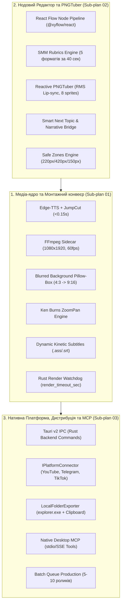
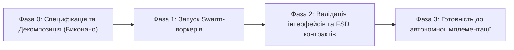

# CosmoLost Desktop Client: Генеральний Архітектурний План «Фабрики Контенту» (00_MASTER_PLAN.md)

> **Статус**: План декомпозиції та оркестрації  
> **Версія проекту**: CosmoLost Desktop Client v0.2.0  
> **Стек**: Tauri v2 (Rust) + React 19 + TypeScript + Chakra UI v3 + Feature-Sliced Design (FSD v2.1) + `@xyflow/react` + FFmpeg + Edge-TTS + Native MCP  
> **Джерела вимог**:  
> - `business/inbox/Створення IT-контенту для соцмереж.md`  
> - `business/spec/04_features/FEAT-03_content_factory.md`  
> - `business/spec/04_features/FEAT-04_social_publishing.md`  
> - `business/spec/06_architecture/03_API_CONTRACTS.md`  
> - `business/spec/06_architecture/04_SEQUENCES.md`  
>  
> **Обмеження поточної ітерації (Згідно з вказівкою користувача)**:  
> - **ВИКЛЮЧЕНО з реалізації на даному етапі**:  
>   1. Інтеграція з віддаленим бекенд API (`/api/v1/editor/`, `/api/v1/portal/`) — замінюється локальними мок-фікстурами та Direct NASA CDN.  
>   2. Синхронізація віддалених сутностей БД (`ENT-*` на бекенді) — використовується строго автономний локальний клієнтський стан.  
>   3. Детальний візуальний UI/UX дизайн (косметична стилізація, кольорові палітри, піксель-перфект верстка) — інтерфейс фокусується виключно на логіці та структурі.  
> - **НЕ виконувати генерацію робочого коду та компіляцію зараз** — тільки затвердження плану, створення деталізованих `.md` специфікацій та розподіл завдань між Swarm-агентами.

---

## 1. Загальна візія та Local-First Архітектура

Десктопний клієнт **CosmoLost «Фабрика контенту»** — це нативний комбайн для виробництва вірусних науково-популярних вертикальних відео (1080x1920, 9:16) для YouTube Shorts, TikTok та Instagram Reels.

### Ключові інженерні принципи:
1. **100% Local-First / Клієнтська автономія**: Усі важкі розрахунки (TTS озвучка, Jump-cut фільтрація тиші, ліпсінк аватара, Ken Burns зумування, Pillow-box розмиття фону, монтаж FFmpeg) відбуваються локально на машині користувача.
2. **Нульове навантаження на сервер**: Відео- та аудіоматеріали не передаються на центральний бекенд.
3. **Rust Watchdog з адаптивним таймаутом**: Рендеринг відео враховує слабкі інтегровані GPU/CPU (налаштування `render_timeout_sec` від 30 до 300 секунд), запобігаючи аварійному перериванню робочого процесу.
4. **Нативний контур експорту (Graceful Fallback)**: Якщо прямий автопостинг недоступний, моментально спрацьовує нативна функція ОС «Відкрити папку з файлом» (`explorer /select,`) з копіюванням 3-рядкового SEO-пакету в системний буфер обміну.

---

## 2. Модульна декомпозиція системи

Архітектура розбивається на 3 взаємопов'язані автономні функціональні домени:

---

## 3. Реєстр суб-планів та зона відповідальності Swarm-агентів

| Суб-план | Файл специфікації | Swarm Воркер | Ключові обов'язки воркера |
| :--- | :--- | :--- | :--- |
| **План 1** | [`01_video_audio_ffmpeg_pipeline.md`](./01_video_audio_ffmpeg_pipeline.md) | `worker-media` | Специфікація та реалізація пайплайну аудіо/відео монтажу: Edge-TTS, Jump-cut фільтрація тиші, багатодоріжковий мікшер (голос -3dB, музика -24dB), FFmpeg `filter_complex`, Pillow-box розмиття для фото 4:3, ефект Кена Бернса, кінетичні субтитри та сторожовий таймер Rust Watchdog. |
| **План 2** | [`02_pngtuber_node_graph_engine.md`](./02_pngtuber_node_graph_engine.md) | `worker-nodegraph` | Архітектура нодового графа на `@xyflow/react`: 7 типів нод, реактивний PNGTuber (8 спрайтів, RMS ліпсінк, анімація переміщення з центру в кут), SMM-рубрики (5 шаблонів на 40 секунд), матриця безпечних зон (Pillow-box) та алгоритм серійності «Smart Next Topic». |
| **План 3** | [`03_native_ipc_distribution_mcp.md`](./03_native_ipc_distribution_mcp.md) | `worker-platform` | Нативна інтеграція Tauri v2: IPC команди Rust, конектори соцмереж (`IPlatformConnector`: YouTube OAuth PKCE, Telegram Bot, TikTok fallback), нативний експорт у провідник із буфером обміну, черга пакетної генерації (`REQ-FAC-11`) та нативний десктопний MCP-сервер (`REQ-FAC-12`). |

---

## 4. Специфікація вимог до контенту (за даними `inbox` та `spec`)

### 4.1. Формат та хронометраж
- **Співвідношення сторін**: 9:16 (1080x1920 Full HD).
- **FPS**: 30 або 60 FPS (60 FPS обов'язково при динамічних 3D фонах).
- **Цільовий хронометраж**: **~40 секунд** (найвища точка віральності):
  - `0–3 сек`: Візуальний/текстовий хук (провокація, великий аватар по центру).
  - `3–32 сек`: 3 стислі наукові тези без привітань і води (B-roll, 3D прольоти, телеметрія HUD).
  - `32–40 сек`: Панчлайн, безшовне зациклення (Seamless Loop) та заклик до дії (CTA).

### 4.2. Безпечні зони (Safe Zones)
- **Верхня мертва зона**: 220 px (інтерфейс пошуку платформи та плашка треку).
- **Нижня мертва зона**: 420 px (опис ролика, нікнейм каналу, кнопка звуку).
- **Права мертва зона**: 150 px (кнопки лайка, репосту, коментарів).
- **Центральний квадрат**: Будь-який текст, субтитри та фокусні об'єкти розташовуються виключно у безпечному полі.

### 4.3. Золота формула опису та Pin Comment
- **Рядок 1**: Байт на розгортання опису (до кнопки «...ще»).
- **Рядок 2**: SEO-ядро на 2–3 речення з ключовими словами для пошукових роботів алгоритму.
- **Рядок 3**: Рівно 4–5 тематичних хештегів (2 широкі, 2 вузькі, 1 брендовий).
- **Pin Comment**: Дискусійне запитання під відео для провокації коментарів, що подвоює retention під час читання/написання відповідей.

---

## 5. Дорожня карта виконання

