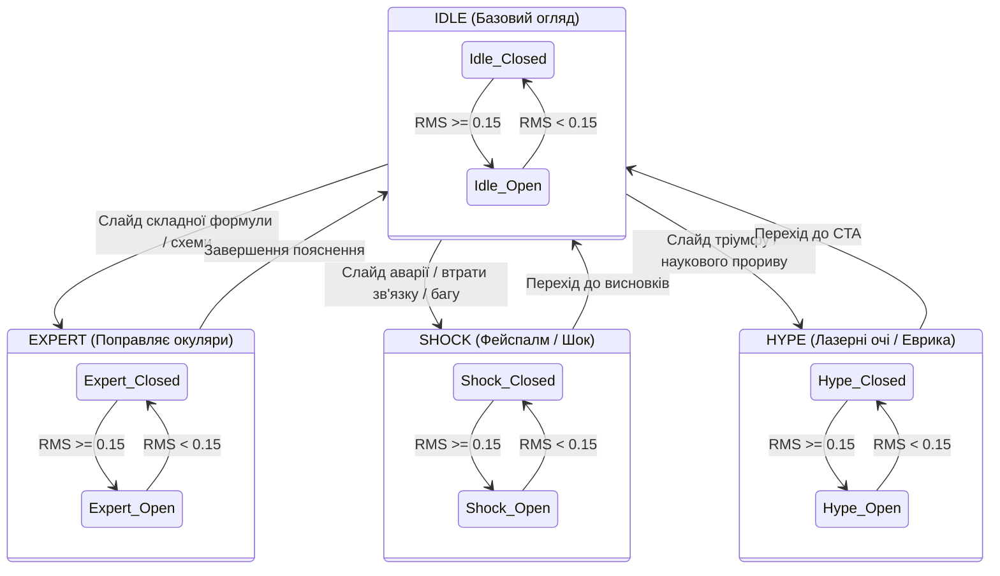

# План 2: Нодовий Граф (@xyflow/react), PNGTuber та SMM-Рубрикатор (02_pngtuber_node_graph_engine.md)

> **Статус**: ВЕРИФІКОВАНО ТА ЗАТВЕРДЖЕНО (Validated Technical Specification)  
> **Swarm Воркер**: `worker-nodegraph`  
> **Робоча директорія**: `desktop-client`  
> **Стек**: React 19 + TypeScript + `@xyflow/react` (React Flow) + Chakra UI v3 + Zustand + Feature-Sliced Design (FSD v2.1)  
> **Джерела**:  
> - `business/inbox/Створення IT-контенту для соцмереж.md` (розділи «Що таке рубрикація», «Матриця ідей», «Візуал: VTuber, геймплей знизу», «Фішки для утримання»)  
> - `business/spec/04_features/FEAT-03_content_factory.md` (розділи 2, 2.1, 4)  
> - `desktop-client/plans/00_MASTER_PLAN.md`  
>  
> **Обмеження поточної фази**:  
> - НЕ виконувати імплементацію прикладного коду або компіляцію.  
> - НЕ підключати віддалені бекенд API — використання автономних локальних моків та Direct NASA CDN.  
> - НЕ створювати детальний декоративний UI/UX дизайн. Зафіксувати суворі типи, інтерфейси, математичні формули та FSD-архітектуру.

---

## 1. Мета та Зона Відповідальності

`worker-nodegraph` забезпечує повну технічну специфікацію та контракти підсистем:
1. **Візуальний редактор графа зв'язків на базі `@xyflow/react` (7 кастомних типів нод)**.
2. **Реактивна машина станів PNGTuber (4 емоційні стани $\times$ 2 фази рота = 8 спрайтів) з RMS-ліпсинком**.
3. **Кінематика переміщення аватара (Хук 0-3с по центру $\to$ переліт зі звуком *whoosh* у нижній лівий кут над 420px мертвою зоною)**.
4. **Двигун SMM-рубрикації (5 готових контент-патернів під 40-секундний хронометраж)**.
5. **Математичний модуль безпечних зон (Safe Zones Engine) з перевіркою колізій (220px зверху, 420px знизу, 150px справа)**.
6. **Smart Next Topic Engine (генерація сюжетного містка `Narrative Bridge`, серійного хука та `Pin Comment`)**.
7. **FSD v2.1 архітектурний розподіл (повна ізоляція слайсів фіч, відсутність крос-імпортів)**.

---

## 2. Архітектура Нодового Графа (`@xyflow/react`)

### 2.1. DAG-Топологія відеомонтажного конвеєра

```
[ArtifactSourceNode] ---> [ScriptTemplateNode] ---> [AudioTTSNode]
                                                           |
                                                           v
[SocialPublishNode]  <--- [FFmpegRenderNode]   <--- [VisualCompositeNode]
                                                           ^
                                                           |
                                                    [SubtitleNode]
```

### 2.2. Типізовані контракти 7 кастомних типів нод (TypeScript DTOs)

```typescript
// ==========================================
// 1. ARTIFACT SOURCE NODE
// ==========================================
export type CelestialBody = 'moon' | 'mars';

export interface ArtifactPhoto {
  id: string;
  url: string;
  localCachedPath?: string;
  caption: string;
  isArchive4x3: boolean;
}

export interface ArtifactSourceNodeData {
  celestialBody: CelestialBody;
  artifactId: string;
  artifactName: string;
  mission: string;
  landingDate?: string;
  photos: ArtifactPhoto[];
  telemetry: Record<string, string | number>;
  scientificFacts: string[];
  selectionReason: string;
}

// ==========================================
// 2. SCRIPT TEMPLATE NODE
// ==========================================
export type RubricId = 
  | 'last_sol_drama'
  | 'how_it_works_tech'
  | 'dictionary_30s'
  | 'crash_test_failures'
  | 'backstage_build_in_public';

export type ScriptPhase = 'hook' | 'meat' | 'loop_cta';

export interface ScriptSlide {
  id: string;
  phase: ScriptPhase;
  startTimeSec: number;
  endTimeSec: number;
  textUa: string;
  textEn: string;
  visualAssetId?: string;
  avatarEmotion: PngTuberEmotion;
  hudTelemetryKey?: string;
}

export interface ScriptTemplateNodeData {
  rubricId: RubricId;
  targetDurationSec: number; // default: 40s (допустимий діапазон 15-60s)
  selectionReason: string;   // обов'язкова фіксація причини вибору теми
  slides: ScriptSlide[];
}

// ==========================================
// 3. AUDIO TTS NODE
// ==========================================
export interface WordTiming {
  word: string;
  startSec: number;
  endSec: number;
}

export interface AudioTTSNodeData {
  voiceId: 'uk-UA-OstapNeural' | 'en-US-GuyNeural' | string;
  speed: number;                   // default: 1.1x
  jumpcutThresholdSec: number;     // default: 0.15s (видалення пауз)
  audioFileRef?: string;
  durationSec: number;
  rmsWaveform: number[];           // масив амплітуд для синхронізації ліпсингу
  wordTimings: WordTiming[];
}

// ==========================================
// 4. VISUAL COMPOSITE NODE
// ==========================================
export interface PngTuberPosition {
  x: number;
  y: number;
  scale: number;
}

export interface PngTuberConfig {
  avatarSetId: string;             // 'default_violetta' або 'custom'
  rmsThreshold: number;            // default: 0.15
  initialPosition: PngTuberPosition; // 0-3s Hook: X=324px, Y=744px, scale=0.40
  dockedPosition: PngTuberPosition;  // 3s+: X=40px, Y=1242px, scale=0.22
  transitionTimeSec: number;       // default: 3.0s
}

export interface VisualCompositeNodeData {
  pillowBoxEnabled: boolean;       // розмитий фон для архівних фото 4:3
  kenBurnsEnabled: boolean;        // плавний зум zoompan
  hudTelemetryEnabled: boolean;    // Sci-Fi оверлей телеметрії
  bgMusicTrackId?: string;         // трек Synthwave / Dark Synth
  bgMusicVolumeDb: number;         // default: -24 dB
  voiceVolumeDb: number;           // default: -3 dB
  pngTuberConfig: PngTuberConfig;
  safeZonesOverlay: boolean;
}

// ==========================================
// 5. SUBTITLE NODE
// ==========================================
export interface SubtitleNodeData {
  fontFamily: string;              // 'Inter ExtraBold', 'Montserrat Black'
  fontSize: number;                // default: 48px
  activeWordColor: string;         // default: '#FFD700' (неоновий жовтий)
  strokeColor: string;             // default: '#000000'
  strokeWidth: number;             // default: 4px
  maxWordsPerLine: number;         // default: 3 (діапазон 2-4)
  verticalPositionPx: number;      // default: 1350px (безпечна зона)
  assFilePath?: string;
}

// ==========================================
// 6. FFMPEG RENDER NODE
// ==========================================
export interface FFmpegRenderNodeData {
  resolution: { width: 1080; height: 1920 };
  fps: 30 | 60;                    // 60 FPS для динамічного 3D
  crf: number;                     // default: 20
  preset: 'fast' | 'medium';
  renderTimeoutSec: number;        // 30-300s (дискретна GPU 40s / CPU 120s)
  status: 'idle' | 'rendering' | 'completed' | 'failed';
  progress: number;                // 0-100%
  fpsCurrent?: number;
  renderedMp4Path?: string;
}

// ==========================================
// 7. SOCIAL PUBLISH NODE
// ==========================================
export interface ThreeLineCaption {
  hookBait: string;                // Рядок 1: Байт на розгортання
  seoCore: string;                 // Рядок 2: SEO-ядро (2-3 речення з ключовими словами)
  hashtags: string[];              // Рядок 3: Рівно 4-5 хештегів
}

export interface SocialPublishNodeData {
  caption: ThreeLineCaption;
  pinComment: string;              // Дискусійне питання для коментарів
  channels: ('youtube_shorts' | 'tiktok' | 'instagram_reels' | 'telegram')[];
  exportMode: 'native_folder' | 'direct_api';
}
```

---

## 3. Реактивна Машина Станів PNGTuber та RMS Ліпсінк

### 3.1. Матриця Станів (4 емоції $\times$ 2 фази рота = 8 спрайтів)



- **Спрайт-маніфест 8 файлів**:
  1. `idle_closed.png`: базовий спокійний стан, рот закритий.
  2. `idle_open.png`: базовий стан під час вимови.
  3. `expert_closed.png`: жест руки біля підборіддя / поправляє окуляри.
  4. `expert_open.png`: експертне пояснення, рот відкритий.
  5. `shock_closed.png`: шокований вираз, очі розширені.
  6. `shock_open.png`: крик / шокована вимова.
  7. `hype_closed.png`: лазерні очі / ейфорія, посмішка.
  8. `hype_open.png`: емоційний тріумфальний вигук.

### 3.2. Алгоритм RMS-Ліпсингу та Гістерезису
- Розрахунок середньоквадратичної амплітуди:
  $$RMS = \sqrt{\frac{1}{N} \sum_{i=1}^{N} x_i^2}$$
- **Поріг спрацьовування**: $Threshold = 0.15$ (діапазон чутливості 0.05 – 0.40).
- **Захист від мерехтіння (Debounce / Hysteresis)**:
  - Мінімальний час утримання стану (Hold Time): **60 мс**.
  - Перехід у стан `open` відбувається миттєво при $RMS \ge 0.15$.
  - Повернення у стан `closed` затримується на $60\text{ мс}$ після спаду $RMS < 0.15$, забезпечуючи плавне мовлення без дрижання на 60 FPS.

---

## 4. Кінематика Переміщення Аватара («Ламання 4-ї стіни»)

### 4.1. Координати та Фази Руху

| Фаза | Часовий інтервал | Розмір аватара | Координати $[X, Y]$ | Функція та візуальна дія |
| :--- | :--- | :--- | :--- | :--- |
| **Hook (Емоційний контакт)** | `0.00 – 3.00 сек` | $40\%$ ширини ($432 \times 432$ px) | $X = 324\text{ px}, Y = 744\text{ px}$ | Аватар розташований по центру екрана, дивиться прямо в очі глядачеві, зупиняючи скролінг стрічки. |
| **Whoosh Transition** | `3.00 – 3.35 сек` | Плавне зменшення $40\% \to 22\%$ | Інтерполяція: $324 \to 40\text{ px}$, $744 \to 1242\text{ px}$ | Супроводжується звуковим ефектом `whoosh.mp3` (-12 dB). Еазинг: `cubic-bezier(0.25, 1, 0.5, 1)`. |
| **Docked B-roll (Звільнення сцени)** | `3.35 – 40.00 сек` | $22\%$ ширини ($238 \times 238$ px) | $X = 40\text{ px}, Y = 1242\text{ px}$ | Аватар сидить у лівому нижньому кутку. Нижня межа аватара: $Y = 1480\text{ px}$, що строго на **20 px вище** нижньої мертвої зони (1500 px). Центр повністю відкритий під B-roll та HUD. |

---

## 5. Специфікація 5 SMM-Рубрик (~40-секундний таймлайн)

Стандартний золотий таймлайн: **Хук (0–3с) $\to$ 3 тези B-roll (3–32с) $\to$ Seamless Loop CTA (32–40с)**.

### 5.1. Матриця рубрик

```
1. «Останній сол / Драма» (last_sol_drama):
   - 0-3с Hook: «Чому вчені NASA мовчали про те, що сталося на Sol 5111?» (Emotion: SHOCK, Center)
   - 3-12с Теза 1: Пилова буря затьмарює сонце, падіння заряду сонячних батарей. (Emotion: EXPERT)
   - 12-22с Теза 2: Останнє фото горизонту та тиша в ефірі. (Emotion: SHOCK)
   - 22-32с Теза 3: «Мій заряд на нулі, і стає темно»: розшифровка останніх слів телеметрії. (Emotion: IDLE)
   - 32-40с Loop CTA: «А який марсохід ти вважаєш найвитривалішим? Напиши в коментарях, бо саме зараз...» (Loops back to Hook)

2. «Як це працює / Тулза дня» (how_it_works_tech):
   - 0-3с Hook: «Як марсохід живиться без розетки 15 років поспіль?» (Emotion: EXPERT, Center)
   - 3-14с Теза 1: Розпад плутонію-238 та анатомія ядерного РІТЕГ (RTG). (Emotion: EXPERT)
   - 14-25с Теза 2: Термоелементи Зеєбека: як різниця температур перетворюється у вольти. (Emotion: IDLE)
   - 25-32с Теза 3: Чому сонячні панелі вмирають, а атомне серце продовжує битися. (Emotion: HYPE)
   - 32-40с Loop CTA: «Збережи цей розбір і пиши, який інструмент розібрати в наступній серії...»

3. «Словник / Термін за 30 секунд» (dictionary_30s):
   - 0-3с Hook: «Що таке точка Лагранжа і чому там паркують телескопи на мільярди доларів?» (Emotion: IDLE, Center)
   - 3-12с Теза 1: Гравітаційна рівновага: де тяжіння Землі та Сонця взаємно компенсуються. (Emotion: EXPERT)
   - 12-22с Теза 2: Точка L2 для James Webb: вічний холод і нуль витрат пального на орбіту. (Emotion: EXPERT)
   - 22-30с Теза 3: Чому це найпрестижніша стоянка в Сонячній системі. (Emotion: HYPE)
   - 30-36с Loop CTA: «Підпишись на словник CosmoLost, щоб не пропустити наступний термін...»

4. «Краш-тест / Невдачі місій» (crash_test_failures):
   - 0-3с Hook: «Як одна кома у коді навігації спалила апарат за 125 мільйонів доларів?» (Emotion: SHOCK, Center)
   - 3-13с Теза 1: Метрична катастрофа Mars Climate Orbiter: фути проти ньютон-секунд. (Emotion: SHOCK)
   - 13-23с Теза 2: Зонд зайшов в атмосферу Марса на 100 км нижче розрахункової траєкторії. (Emotion: EXPERT)
   - 23-32с Теза 3: Як ця трагедія назавжди змінила стандарти unit-тестування в NASA. (Emotion: IDLE)
   - 32-40с Loop CTA: «А яку найдорожчу помилку у коді допускав ти? Чекаю у коментарях...»

5. «Бекстейдж / Build in Public» (backstage_build_in_public):
   - 0-3с Hook: «Як ми оптимізували 4K рендеринг марсіанських панорам на слабких ноутбуках?» (Emotion: HYPE, Center)
   - 3-12с Теза 1: Проблема переповнення VRAM при обробці гігапіксельних знімків NASA. (Emotion: EXPERT)
   - 12-23с Теза 2: Розробка адаптивного Rust Watchdog таймера з лімітом 30-300 секунд. (Emotion: EXPERT)
   - 23-32с Теза 3: Плавний Ken Burns монтаж на 60 FPS навіть на інтегрованій графіці. (Emotion: HYPE)
   - 32-40с Loop CTA: «Код проекту відкритий — підпишись, щоб будувати CosmoLost разом!»
```

---

## 6. Математична Модель Безпечних Зон (Safe Zones Engine)

### 6.1. Геометрія екрана (1080x1920, 9:16)
- **Верхня мертва зона**: $Y \in [0, 220\text{ px}]$ (пошукова плашка та звук).
- **Нижня мертва зона**: $Y \in [1500, 1920\text{ px}]$ (висота 420 px: заголовок, опис, нікнейм, біжучий рядок).
- **Права мертва зона**: $X \in [930, 1080\text{ px}]$ (ширина 150 px: кнопки Like, Share, Comments, Profile).
- **Лівий безпечний відступ**: $X \in [0, 40\text{ px}]$.
- **Робоче безпечне вікно**:
  $$X \in [40, 930\text{ px}] \quad (\text{Ширина } 890\text{ px})$$
  $$Y \in [220, 1500\text{ px}] \quad (\text{Висота } 1280\text{ px})$$

### 6.2. Алгоритм перевірки колізій (Bounds Collision Checker)

```typescript
export interface BoundingBox {
  id: string;
  name: string;
  x: number;
  y: number;
  width: number;
  height: number;
}

export interface SafeZoneViolation {
  elementId: string;
  elementName: string;
  zone: 'top_dead_zone' | 'bottom_dead_zone' | 'right_dead_zone' | 'left_margin';
  message: string;
  overflowPx: number;
}

export function checkSafeZoneCollisions(elements: BoundingBox[]): SafeZoneViolation[] {
  const violations: SafeZoneViolation[] = [];

  for (const el of elements) {
    // Перевірка верхньої мертвої зони (220px)
    if (el.y < 220) {
      violations.push({
        elementId: el.id,
        elementName: el.name,
        zone: 'top_dead_zone',
        message: `Елемент перетинає верхню мертву зону на ${220 - el.y}px`,
        overflowPx: 220 - el.y,
      });
    }

    // Перевірка нижньої мертвої зони (420px від низу -> Y > 1500px)
    const bottomEdge = el.y + el.height;
    if (bottomEdge > 1500) {
      violations.push({
        elementId: el.id,
        elementName: el.name,
        zone: 'bottom_dead_zone',
        message: `Елемент заходить у нижню мертву зону (опис/кнопки) на ${bottomEdge - 1500}px`,
        overflowPx: bottomEdge - 1500,
      });
    }

    // Перевірка правої мертвої зони (150px справа -> X > 930px)
    const rightEdge = el.x + el.width;
    if (rightEdge > 930) {
      violations.push({
        elementId: el.id,
        elementName: el.name,
        zone: 'right_dead_zone',
        message: `Елемент перекривається кнопками лайків/репостів на ${rightEdge - 930}px`,
        overflowPx: rightEdge - 930,
      });
    }

    // Перевірка лівого безпечного відступу (40px)
    if (el.x < 40) {
      violations.push({
        elementId: el.id,
        elementName: el.name,
        zone: 'left_margin',
        message: `Елемент притиснутий до лівого краю екрана (відступ ${el.x}px < 40px)`,
        overflowPx: 40 - el.x,
      });
    }
  }

  return violations;
}
```

---

## 7. Smart Next Topic & Narrative Bridge Engine

### 7.1. Алгоритм формування серійності
1. **Вхідні дані**: поточний `artifactId`, `rubricId` та обов'язкове поле `selectionReason`.
2. **Семантичний підбір спорідненого артефакту**:
   - Контрастний близнюк (наприклад, Spirit $\to$ Opportunity).
   - Еволюційний наступник (наприклад, Apollo 11 $\to$ Artemis III).
   - Технологічний аналог на іншому небесному тілі (наприклад, Місячний ровер LRV $\to$ Марсохід Curiosity).
3. **Вихідна структура зв'язки серійності**:

```typescript
export interface SmartNextTopicResult {
  currentArtifactId: string;
  suggestedArtifactId: string;
  suggestedArtifactName: string;
  suggestedRubricId: RubricId;
  narrativeBridge: string;       // Сюжетний перехід
  suggestedHook: string;          // Хук на перші 3 секунди наступного відео
  recommendedPinComment: string;  // Питання для закріпленого коментаря
}

export function generateSmartNextTopic(
  currentArtifactId: string,
  selectionReason: string,
  rubricId: RubricId
): SmartNextTopicResult {
  // Локальний евристичний генератор для автономного режиму
  return {
    currentArtifactId,
    suggestedArtifactId: 'mars_opportunity_rover',
    suggestedArtifactName: 'Марсохід Opportunity (MER-B)',
    suggestedRubricId: 'last_sol_drama',
    narrativeBridge: 'Поки Spirit замерзав у пісках кратера Гусєва, його брат-близнюк Opportunity на протилежному боці Марса тільки починав свій легендарний 14-річний марафон...',
    suggestedHook: 'Як брат-близнюк загиблого Spirit зумів вижити після тієї самої пилової бурі?',
    recommendedPinComment: 'Якби у вас був шанс врятувати тільки один апарат — Spirit чи Opportunity — кого б ви обрали і чому? 👇',
  };
}
```

---

## 8. FSD v2.1 Архітектурне Розміщення (Strict Boundary Rules)

Згідно з правилами проекту `AGENTS.md` та `fsd-rules.md`, заборонено прямі крос-імпорти між слайсами одного рівня.

```
src/
├── entities/
│   └── content-project/             # Єдине джерело доменних моделей проєкту
│       ├── api/
│       │   └── project-repository.ts # Local Storage / IndexedDB репозиторій
│       ├── model/
│       │   ├── types.ts              # Усі DTO вище (ScriptSlide, PngTuberConfig тощо)
│       │   └── useProjectStore.ts    # Zustand стор проєкту
│       └── index.ts                  # Публічний API сутності
│
├── features/
│   ├── node-editor/                  # Граф зв'язків @xyflow/react
│   │   ├── model/
│   │   │   ├── useFlowStore.ts       # Стан нод та ребер React Flow
│   │   │   └── flow-validation.ts    # Валідація з'єднань DAG
│   │   ├── ui/
│   │   │   ├── FlowCanvas.tsx        # Віджет канвасу
│   │   │   └── nodes/                # 7 кастомних компонентів нод
│   │   └── index.ts
│   │
│   ├── pngtuber/                     # Підсистема реактивного аватара
│   │   ├── model/
│   │   │   ├── usePngTuberStore.ts   # Стейт емоцій та RMS трекера
│   │   │   └── lip-sync-math.ts      # RMS поріг та debounce
│   │   ├── ui/
│   │   │   └── PngTuberPreview.tsx   # Прев'ю спрайта з бігунком гучності
│   │   └── index.ts
│   │
│   ├── smm-rubrics/                  # Двигун рубрик та Next Topic
│   │   ├── model/
│   │   │   ├── rubrics-data.ts       # 5 готових конфігурацій рубрик
│   │   │   └── next-topic-engine.ts  # Логіка сюжетного містка
│   │   ├── ui/
│   │   │   └── RubricSelector.tsx
│   │   └── index.ts
│   │
│   └── safe-zones/                   # Інспектор безпечних зон
│       ├── model/
│       │   └── bounds-checker.ts     # Математика 220px/420px/150px
│       ├── ui/
│       │   └── SafeZoneOverlay.tsx   # Chakra UI маска поверх відео
│       └── index.ts
│
└── widgets/
    └── content-factory-editor/       # КОМПОЗИТОР: збирає features разом!
        ├── ui/
        │   └── ContentFactoryWorkspace.tsx
        └── index.ts
```

> [!IMPORTANT]
> **Ізоляція FSD**: Фічі `node-editor`, `pngtuber`, `smm-rubrics` та `safe-zones` **НЕ імпортують одна одну**. Усі спільні типи та інтерфейси імпортуються строго з `@/entities/content-project`, а їхня візуальна інтеграція здійснюється у віджеті `widgets/content-factory-editor` або на сторінці `pages/content-factory`.

---

## 9. Чек-лист верифікації критеріїв готовності (DoD)

- [x] **7 кастомних типів нод `@xyflow/react`**: повністю типізовано вхідні/вихідні інтерфейси DTO та структуру сокетів.
- [x] **Стейт-машина PNGTuber**: розписано 8 спрайтів ($4 \times 2$), математику RMS ($Threshold = 0.15$), формулу гістерезису ($60\text{ мс}$) та Custom Avatar manifest.
- [x] **Кінематика переміщення аватара**: зафіксовано координати $0-3\text{с}$ по центру ($324, 744\text{ px}$, $40\%$) $\to$ $3\text{с}$ переліт `whoosh` $\to$ нижній лівий кут ($40, 1242\text{ px}$, $22\%$) строго над $420\text{px}$ мертвою зоною.
- [x] **5 SMM-рубрик**: розписано повний хронометраж на 40 секунд із фазами Хук (0-3с), B-roll м'ясо (3-32с), Seamless Loop CTA (32-40с).
- [x] **Safe Zones Bounds Engine**: алгоритм колізій на 1080x1920 із зонами 220px (верх), 420px (низ), 150px (право), 40px (ліво).
- [x] **Smart Next Topic Engine**: описано формування `selection_reason`, `narrative_bridge`, серійного хука та `pin_comment`.
- [x] **FSD v2.1 Compliance**: зафіксовано нульові крос-імпорти між фічами та розміщення композиції у віджетах.
