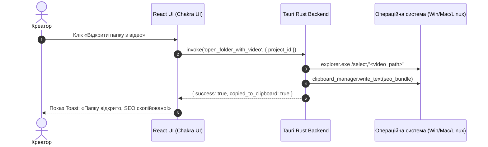

# План 3: Нативна Платформа Tauri v2, Дистрибуція та Native Desktop MCP (03_native_ipc_distribution_mcp.md)

> **Статус**: Деталізований робочий план  
> **Swarm Воркер**: `worker-platform`  
> **Робоча директорія**: `desktop-client`  
> **Стек**: Rust (Tauri v2) + TypeScript + Native Desktop MCP + Tauri Plugins (Opener, Clipboard, Store)  
> **Джерела**: `Створення IT-контенту для соцмереж.md` (розділи «Правила ідеального опису», «Покроковий пайплайн»), `FEAT-04_social_publishing.md`, `FEAT-03_content_factory.md` (розділ 5: Native Desktop MCP), `03_API_CONTRACTS.md` (розділи 4 і 5).  
>  
> **Обмеження**:  
> - НЕ виконувати виклики до віддаленого бекенд API. Всі дані авторизації та публікації зберігаються локально в зашифрованому Tauri Store (`tauri-plugin-store`).  
> - НЕ створювати складні стилі інтерфейсу (UI/UX). Зосередитися на IPC-контрактах, нативних командах Rust та інтеграції протоколу MCP.  
> - НЕ виконувати компіляцію чи білд коду зараз.

---

## 1. Мета та Зона Відповідальності

`worker-platform` відповідає за проектування та реалізацію нативного системного шару застосунку:
1. **Контур нативних IPC-команд Tauri v2 між Rust та React**.
2. **Модульна система конекторів соцмереж (`IPlatformConnector`)**.
3. **Нативний контур моментального експорту «Відкрити папку з відео» з копіюванням SEO-пакету в системний буфер обміну**.
4. **Керування чергою пакетної генерації (Batch Queue Production, `REQ-FAC-11`)**.
5. **Вбудований локальний Native Desktop MCP сервер для автономних ШІ-агентів (`REQ-FAC-12`)**.

---

## 2. Архітектура та Технічні Специфікації

### 2.1. Контур Tauri Desktop IPC (Rust Backend Commands)
Усі операції з операційною системою виносяться в Rust шар `desktop-client/src-tauri/`:



#### Реєстр системних IPC команд:
1. **`open_folder_with_video(project_id: String)`**:
   - Нативний запуск файлового провідника з фокусом на `.mp4`:
     - Windows: `std::process::Command::new("explorer").arg("/select,").arg(video_path).spawn()`
     - macOS: `Command::new("open").arg("-R").arg(video_path).spawn()`
     - Linux: `Command::new("xdg-open").arg(parent_dir).spawn()`
   - Одночасний запис у системний буфер обміну через `tauri_plugin_clipboard_manager`:
     3-рядковий опис (Байт + SEO + 5 хештегів) та Pin Comment.
2. **`copy_to_clipboard(text: String, target: "SEO_BUNDLE" | "PIN_COMMENT")`**:
   - Атомарне копіювання вибраного блоку тексту для швидкої ручної публікації.
3. **`connect_platform_account(args: ConnectPlatformAccountArgs)`**:
   - Ініціалізація зв'язку з платформою (OAuth PKCE локальний сервер `http://127.0.0.1:8089` для YouTube або перевірка Telegram Bot токена).
4. **`list_platform_connectors()`**:
   - Повертає збережений локальний список підключених акаунтів.
5. **`dispatch_publication_multi(project_id: String, connector_ids: Vec<String>)`**:
   - Паралельний запуск фонових задач завантаження ролика у вибрані канали.

---

### 2.2. Архітектура Конекторів Соцмереж (`IPlatformConnector`)

```typescript
export interface IPlatformConnector {
  id: string;
  platformType: "YOUTUBE_SHORTS" | "TELEGRAM_CHANNEL" | "TIKTOK" | "LOCAL_FOLDER";
  displayName: string;
  connect(authPayload: unknown): Promise<ConnectionResult>;
  disconnect(): Promise<void>;
  publishVideo(payload: PublishPayload): Promise<PublishResult>;
  postPinComment(postId: string, commentText: string): Promise<PinCommentResult>;
}
```

#### Реалізація адаптерів:
1. **`YouTubeShortsConnector`**:
   - Авторизація через локальний OAuth2 PKCE.
   - Resumable Upload (чанками по 5 МБ) через YouTube Data API v3 (`videos.insert`).
   - Заголовок: до 60 символів із додаванням обов'язкового суфікса `#Shorts`.
   - Виклик `commentThreads.insert` із наступним закріпленням першого коментаря.
2. **`TelegramChannelConnector`**:
   - Авторизація за Bot Token та Chat ID каналу.
   - Завантаження через `sendVideo` (до 50 МБ або 2 ГБ через локальний Telegram Server).
   - Підпис у форматі `MarkdownV2` (до 1024 символів) з додаванням `inline_keyboard` посилання на 3D-мапу.
3. **`TikTokConnector` (з Graceful Fallback)**:
   - При відсутності прямого API-доступу безшовно перенаправляє на `LocalFolderExporterConnector`.
4. **`LocalFolderExporterConnector`**:
   - Надійний автономний експорт без залежності від мережевих API соцмереж.

---

### 2.3. Пакетний Режим Генерації (Batch Queue Production, `REQ-FAC-11`)
- **Задача**: створення 5–10 готових роликів «у стіл» в один клік, як рекомендовано в маркетинговій стратегії.
- **Черга**:
  - `BatchQueueManager` підтримує послідовну або паралельну чергу рендерингу (обмеження 2 одночасні потоки FFmpeg для захисту CPU/GPU від перегріву).
  - Прогрес черги: `total_count`, `completed_count`, статус по кожному ролику.
  - Усі згенеровані відео автоматично складаються у локальну теку `%USERPROFILE%/Videos/CosmoLost/`.

---

### 2.4. Нативний Десктопний MCP Сервер (`REQ-FAC-12`)
Вбудований локальний сервер Model Context Protocol (транспорт: `stdio` або локальний `SSE`), що дозволяє агентам Claude Desktop / Gemini CLI / Antigravity автоматизувати створення відео.

#### Експортовані інструменти (Tools):
1. **`create_video_task`**:
   ```json
   {
     "name": "create_video_task",
     "description": "Create an automated video rendering task in Content Factory on the local PC.",
     "parameters": {
       "type": "object",
       "properties": {
         "artifact_id": { "type": "string" },
         "rubric_id": { "type": "string", "enum": ["last-sol-drama", "tech-explain", "dictionary-30s", "crash-test", "build-in-public"] },
         "language": { "type": "string", "enum": ["uk", "en"], "default": "uk" },
         "enable_pngtuber": { "type": "boolean", "default": true }
       },
       "required": ["artifact_id", "rubric_id"]
     }
   }
   ```
2. **`get_render_status`**:
   - Перевірка прогресу задачі рендерингу за `task_id` та повернення шляху до змонтованого `.mp4`.
3. **`trigger_social_publish`**:
   - Ініціалізація відправки ролика у вказану платформу або експорт у папку.
4. **`batch_generate_rubric`**:
   - Генерація пакета з 5 роликів вибраної рубрики.

---

## 3. Декомпозиція завдань для воркера

1. **Rust IPC Команди (`src-tauri/src/commands/`)**:
   - Реалізація команд: `open_folder_with_video`, `copy_to_clipboard`, `list_platform_connectors`, `dispatch_publication_multi`.
2. **Модуль конекторів (`src/features/social-publishing/`)**:
   - Інтерфейс `IPlatformConnector`.
   - Реалізації: `YouTubeShortsConnector`, `TelegramChannelConnector`, `LocalFolderExporterConnector`.
3. **Менеджер пакетної генерації (`src/features/batch-queue/`)**:
   - Черга задач з контролем паралелізму.
4. **Desktop MCP Сервер (`scripts/cosmolost-mcp-server.mjs` / Tauri Rust MCP)**:
   - Обробка інструментів `create_video_task`, `get_render_status`, `trigger_social_publish`, `batch_generate_rubric`.

---

## 4. Критерії Готовності (Definition of Done)
- [ ] Описано всі сигнатури Rust команд та DTO для взаємодії через Tauri IPC.
- [ ] Визначено інтерфейс `IPlatformConnector` та його реалізації для YouTube, Telegram та локального експорту.
- [ ] Спроектовано логіку нативного відкриття файлу через `explorer /select,` та копіювання в буфер обміну.
- [ ] Зафіксовано JSON-схеми інструментів для нативного десктопного MCP-сервера.
