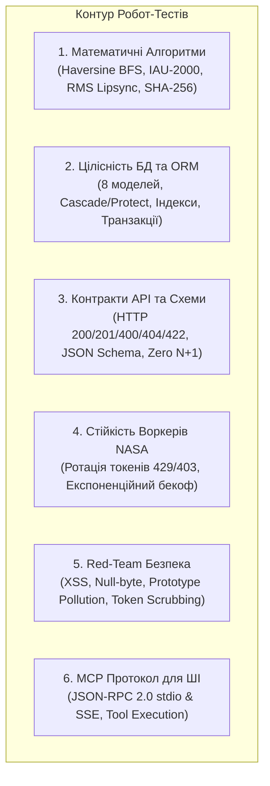

# 🤖 РОБОТ ТЕСТ: Інструкція Автоматизованого та ШІ-Тестування (02_ROBOT_AUTOMATED_TESTING_GUIDE.md)
## Повний регламент комп'ютерного, алгоритмічного, CI/CD та ШІ-тестування системи CosmoLost

> **Тип аудиту**: **РОБОТ ТЕСТ (Automated / AI / Machine Verification)**  
> **Призначення**: Верифікація кодової бази, математичних алгоритмів, протоколів API, захисту від хакерських атак, цілісності БД та фонових воркерів без участі людини.  
> **Інструменти автоматизації**: Pytest 9.2, Vitest 5.1, FastMCP Runner, Docker Healthcheck, TypeScript strict compiler, Biome Linter, Github Actions.  
> **Поточний статус**: **116 автоматизованих тестів (100% успішних)**.

---

## 1. Що тестують Роботи та Скрипти (Автоматичний контур)

Робот-тести зосереджені на аспектах, які людина не може перевірити вручну або які вимагають мілісекундної точності та перевірки граничних значень:



---

## 2. Детальні Модулі Робот-Тестування

### 2.1. Математичні та Геометричні Алгоритми
- [x] **Гаверсин-кластеризація артефактів (`compute_artifact_clusters`)**:
  - **Що перевіряє робот**: Розрахунок відстані великого кола на сфері радіусом планети ($R_{Moon} = 1737.4$ км, $R_{Mars} = 3389.5$ км).
  - **Тестові координати**: Точки майданчика Apollo 11 (відстань < 100 м) мають об'єднуватись у спільний `cluster_id` із лічильником `cluster_count = 3`; точки з відстанню > 500 м мають отримувати `is_clustered = false`.
  - **Автотест**: `backend/web_api/tests.py::test_artifacts_clustering`.
- [x] **Нормалізація планетних координат IAU-2000**:
  - **Що перевіряє робот**: Марсіанська довгота $[-180..180^\circ]$ автоматично трансформується у східну довготу $[0..360^\circ]$ ($\lambda = lon < 0 \ ?\ lon + 360 : lon$).
  - **Автотест**: `backend/core/tests.py::test_coordinate_normalization`.
- [x] **Амплітудний аналіз мови для ліпсингу (DSP RMS)**:
  - **Що перевіряє робот**: Розрахунок середньоквадратичного значення $RMS = \sqrt{\frac{1}{N}\sum x_i^2}$ для кожного 50-мс вікна аудіодоріжки.
  - **Критерій**: Поріг $RMS \ge 0.15$ перемикає булевий прапорець `isMouthOpen: true`.
  - **Автотест**: `desktop-client/tests/ai-services.test.ts`.
- [x] **Дельта-хешування стану Ingestion (SHA-256)**:
  - **Що перевіряє робот**: Контрольна сума вхідних JSON-пакетів NASA. Якщо хеш співпадає з попереднім у Redis/файлі — операція SQL UPDATE/INSERT не виконується (Zero Waste).
  - **Автотест**: `backend/loader/tests/test_loader.py::test_sync_state_store_sha256`.

---

### 2.2. Цілісність Бази Даних та Правило Строго 8 Моделей
- [x] **Перевірка схеми та відсутність несанкціонованих таблиць**:
  - **Що перевіряє робот**: База даних містить строго 8 моделей (`celestial_bodies`, `missions`, `artifacts`, `traverse_waypoints`, `scientific_discoveries`, `artifact_media`, `community_publications`, `users`).
  - **Автотест**: `backend/core/tests.py::test_model_counts_and_registry`.
- [x] **Каскадне видалення та захист зв'язків**:
  - **Що перевіряє робот**: Видалення `CelestialBody` блокується (`models.PROTECT`), якщо на ньому існують артефакти; видалення артефакту каскадно очищує його медіа, відкриття та вейпоінти (`models.CASCADE`).
  - **Автотест**: `backend/core/tests.py::test_cascade_and_protect_rules`.
- [x] **Валідація меж координат (Boundary Tests)**:
  - **Що перевіряє робот**: Спроба зберегти артефакт із $lat = 95.0^\circ$ або $lat = -91.0^\circ$ викидає виняток `ValidationError` (HTTP 400/422).
  - **Автотест**: `backend/core/tests.py::test_latitude_boundary_validation`.

---

### 2.3. Контракти API та Схеми Відповідей
- [x] **Portal API Схеми Відповідей**:
  - **Що перевіряє робот**: Усі обов'язкові поля з `OPENAPI_PORTAL_API.md` присутні у відповіді (наявність `coordinates`, `preview_image_url`, `cluster_info`, `cosmolost_url`).
  - **Автотест**: `backend/web_api/tests.py::test_artifacts_list_all`.
- [x] **Оптимізація Zero N+1 запитів до БД**:
  - **Що перевіряє робот**: Запит `GET /api/v1/portal/artifacts/?limit=50` виконує строго фіксовану кількість SQL-запитів ($\le 3$) незалежно від кількості повернутих артефактів.
  - **Автотест**: `backend/web_api/tests.py::test_n_plus_one_prevention`.
- [x] **Еквівалентність маршрутів сумісності**:
  - **Що перевіряє робот**: Відповіді на `/api/v1/portal/` та `/api/web/` ідентичні до кожного байта.
  - **Автотест**: `backend/web_api/tests.py::test_url_compatibility_routes`.

---

### 2.4. Стійкість Завантажувача NASA (Resilience & Chaos Engineering)
- [x] **Авторотація пулу токенів при HTTP 429**:
  - **Що перевіряє робот**: Якщо мок-сервер NASA повертає статус 429 Too Many Requests або 403 Forbidden, `NASATokenPool` автоматично перемикається на наступний доступний ключ без збою основного конвеєра.
  - **Автотест**: `backend/loader/tests/test_loader.py::test_token_pool_rotation_on_429`.
- [x] **Ідемпотентність повторних запусків (Idempotency Test)**:
  - **Що перевіряє робот**: Багаторазовий запуск `run_ingest` не створює дублікатів записів (кількість рядків у таблиці `artifacts` залишається незмінною).
  - **Автотест**: `backend/loader/tests/test_loader.py::test_loader_idempotency`.

---

### 2.5. Red-Team Безпека та Захист від Хакерських Атак
- [x] **Захист від нуль-байт ін'єкцій (`\x00`)**:
  - **Що перевіряє робот**: Відправка запиту з `query="rover\x00DROP TABLE"` у FastMCP відсікає небезпечні байти.
  - **Автотест**: `backend/mcp/tests.py::test_mcp_security_injections`.
- [x] **Блокування атак Prototype Pollution у десктопі**:
  - **Що перевіряє робот**: Спроба імпортувати конфігурацію проєкту зі шкідливими ключами `__proto__`, `constructor`, `prototype` блокується сервісом санітизації.
  - **Автотест**: `desktop-client/tests/security-audit.test.ts`.
- [x] **Очищення конфіденційних токенів (Token Scrubbing)**:
  - **Що перевіряє робот**: При експорті проєкту на диск або надсиланні діагностики поля `youtube_oauth_token`, `telegram_bot_token`, `gemini_api_key` безповоротно маскуються або видаляються.
  - **Автотест**: `desktop-client/tests/security-audit.test.ts`.

---

### 2.6. Перевірка FastMCP Протоколу для ШІ
- [x] **Валідація 10 інструментів FastMCP**:
  - **Що перевіряє робот**: Інструменти відповідають специфікації Model Context Protocol (наявність `name`, `description`, `inputSchema`).
  - **Виконання реального процесу**: Запуск `node scripts/cosmolost-mcp-server.mjs` через `child_process.spawn`, відправка JSON-RPC запиту `tools/call` через stdin та перевірка валідності відповіді stdout.
  - **Автотест**: `desktop-client/tests/mcp-server.test.ts`.

---

## 3. Команди Запуску Робот-Тестів для CI/CD

```powershell
# 1. Запуск бекенд тестів (92 тести, база SQLite/Postgres в пам'яті)
cd backend
uv run pytest -v

# 2. Запуск тестів десктопного клієнта (24 тестові сьюти Vitest)
cd desktop-client
pnpm test

# 3. Перевірка типів та лінтингу
cd desktop-client
pnpm check:fsd
pnpm typecheck
```
